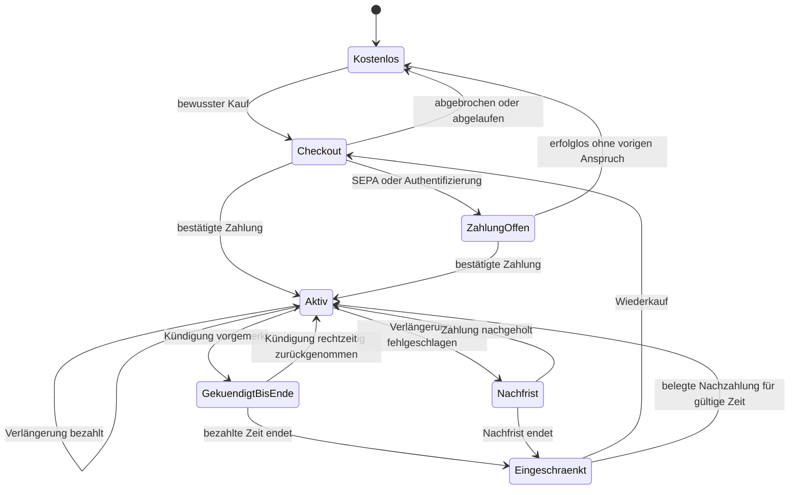
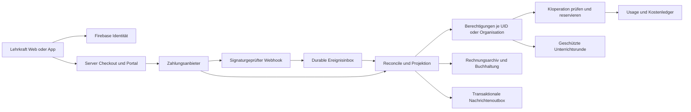

# GradeCrew: Gratisversion, Preise, Schullizenzen und Zahlungsbetrieb

**Entscheidungsbericht · 04.11.2026 · GC-BILLING-PLAN-01 · ausschließlich Recherche und Planung**

Alle Produktwerte in diesem Bericht sind Vorschläge, soweit sie nicht ausdrücklich als belegter Bestand bezeichnet sind. Kein Preis wurde beschlossen oder aktiviert. Kein Zahlungsanbieter-Konto, Vertrag, Produktcode, Zahlungsauftrag oder Deployment wurde angelegt. Offizielle Quellen wurden am 04.11.2026 abgerufen; Gebühren, Gesetze und Applebedingungen vor tatsächlichem Start erneut prüfen. Rechts- und Steuerfragen benötigen die benannten qualifizierten Prüfungen anhand des tatsächlichen Geschäfts.

## 1. Eine Seite für Martin

**Meine Empfehlung: GradeCrew dauerhaft kostenlos zugänglich lassen und zum Einstieg drei vollständige Tests schenken – ohne Kreditkarte, ohne Countdown ab Registrierung und ohne automatische Umwandlung in ein Abo.** Danach bleiben Anmeldung, eigene Ergebnisse, manuelle Korrektur und der vereinbarte Export zugänglich. Neue KI-Erstellungen und neue Unterrichtsrunden benötigen ein bezahltes Paket; bereits gestartete Klassen dürfen fertig werden. So erlebt eine Lehrkraft den Nutzen von Remy über Emmi und den Unterricht bis zu Wilma, bevor sie kaufen soll.

Mit „drei Tests“ meine ich drei erfolgreich gespeicherte, bearbeitbare Testentwürfe mit einer klar begrenzten Größe, nicht drei Klicks auf „Erstellen“. Technische Fehlschläge verbrauchen kein Kundenguthaben. Bilder, Audio und KI-Korrektur erhalten verständliche separate Grenzen. Das Startpaket muss einen echten vollständigen Unterrichtsablauf finanzieren; große Medienproduktionen sind kein sinnvoller Gratisstandard. Die konkrete V1-Beispielstrategie steht in Abschnitt 4 und ist noch nicht beschlossen.

**Für den ersten bezahlten Webbetrieb empfehle ich Stripe Checkout + Billing + Kundenportal und einen gesonderten jährlichen Schulweg auf Bestellung/Rechnung. Eignung 8/10** für einen zunächst überschaubaren deutschen Markt mit eigener kaufmännischer Betreuung. Stripe übernimmt das sichere Bezahlen und viel Aboverwaltung; GradeCrew bleibt bei diesem Weg Verkäufer und muss korrekte Steuern, Rechnungen, Rechte und Support organisieren. Für einen schnellen internationalen Privatkundenvertrieb wäre Paddle als Merchant of Record ernsthaft zu bevorzugen, wenn dessen Verkäuferrolle und Schulrechnungen passen. Gleiche Vergleichskriterien und Grenzen: Abschnitt 6.

**Preise jetzt als Hypothese testen:** ein einziges Lehrkraftpaket, beispielsweise 12,90 EUR monatlich oder 129 EUR jährlich; Schulen zunächst ein kleines jährliches Sitzpaket statt komplizierter Verbrauchsrechnungen. Das sind Rechen- und Interviewwerte, keine fertige Preisliste. Die Annahmenrechnung zeigt bei mittlerer betreuter Nutzung bereits etwa 7,15 EUR variable Vollkosten je Monat. Für ein wirtschaftlich gutes 129-EUR-Jahr müssen die tatsächlichen durchschnittlichen Kosten deutlich niedriger liegen oder Preis/Leistungsumfang angepasst werden. „Unbegrenzte KI“ würde ich nicht versprechen.

**Bei ausgebliebener Zahlung das Abo einschränken, niemals einfach den Login abschalten oder das Konto löschen.** Zahlungserinnerung, Nachfrist, klare Anzeige und Wiederaktivierung gehören dazu. Kein Zahlungsfehler darf eine laufende Prüfung abbrechen, Antworten löschen oder automatisch eine endgültige Note erzeugen. Ein Konto, ein Schulzugang und ein Abo sind drei unterschiedliche Dinge.

**Vor einem Kaufstart sind drei konkrete Dinge zu entscheiden:** Gratisumfang und Preisidee; tatsächlicher Verkäufer-/Steuerstatus und Rechnungsweg; zulässiges Kaufmodell der Lehrer-App. Besonders Apple ist ein eigenständiges Gate: Die EU-Bedingungen wurden zum 01.10.2026 geändert. Ein Webkauf ist keine pauschale Erlaubnis, Stripe in jeder iOS-App zu bewerben. Die Schüler-App Secure bleibt ein eigener, kostenloser Zugangsweg.

**Aufwand:** belastbarer Web-Abobetrieb mit Rechteprüfung, Kostenkontrolle, Rechnungen, Kündigung/Widerruf, Support und Abnahmetests ungefähr **39–66 Personentage** einschließlich der ersten einfachen institutionellen Abwicklung, unter den Annahmen in Abschnitt 13. Apple-IAP oder ein größerer automatisierter Schulvertrieb kommen gegebenenfalls hinzu. Der Checkoutbutton allein ist ein kleiner Teil. Zuerst Entscheidungen und Messung, dann isolierte Testzahlungen, dann freiwilliger Pilot, zuletzt ausdrücklich freigegebener Echtbetrieb.

**Bewertung dieses Konzepts: 8/10** für einen fairen, verständlichen und kontrollierbaren Einstieg. Begründung: voller Unterrichtskreislauf, begrenztes Gratisrisiko, existierende Firebasebasis, bewährte externe Zahlungsoberflächen. Offene Risiken separat: keine repräsentativen Ist-Kosten/Zahlungsbereitschaft, unbekannter Steuerstatus, noch ungeprüfte Apple-Einordnung und Schulbeschaffung. **Die tatsächliche Betriebsbereitschaft eines zahlungspflichtigen GradeCrew-Angebots kann ich aus dem vorhandenen Bestand nicht belastbar auf 1–10 bewerten**: ein implementierter und getesteter Billingablauf ist nicht nachgewiesen. Das ist keine Bewertung des Gesamtprojekts.

## 2. Was heute tatsächlich vorhanden ist

### 2.1 Quellen und Umgebungen

Die Recherche begann auf `HerrLoeffler/Hausaufgabe/main@e4109f9fe04bed8cb05a90ba58531ac2be22e63a`. START_HERE, AGENTS, STATE, TODO, CHAT_CONTRACT, CHAT_RECOVERY, Registry und Assurance-Einstiege wurden gelesen. Ein eigener Clone und Dokumentationsbranch vermeiden Eingriffe in laufende Facharbeiten. Quellen unter `sources/` wurden nicht verändert.

Der frische read-only Development Status vom 04.11.2026 zeigt 28 aktive Baustellen, 36 mögliche Dateiüberschneidungen und deutlich auseinanderliegende Branchhistorien. Diese Zahlen sind Warnsystemwerte, keine Qualitätsquote. Das Werkzeug konnte ohne `GITHUB_TOKEN` keine PRs abfragen; ergänzend wurde die öffentliche GitHub-API gelesen: 99 offene PRs, kein Titel/Head mit Billing/Stripe/Payment/Subscription/Lizenz/Quota/Meter. Registry/TODO und Branchnamen lieferten ebenfalls keinen passenden eigenständigen Billingauftrag. Deshalb neue enge Task-ID **GC-BILLING-PLAN-01**; verwandte Aufträge bleiben bestehen. Keine fremden Chats wurden angewiesen.

| Quelle | Frisch belegter Stand | Aussagegrenze |
|---|---|---|
| Gemeinsamer Webbranch | `feature/gradecrew-app-integration@5e45e9df2449ca7e4c4b735ae754452a6f304ab7` | Quellbestand, keine automatische Gleichsetzung mit Live |
| Öffentliche Liveadresse | `gradecrew.de/release.json`: Projekt `hausaufgabe-staging`, environment `production`, Commit `69414965b345881a8e66e55b6b76b2dd982dec41` | Hostingmanifest gelesen; keine neue vollständige Hash-/Backend-/Rulesprüfung |
| Öffentliches getrenntes Staging | `gradecrew-staging-2026.web.app/release.json`: Commit `5be513d6f8cc90520efb63ee3c0d4e878e84df2d` mit Kompositionsangaben | Hosting enthält Teilkompositionen; kein monolithischer Beweis für alle Dienste |
| Wilma | PR396/Branch `fix/wilma-budget-fundus-live-20261029@69414965`; HDF und Code der Budget-/Providerfunktionen gelesen | vorhandene Livebelege sind fremde Releasebelege, kein neuer Modell- oder Gerätetest |
| Native | `feature/native-live-staging-20261018@97cf926ee92519bc3457785e1f7b2d6212ad4879` | bestehende Store-/Authübergaben; keine aktuelle ASC-Sitzung oder angenommene Appprüfung |
| Analytics | `feature/analytics-teacher-v1-20261021@1b2fbdd14577e5646a1d57c1048623178ab1ff7a` | vorhandener Messvertrag, kein abgerufener Privatkunden-/Umsatzbestand |
| Schule/Datenschutz | PR366, `docs/gc-school-readiness-20261028@d0b463a71d36dd4729db97740596cd862faabc3c` | Standort-/Rechtsentscheidungen bleiben beim vorhandenen Owner |

Primärbelege: [main](https://github.com/HerrLoeffler/Hausaufgabe/tree/e4109f9fe04bed8cb05a90ba58531ac2be22e63a), [Live-Manifest](https://gradecrew.de/release.json), [Staging-Manifest](https://gradecrew-staging-2026.web.app/release.json), [Wilma-PR396](https://github.com/HerrLoeffler/Hausaufgabe/pull/396), [Schulbericht-PR366](https://github.com/HerrLoeffler/Hausaufgabe/pull/366).

### 2.2 Vorhandene Technik und wiederverwendbare Teile

- Weboberfläche: vorhandenes HTML/CSS/JavaScript, Firebase Auth, Firestore, getrennte Functions für KI und Assessment. Kein Anlass für einen Frontendframeworkwechsel.
- `functions/lib/access.js` erlaubt KI für aktive Teacher/Adminprofile; ein altes Betaflag wird absichtlich ignoriert. `profile.status` ist Kontostatus. **Diesen Schalter nicht zur Abozahlung umdeuten.** Billing erhält eigene Berechtigungen.
- `functions/lib/usage.js` hat transaktionale Minuten-/Tagesgrenzen, technische Events und Monatsrollups nach UID/Art. Minuten/Tag/Monat werden dort per UTC-ISO gebildet. Der Zähler steigt vor dem Providerstart; dieses Sicherheitslimit ist kein fairer kommerzieller Erfolgszähler.
- `recordUsage` lässt ein nachträgliches Statistikschreibproblem die bezahlte Antwort nicht vernichten. Gut für Produktzuverlässigkeit; allein kein vollständiges finanzielles Ledger, weil ein fehlgeschlagener Statistikeintrag nicht zwingend den Verbrauch belegt.
- Roh-KIevents sind im geprüften Modul auf 30 Tage, Quoten auf 14 Tage begrenzt; Monatsrollups enthalten Zähler/Modelle. Neue Rechnungsaufbewahrung darf nicht daraus abgeleitet werden.
- Konfiguriert sind `gpt-5.6-luna`, `gpt-image-2` und `gpt-4o-mini-tts`. Die gelesene Bildroute erzeugt ein Bild mit `1024x1024`, `quality: low`, WebP. Bilder können zusätzliche Text-/Bildprüfung und Wiederholungen verursachen. Hördateien und Varianten müssen einzeln zugeordnet werden.
- Bestehende Bildercaches und Wilmas bestätigter privater Fundus reduzieren Wiederholaufrufe. Nur echte Treffer zählen als Ersparnis; keine versprochene Trefferquote und kein automatisches Training mit Schülerdaten.
- Die Wilmaquelle hat eine konservative 20-EUR-Monatsgrenze mit getrennten maximalen Stage-/Liveanteilen (11,25/8,75 EUR), Reservierungen, unbekanntem Verbrauch als Hold, Europe/Berlin-Monat und einer bis 27.01.2027 begrenzten Preisrichtlinie. **Das ist ein gesamter technischer Kostenrahmen, kein 20-EUR-Preis pro Nutzer und keine Providerrechnung.** Neue Kundenpakete dürfen diesen bestehenden Rahmen nicht nebenbei aushebeln.

Dateibelege: [Access](https://github.com/HerrLoeffler/Hausaufgabe/blob/5e45e9df2449ca7e4c4b735ae754452a6f304ab7/functions/lib/access.js), [Usage](https://github.com/HerrLoeffler/Hausaufgabe/blob/5e45e9df2449ca7e4c4b735ae754452a6f304ab7/functions/lib/usage.js), [Konstanten](https://github.com/HerrLoeffler/Hausaufgabe/blob/5e45e9df2449ca7e4c4b735ae754452a6f304ab7/functions/lib/constants.js), [Bildroute](https://github.com/HerrLoeffler/Hausaufgabe/blob/5e45e9df2449ca7e4c4b735ae754452a6f304ab7/functions/lib/media.js), [Wilma-Budget](https://github.com/HerrLoeffler/Hausaufgabe/blob/69414965b345881a8e66e55b6b76b2dd982dec41/functions/lib/wilma/budget.mjs), [Wilma-Provider](https://github.com/HerrLoeffler/Hausaufgabe/blob/69414965b345881a8e66e55b6b76b2dd982dec41/functions/lib/wilma/provider.mjs).

### 2.3 Was sich daraus nicht behaupten lässt

Kein Nachweis eines laufenden Kundenabosystems, Stripe-/MoR-Kontos, automatisierter Rechnungszustellung, institutioneller Sitzverwaltung oder einer plattformübergreifenden Kaufberechtigung. Keine repräsentativen Produkt-Providerrechnungen, Ist-Kosten je Lehrkraft, aktuelle MAU-Kosten oder Zahlungsbereitschaft abgerufen. Kein Billingbestand aus Lehrerfeedback erschlossen. Bestehende Preis-/Finanzierungsentwürfe sind Szenarien. Games, ASV, VIDIS und Classroom haben eigene Reifegrade; sie werden nicht pauschal als verkaufsfertiger Bestandteil versprochen. VIDIS vermittelt Identität/Zugang, keine Zahlung oder Beschaffungsfreigabe.

## 3. Drei faire Gratisansätze

Ziel ist **ein echter vollständiger Kreislauf**, nicht eine hohe Zahl Registrierungen: erstes brauchbares Ergebnis, eigene Anpassung, Unterrichtseinsatz, verständliche Ergebnisse, freiwillige Kaufentscheidung. Schulkalender und Ferien machen Kalendertrials besonders empfindlich. Die folgenden Bewertungen sind begründete Eignungseinschätzungen, keine gemessenen Conversionraten.

Gleiche Kriterien, jeweils 1–10: **Erlebnis** (voller Kreislauf), **Fairness** (Zeitdruck/Transparenz), **Kostenkontrolle**, **Einfachheit im Betrieb**. Gleich gewichtet; Gesamt gerundet, entscheidende Schwächen separat.

| Kandidat | Erlebnis | Fairness | Kosten | Betrieb | Gesamt | Hauptabwägung |
|---|---:|---:|---:|---:|---:|---|
| A: drei erfolgreiche Startertests ohne Zeitablauf, danach Archiv/Abschluss | 8 | 9 | 9 | 8 | **9/10** | Genügend Versuche, begrenzte Akquisitionkosten; Wiederkehr ohne Kauf ist schwächer |
| B: 30 aktive Kalendertage ab erstem erfolgreichen Test, zusätzlich feste Verbrauchsgrenzen | 9 | 7 | 8 | 7 | **8/10** | Wiederholter Nutzen möglich; Ferien und Ausfalltage benötigen faire Verlängerung |
| C: dauerhaft ein kleiner neuer Test pro Monat plus höheres Starterguthaben | 9 | 10 | 5 | 6 | **8/10** | Starker Wiedereinstieg; wiederkehrende Kosten auch ohne Umsatz und mehr Missbrauchsprüfung |

**V1-Empfehlung A**, weil repräsentative Kosten- und Wiederkehrdaten fehlen. Ein dauerhafter Gratis-Kontostatus mit Starterguthaben ist eine echte kostenlose Version. Nach dem Verbrauch nicht nur eine undurchsichtige Paywall anzeigen, sondern die konkret weiter verfügbaren Funktionen. C später anhand Kosten pro aktiviertem Nichtzahler entscheiden; A nicht nachträglich heimlich in einen ablaufenden Trial verwandeln.

### 3.1 Warum nicht nur ein oder zwei Tests?

**Ein Test: 5/10** als einziger Realtrial. Technisch günstig, aber die erste Erstellung kann ein Lernversuch oder thematisch unpassend sein; zwischen Entwurf und Unterricht liegt oft Zeit. Ein schlechter Erstversuch darf kein verlorener einziger Kaufbeweis sein. Als zusätzliche öffentliche Demo gut.

**Zwei Tests: 7/10**, wenn beide vollständig überarbeitbar und praktisch durchführbar sind. Ein Lernlauf plus ein echter Kurs reicht häufig zur Orientierung, bleibt bei Fehlpassung knapp.

**Drei Tests: 9/10** für den Einstieg nach den gleichen Erlebnis-/Fairness-/Kosten-/Betriebskriterien. Erlaubt Lernversuch, echte Klasse und zweite Unterrichtserfahrung. Der Mehrpreis besteht im zusätzlichen begrenzten Erstellungs-/Korrekturverbrauch; nicht in einem beliebig offenen KIzugang. Vier/zehn Tests sind ohne Nutzungsdaten derzeit kein begründeter Standard.

### 3.2 7, 14 oder 30 Tage?

| Dauer, jeweils ab erstem brauchbarem Ergebnis und mit gleichem Verbrauchsdeckel | Erlebnis | Fairness | Kostenkontrolle | Betrieb | Eignung |
|---|---:|---:|---:|---:|---:|
| 7 Tage | 4 | 4 | 9 | 8 | **6/10** |
| 14 Tage | 7 | 6 | 8 | 8 | **7/10** |
| 30 Tage | 9 | 8 | 8 | 7 | **8/10** |

Sieben Tage können zwischen zwei Fachstunden bereits vorbei sein. 14 Tage sind vertretbar, aber Krankheits-/Ferienfälle bleiben. 30 Tage sind der beste Kalendertrial, wenn man B auswählt; Friststart explizit beim ersten erfolgreichen eigenen Test, nicht bei einer liegengebliebenen Registrierung. Unbegrenztes Generieren innerhalb eines Zeittrials wäre ein anderes, riskanteres Angebot.

### 3.3 Kreditkarte und Schulpilot

**Ohne Kreditkarte: 9/10**, mit vorab hinterlegter Karte und automatischem Bezahlstart: **5/10** für das Ziel unverbindlicher Lehrkrafterprobung. Gleiche Kriterien hier: Einstiegshürde, bewusster Kauf, Betriebsaufwand, Zahlungssicherheit. Karte kann später unfreiwilligen Zahlungsverlust reduzieren, nimmt aber Vertrauen und erfordert klare Einwilligungs-/Erinnerungsprozesse. V1 ohne Karte; erst ein ausdrücklicher Checkout schließt einen kostenpflichtigen Vertrag.

Ein **Schulpilot ist ein eigener vereinbarter Vorgang**, beispielsweise sechs tatsächliche Unterrichtswochen innerhalb eines Terminkorridors, bestimmte Sitze und ein ausdrücklich genanntes Kostenlimit. Ferienregel, Verantwortliche, Datenschutz-/Freigabeumfang, Support und Auswertung schriftlich festlegen. Kein stilles Jahresabo nach Pilotende. Ein konkreter Pilot darf kürzer/länger sein; sechs Wochen sind ein Entwurf, keine behauptete Nutzerentscheidung oder Pflichtdauer.

## 4. Ausgearbeitetes V1-Beispiel zur Entscheidung

### 4.1 Produktversprechen und Kontingente

**Vorschlag „GradeCrew Start“:** dauerhaft kostenloses Konto, drei Startertests, keine Zahlungsmethode erforderlich. Nach erfolgreicher Registrierung und angemessener Identitätsprüfung steht das Guthaben bereit. Öffentliche Demo bleibt zusätzlich ohne KIaufruf verfügbar.

| Leistung | Beispiel Start | Beispiel Lehrkraft Plus | Was die UI sagt |
|---|---|---|---|
| Neue erfolgreiche Tests | 3 insgesamt | 12 je Abomonat | „Noch 2 von 3 Startertests“ / „Noch 8 Tests bis …“ |
| Größe | bis 20 neue Aufgaben je Erstellung | bis 40 je Erstellung, Kostenreserve gesondert prüfen | Größe vor Erstellen anzeigen; große Tests nicht still als mehrere Tests berechnen |
| KIüberarbeitungen | 10 begrenzte Aktionen insgesamt | 40 je Monat | ganze Testrevision und Einzeländerung getrennt vor Aufruf benennen |
| Neue Bilder | 2 insgesamt | 20 je Monat | gespeichertes Bild erneut anzeigen verbraucht nichts |
| Neues Audio | bis 2 Minuten insgesamt | bis 20 Minuten je Monat | Frage und Antworten/Lösungen sind getrennte neue Spuren |
| Neue Wilma-KIvorschläge | bis 210 einzelne Antworten insgesamt | bis 300 je Monat | bekannte Regeln/Fundus und manuelle Bewertung weiter verfügbar |
| Klasse | je Startertest eine Runde bis 35 Teilnahmen | normale pädagogische Klassenlimits, keine Unlimitedzusage | vor Veröffentlichung realen Umfang und KIreichweite anzeigen |
| Bestehende Tests/Ergebnisse | lesen, manuell korrigieren, bestätigte Ergebnisse/vereinbarter Export | ebenso plus neue Erstellung/Unterrichtsrunden | Zahlungsgrenze zerstört keinen vorhandenen Unterricht |

Diese Zahlen sind **eine prüfbare Angebotsannahme**, keine bereits tragfähige Freigabe. Die aktuelle Produktgröße bis 100 Fragen und technische Tagesgrenzen sind andere Grenzen. 12 Tests mit jeweils 40 Fragen kosten möglicherweise mehr als das Kalkulationsmittel; verbindliche Preisentscheidung erst nach Größe-/Material-/Reparaturmessung. Die 210 Gratisvorschläge erlauben z. B. drei Klassen mit 35 Teilnahmen und je zwei neuen Freitextantworten. Bei mehr Freitext ist der Rest weiterhin manuell zu bewerten; das muss vor Veröffentlichung klar sein. Wilmas technische Gesamtgrenze bleibt zusätzlich bestehen und braucht vor Kundenzusage eine eigene wirtschaftliche Freigabe.

Keine Sperre nach dem überraschenden 36. Schüler mitten im Unterricht: Teilnehmererwartung/Leistungsumfang vor Start prüfen, angemessenen technischen Überlauf für berechtigt gestartete Runden einplanen. Sicherheits-/Lastgrenzen bleiben verbindlich und müssen vorher sichtbar sein. Die bezahlte Stufe bekommt keine versteckte automatische Zusatzrechnung. Kontingent leer → Wahl: warten auf nächste Periode, manuell weiterarbeiten oder ausdrücklich ein später angebotenes Zusatzpaket kaufen.

### 4.2 Was genau zählt als „Test“?

Eine **Erstellungseinheit** entsteht erst, wenn ein validierter und wieder öffnbarer Entwurf dauerhaft gespeichert ist und der Jobstatus das bestätigt. Mehrere Klicks, Polling, Download, Gerätewechsel und Wiederaufnahme desselben Jobs erzeugen keinen weiteren Verbrauch. Kundenwunsch nach einem anderen Thema ist eine neue Erstellung. Korrigierte technische Fehlgenerierung gehört zum ursprünglichen Job; zehn bewusst neue Alternativen sind echte weitere Nutzung.

„Brauchbar“ ist nicht gleich „Lehrkraft vergibt ein Smiley“: Sonst könnte beliebig viel nutzbarer Inhalt ohne Verbrauch entnommen werden. Automatische Struktur-/Vollständigkeitschecks bestimmen den technischen Erfolg; fachlich unbrauchbare Ergebnisse erhalten einen einfachen Reklamationsweg mit geringen, kontrollierten Ersatzgutschriften. Keine KIentscheidung allein über berechtigten Ersatz, kein Ranking von Lehrkräften. Fehlerquote zusätzlich intern messen.

- Entwurf kopieren, Titel/Text manuell ändern, neu öffnen: keine Erstellungsbuchung.
- Neue ganze KIvariante: vorab als neuer Test oder große Revision benennen; für V1 als Testeinheit zählen, weil eine vollständige neue Fassung erzeugt wird.
- Emmi-Einzeländerung/Antwortalternativen: eigene begrenzte Überarbeitungseinheit. Größe des Kontextes bleibt intern gedeckelt.
- Medien: nur neue erfolgreiche Datei zählt; identischer freigegebener Cachetreffer nicht. Schlechte Bild-/Audioqualität, abgebrochene oder unvollständige Datei führt nicht willkürlich zu Kundenverbrauch.
- Audioabhören durch 35 Schüler erzeugt nicht 35 neue Spracherzeugungen. Egress/Hosting kostet trotzdem.
- Wilma: eine neu an den Provider gesendete Antwortprüfung ist Kostenverbrauch, ein erneutes Anzeigen keine neue Prüfung. Geändertes Raster/Antwort kann neue Prüfung erfordern. Bestätigte Fundustreffer gesondert zählen.
- Bereits veröffentlichte Fassungen und aktive Attempts nicht nachträglich neu abrechnen; eine neue Klasse/Runde ist eine andere Operation als bloßes Wiederöffnen.

### 4.3 Limit ohne Unterrichtsabbruch

Bei Veröffentlichung eines Tests wird ein **versionierter Durchführungsanspruch** für die konkrete Runde gespeichert: Aufgabenfassung, Owner/Organisation, erlaubter Teilnehmerrahmen, aktive Abgaben/Offlinesync und Abschluss-/Exportrechte. Beispielhaft 14 Tage Annahme für Offline-Nachsynchronisierung nach offiziellem Rundenende, explizit sichtbar und mit bestehenden Securefristen abzustimmen. Keine heimliche Dauerverlängerung jeder offen gehaltenen Runde. Für einen geplanten späteren Unterrichtstermin gelten die im Angebot benannten Bedingungen; außerhalb der schon zugesagten Runde kann eine neue Veröffentlichung gesperrt sein.

Aboablauf oder globaler KIstop hindert den serverseitigen sicheren Abschluss nicht. Neue kostenpflichtige Wilmaaufrufe können bei Kostensperre warten; regelbasierte vorläufige Bewertung und manuelle Bestätigung bleiben. Kein ausfallender Zahlungseinzug macht Schülerantworten zu null Punkten. Sicherheitsnotfälle werden separat behandelt; ein Geldproblem ist kein Grund für Kontosperrung.

### 4.4 Missbrauchsschutz mit wenig Daten

Verifizierte E-Mail, bestehende UID, Rate-/Parallelitätsgrenzen, App Check wo passend, tägliches kostenloses Gesamtbudget, ungewöhnliche Konto-/Jobmuster und manuelle Kulanz-/Sperrprüfung kombinieren. Keine Ausweiskopie, Schulzugehörigkeit oder Kreditkarte für jeden Gratisnutzer verlangen. Schul-WLAN ist geteilt: IP allein darf weder Beweis für Mehrfachmissbrauch noch alleinige Sperre sein. Wegwerf-Mail-/Gerätesignale nur begründet, kurzlebig und datenschutzgeprüft verwenden. Schülerinnen und Schüler brauchen für die kommerzielle Quotierung kein Trackingprofil. Versehentlich doppelte Lehrerkonten müssen zusammengeführt werden können, ohne neue Startergutschriften beliebig zu vervielfachen.

### 4.5 Preisstruktur als Hypothese

Ein Startkonto, **ein** persönliches Pluspaket, **ein** institutioneller Jahresweg. Keine fünf fast gleichen Tarife. Als Interview-/Kalkulationsanker 9,90 / 12,90 / 14,90 EUR monatlich vergleichen, Jahresangebot etwa zehn Monatszahlungen bei zwölf Monaten Nutzung nur dann, wenn es sich rechnet. **Vorläufiger Lieblingskandidat: 12,90 EUR/Monat bzw. 129 EUR/Jahr**, weil leicht verständlich und innerhalb vergleichbarer persönlicher Toolbudgets; die jetzige Kostenannahme ist dafür noch zu dünn.

Entscheidungsregel vor Veröffentlichung: Bei diesem Preis durchschnittliche variable Vollkosten möglichst höchstens 4 EUR/Lehrkraftmonat und belastbare hohe Nutzungsfälle innerhalb der zugesagten Limits finanzierbar. Das ist unser wirtschaftliches Entwurfsziel, kein allgemeiner Branchenstandard. Bei höheren Ist-Kosten zunächst Reparatur-/Supportaufwand reduzieren, Medien-/Größenumfang korrigieren oder 14,90/149 prüfen. Nicht einfach Qualität abschalten.

Schulbeispiele für Gespräche: 10 namentlich zugewiesene Lehrkraftsitze/990 EUR pro Jahr oder 25 Sitze/1.990 EUR pro Jahr, **nur hypothetische Endpreise unter der später bestätigten Steuerbehandlung**. Rechenwerte je Sitz/Monat: 8,25 bzw. 6,63 EUR brutto. Der Rabatt erhöht das Margenrisiko; nicht mit vollen Privatlimits plus umfangreichem Einführungsservice ungesehen zusagen. Schulpaket bündelt persönliches Grundkontingent und begrenzten geteilten Medienpool, Mindestumfang, Sitzwechselregel und Support. Unbegrenzte Schülerzahl heißt nicht unbegrenzte neue KIbewertungen. Trägerangebot erst bei echter Nachfrage mit Sammelrechnung, Beschaffungsweg, Verantwortlichkeit und Einführung kalkulieren.

Sitz = konkrete nutzende Lehrkraft, kein geteiltes Passwort und kein Schüler. Teilzeit, Vertretung, Schulwechsel und Abwesenheit vertraglich fair regeln. Ein bloßer Eintrag einer Schuldomain beweist keine bezahlte Sitzberechtigung.

## 5. Kosten, Preise und wirtschaftliche Grenzen

### 5.1 Offizielle Modellpreise und konkrete Bestandsrisiken

Die geprüfte Produktkonfiguration verwendet OpenAI direkt; die getrennte Multi-Provider-Gatewayentwicklung ist kein Beweis, dass jeder Liveaufruf bereits durch ein gemeinsames Finanzledger läuft. Keine Modellmigration aus dieser Recherche ableiten.

| Modell/Route aus dem Code | Offizieller Tarif am Abrufdatum | Bedeutung für die Kalkulation |
|---|---|---|
| GPT-5.6 Luna | 0,20 USD/Mio. Eingabetokens, 0,02 gecachte Eingabe, 1,20 Ausgabe | vollständige Usage einschließlich bezahlter Reparatur-/Prüfaufrufe; große Kontexte können anders kosten |
| GPT Image 2 | 1024²: Ausgabe low ca. 0,006 USD, medium 0,053, high 0,211; Eingaben zusätzlich | Code nutzt low; kein pauschaler identischer Preis für Bearbeitungen/Prüfungen |
| GPT-4o mini TTS | 0,60 USD/Mio. Texteingabetokens, 12 USD/Mio. Audioausgabetokens | Textlänge/Sprachtempo allein kein geprüfter exakter Rechnungspreis pro Minute |

Quellen: [Luna-Modellpreis](https://developers.openai.com/api/docs/models/gpt-5.6-luna), [offizielle Bildkalkulation](https://developers.openai.com/api/docs/guides/image-generation#calculating-costs), [TTS-Modellpreis](https://developers.openai.com/api/docs/models/gpt-4o-mini-tts). USD sind keine Euro; eventuelle regionale Aufschläge, Steuer auf Providerbezug, tatsächlicher Tarif und Wechselkurs sind gesondert zu prüfen.

**Konkreter Lifecyclebefund:** Die offizielle TTS-Dokumentation nennt die Abschaltung von `gpt-4o-mini-tts` am **06.01.2027** und einen anderen APIworkflow als Nachfolger. Deshalb neue längerfristige Audioangebote erst mit dem Medienowner auf Migration, Qualität und neue Kosten prüfen. Kein stiller Modellwechsel und keine Gleichsetzung des neuen Modells mit `/v1/audio/speech`. [OpenAI Text-to-Speech](https://developers.openai.com/api/docs/guides/text-to-speech).

### 5.2 Ein vollständiger Kostenbegriff

Pro Operation brauchen wir Modell + tatsächliche Version, Zeitpunkt, Service-Tier, Region, Eingabe/Ausgabe, Cacheanteile, Mediengröße/-dauer, Providerrequest-ID, erfolgreiche/fehlgeschlagene Versuche und Preisversion. Zusätzlich Cloud Functions/Run, Firestore-Lese-/Schreibzugriffe, Storage, Medienübertragung, Backups/Logs/Secrets, Auth-/E-Mailkosten, Supportzeit, PSP-/Billing-/Taxgebühren, Rückerstattungs-/Rücklastschriftkosten und Akquisitionsguthaben.

Firebase hat Freikontingente und verbrauchsabhängige Preise; Hostingtransfer ist auch bei CDNcachetreffern nicht automatisch kostenlos. Auth-, Datenbank-, Functions- und Storagepreise hängen vom Produkt und tatsächlichem Tarif ab. Keine Annahme, dass alle freien Quoten je Lehrkraft neu entstehen. [Firebasepreise](https://firebase.google.com/pricing), [Hostingquoten](https://firebase.google.com/docs/hosting/usage-quotas-pricing).

Unternehmensfixkosten – Steuerberatung, Verträge, Buchhaltungssoftware, Domain, Appleentwicklerprogramm, CI, Bereitschaft, Entwicklung und Gründerlohn – kommen danach. Die folgenden Deckungsbeiträge sind **kein Gewinn**. Bereits vorhandene Konten/CI erzeugen keine sichere Nullkostenintegration.

### 5.3 Rechenmodell statt erfundener Ist-Messung

Formeln:

- `Textkosten USD = Summe(input_ungecached × Eingabetarif + input_cached × Cachetarif + output × Ausgabetarif) / 1.000.000`, alle Providerrequests einschließen.
- `KI EUR = USD × tatsächlicher EUR/USD-Umrechnungsfaktor + weitere Provider-/Regionskosten`.
- `Variable Kosten = KI + Cloud/Transfer + Support + Zahlungsgebühren + erwartete Ausfall-/Refundkosten`.
- `Deckungsbeitrag vor Fixkosten = Umsatz ohne abzuführende Umsatzsteuer − variable Kosten`.
- `Mindestpreis` bei proportionaler PSPgebühr `a`, fixer Gebühr `b`, übrigen Kosten `K` und gewünschtem Beitrag `D`: unter vereinfachten 19% USt `Bruttopreis = (K + D + b) / (1/1,19 − a)`.

**Eigene Beispielannahmen, keine gemessenen Durchschnittswerte:** 1 USD = 0,92 EUR ausschließlich als Rechenfaktor. Keine Wechselkursprognose. Ein mittlerer Test summiert 60.000 Eingabe-/12.000 Ausgabetokens: 0,0264 USD; doppelter Aufwand für weitere Prüf-/Reparaturarbeit ergibt rund 0,05 EUR. Eine begrenzte Emmiaktion 0,01 EUR, ein geprüftes Lowbild einschließlich mittlerer Zusatzarbeit 0,02 EUR, eine erzeugte Audiominute 0,02 EUR als Budgetansatz, ein neuer kleiner Wilmavorschlag 0,002 EUR. Zusätzlich 25% KIreserve. Audio-/Bild-/Freitextkosten können diese Ansätze deutlich übersteigen; das sind keine Zusagen des Providers.

| Nutzung pro Lehrkraftmonat | Klein | Mittel | Intensiv, außerhalb des vorgeschlagenen V1-Pakets |
|---|---:|---:|---:|
| Neue Tests | 4 | 12 | 40 |
| Begrenzte Emmiaktionen | 8 | 24 | 120 |
| Neue Bilder | 4 | 20 | 100 |
| Neues Audio in Minuten | 4 | 20 | 120 |
| Neue kleine Wilmavorschläge | 60 | 240 | 1.500 |
| KI aus obigen Stückannahmen | 0,56 EUR | 2,12 EUR | 10,60 EUR |
| KI einschließlich 25% Reserve | 0,70 EUR | 2,65 EUR | 13,25 EUR |
| Cloud/Transferannahme | 0,60 EUR | 1,00 EUR | 3,00 EUR |
| Supportannahme zu 30 EUR/Stunde | 4 min = 2 EUR | 7 min = 3,50 EUR | 20 min = 10 EUR |
| Summe vor Payment/Steuer/Fixkosten | **3,30 EUR** | **7,15 EUR** | **26,25 EUR** |

Support wird auch dann als Kosten angesetzt, wenn Martin ihn zunächst selbst unbezahlt leistet. Ein ruhiger Bestandskunde kann wenig Support benötigen; der Startmonat mehr. Ein Median allein genügt nicht: p90/p95, teure Materialien, 40/100-Fragentests und besonders aufwendige Reparaturpfade messen. Bei dreifachen KIstückkosten steigt die mittlere Summe auf 12,45 EUR und die intensive auf 52,75 EUR. Genau deshalb keine unlimitierte Flatrate auf Basis eines günstigen Einzelaufrufs.

### 5.4 Was vom Bruttopreis übrig bleibt

Rechenfall **Regelbesteuerung Deutschland mit 19%**; der tatsächliche Status und die Einstufung der Leistung sind nicht bestätigt. Stripe-Standard-EWR-Karte + Billing + Tax Basic integriert vereinfacht `1,5% + 0,7% + 0,5% + 0,25 EUR = 2,7% + 0,25 EUR`; Gebührenbasis/Steuer auf Gebühren im echten Vertrag prüfen. Ohne gebuchtes Tax Basic fallen dessen 0,5% nicht an. Kein pauschales zusätzliches 0,4%-Invoicing auf jede Billing-Aborechnung rechnen.

| Bruttopreis/Monat | Umsatz ohne 19% USt | Modellierte Payment/Billing/Taxgebühr | Verfügbar vor Produktkosten | DB klein* | DB mittel* | DB intensiv* |
|---|---:|---:|---:|---:|---:|---:|
| 9,90 EUR | 8,32 | 0,52 | 7,80 | 4,50 | 0,65 | −18,45 |
| 12,90 EUR | 10,84 | 0,60 | 10,24 | 6,94 | 3,09 | −16,01 |
| 14,90 EUR | 12,52 | 0,65 | 11,87 | 8,57 | 4,72 | −14,38 |

*Die DBwerte sind vor zusätzlicher Refund-/Chargeback-/Gratisakquisitionsreserve und Fixkosten. Beispiel nur zur Sensitivität: Bei angenommenen2% vollständigen Erstattungen des12,90-EUR-Monatsumsatzes vermindert sich der erwartete Nettobeitrag um rund0,22EUR; bleiben ursprüngliche PSPgebühren einbehalten, werden sie nicht als Ersparnis verbucht. Bei zusätzlich angenommenen0,1% Disputes mit20EUR Zusatzgebühr kommen rechnerisch0,02EUR je Zahlung hinzu. Der mittlere Beitrag liegt dann etwa bei2,85EUR statt3,09EUR, vor weiteren Rücklastschrift-/Bearbeitungs- und Akquisitionskosten. Diese Quoten sind keine Erfahrungswerte; echte Provider-Refund-/Disputebedingungen und Buchhaltung müssen das ersetzen.*

**Jahresfall 129 EUR:** Zahlung einmal; rechnerischer Nettoumsatz pro Leistungsmonat 9,0336 EUR, modellierte Jahresgebühr 3,733 EUR bzw. 0,3111/Monat. Übrig vor Produktkosten 8,7225 EUR/Monat; beim mittleren Szenario Beitrag 1,5725 EUR. Monatlich 12,90 ist wirtschaftlich nicht dasselbe wie 129 jährlich. Vorauszahlung ist Liquidität, noch kein sofort vollständig verdienter Jahresgewinn; periodische Erlösabgrenzung/steuerliche Behandlung mit Buchhaltung festlegen.

Kleinunternehmer dürfen nicht einfach diese Tabelle durch „19% mehr Gewinn“ ersetzen: fehlender Vorsteuerabzug, Leistungsort und gegebenenfalls Reverse Charge auf eingekaufte Cloud-/KIleistungen verändern die Kosten. Eine USt-ID beweist weder Regelbesteuerung noch Befreiung. [§19 UStG](https://www.gesetze-im-internet.de/ustg_1980/__19.html).

### 5.5 Kosten der kostenlosen Erprobung

Voll ausgeschöpftes Startpaket aus Abschnitt 4, mit mittleren Entwurfsgrößen: 3×0,05 + 10×0,01 + 2×0,02 + 2×0,02 + 210×0,002 = **0,75 EUR KI**; 25% Reserve ergibt 0,9375. Plus 0,40 Cloud und 2,00 Supportannahme = **3,3375 EUR pro vollständig aktiviertem Starterkonto**. Das ist eine Szenariorechnung, keine Kostengarantie. 1.000 solche Konten entsprechen rund 3.338 EUR; 10.000 rund 33.375 EUR, noch ohne Marketing und Betrug. Nutzer mit nur Demo/Registrierung kosten anders.

Wenn 20% der aktivierten Starter später bezahlen, entfallen rechnerisch fünf Starterkosten auf einen Zahler: rund 16,69 EUR Akquisitionskosten allein aus Gratisnutzung. 20% ist nur eine Sensitivitätsannahme, keine Prognose. Bei 10% verdoppelt sich dieser Wert. Deshalb zusätzlich Gesamtbudget für Startguthaben und serverseitige begrenzte Aufnahme neuer Gratisjobs, ohne vorhandene Klassen still zu beeinträchtigen.

### 5.6 Wirtschaftliche Schulprüfung

10 Sitze/990 EUR brutto ergeben bei 19% USt 831,93 EUR netto/Jahr bzw. 6,93 EUR je Sitzmonat **vor** Zahlungs-/Rechnungskosten. 25/1.990 ergeben 1.672,27 netto bzw. 5,57 je Sitzmonat. Das mittlere private Kostenbeispiel 7,15 wäre bei Vollnutzung aller Sitze bereits zu teuer. Solche Schulpreise nur mit gemessen geringerem Durchschnitt, klaren gemeinsamen Budgets oder entsprechend höherem Preis anbieten. Nicht unterstellen, dass 80% gekaufter Sitze ungenutzt bleiben.

Keine faire Lizenz sperrt die ganze Schule, weil eine sehr aktive Lehrkraft alle Medien verbraucht: Grundrechte pro Sitz, transparenter Pool, individuelle Tagesgrenzen und sichtbare Ressourcenzuordnung. Vor einer neuen Runde Kapazität prüfen. Vertretungen/Schulleitungsadmin ohne volle Generierung brauchen gegebenenfalls keinen kostenpflichtigen Lehrkraftsitz; Beschluss im Angebot festhalten.

### 5.7 Kleiner offizieller Marktvergleich

Kein direkter Featuregleichstand, keine Behauptung über Qualität/Verkäufe oder Zahlungsbereitschaft. Preise sind nur ein Rahmen; GradeCrews Kernnutzen wäre der zusammenhängende Test-/Unterrichts-/Ergebniskreislauf.

| Angebot | Offiziell sichtbarer Preis/Gratisweg am Abrufdatum | Vergleichsgrenze |
|---|---|---|
| fobizz | Basic gratis; Tools 119 EUR/Jahr, Kombi 239; Schulprodukte ab 500 EUR/Jahr, laut Seite inklusive deutscher MwSt | breitere Tools/Fortbildungen; Schulpreis „ab“, kein Beweis für identischen Umfang |
| to teach | Free mit monatlich 5 Übungen/3 Arbeitsblättern/2 Entwürfen; sichtbare Monatsansicht Starter 5 EUR, Pro 10 EUR; Jahresrabatt beworben | Vorbereitung/Material statt identischer Assessment-/Secureleistung; Steuer-/Checkoutanzeige konkret prüfen |
| schulKI | Start 7,99 EUR/Monat oder 95,88/Jahr; Schul-/Teamangebote gesondert | chat-/medien-/feedbackorientiert und kontingentabhängig, keine Gleichsetzung „alle KI unbegrenzt“ |

Quellen: [fobizz Preise](https://fobizz.com/de/preise/), [to teach Preise](https://to-teach.ai/?lng=de), [schulKI](https://schulki.de/). Diese offiziellen Preisansichten belegen ein vorhandenes Angebot, keine Kaufwahrscheinlichkeit für GradeCrew. Keine Fremdlogos/-texte kopiert.

### 5.8 Zahlungsbereitschaft praktisch validieren

Mit 8–12 freiwilligen Lehrkräften unterschiedlicher Fächer/Schularten und 2–3 tatsächlichen Beschaffenden zunächst Gespräche und echte Unterrichtskreisläufe planen. Keine fingierten Käufe und keine verborgenen wechselnden Preise für dieselbe Schule. Erst fragen, welches Problem/welche Alternative Zeit kostet; dann konkrete Pakete und Endpreise zeigen, erwartete Nutzung und Kaufhindernisse erfassen. Privatbudget, schulischer Erstattungsweg und Trägerbeschaffung getrennt.

Erfassen: erstes erfolgreiches Ergebnis, eigene Überarbeitung, tatsächliche Durchführung, Ergebnisse geprüft, Kaufabsicht bei konkretem Preis und später tatsächlicher freiwilliger Kauf. Ein positives „tolle Idee“ ist keine Zahlungsbereitschaft. Kleine Fallzahl liefert qualitative Hindernisse, keine statistische Conversiongewissheit. Vor dem Pilot Erfolgskriterien und Beobachtungsfenster festlegen, ohne den Unterricht für Marketingmessungen umzubauen.

## 6. Zahlungsanbieter und Rechnungsweg

### 6.1 Gleiche Vergleichskriterien

Je 1–10, höher = geeigneter für den vorgeschlagenen deutschen V1-Betrieb: **Gesamtkosten** einschließlich Eigenarbeit, **Steuer-/Rechnungsentlastung**, **Privat+Schule**, **Integration/Betrieb**, **Daten-/Vertragskontrolle**, **Apple-Verwendbarkeit**. Letzteres heißt technische Anschlussfähigkeit unter gesonderter Appleprüfung, keine Befreiung von Storebedingungen. Bewertungsurteile sind eigene Einschätzungen.

| Weg | Kosten | Rechnung/Steuer | Privat+Schule | Betrieb | Kontrolle | Apple | Eignung für V1 |
|---|---:|---:|---:|---:|---:|---:|---|
| Stripe Checkout/Billing/Portal, eigener Verkäufer | 8 | 6 | 9 | 8 | 8 | 6 | **8/10**, Empfehlung bei Schwerpunkt DE und gesicherter Buchhaltung |
| Mollie PSP mit Recurring und eigenem Lizenz-/Rechnungsprozess | 8 | 5 | 8 | 6 | 8 | 6 | **7/10**, gute PSPalternative, mehr spezifische Ablaufarbeit prüfen |
| Paddle Merchant of Record | 6 | 9 | 6 | 8 | 5 | 6 | **7/10** für DE/Schulen, **9/10** für zuerst internationale Einzelkunden ohne eigenen Steuerapparat |
| Lemon Squeezy Merchant of Record | 5 | 9 | 5 | 7 | 5 | 6 | **6/10**, wegen Zuschlägen und institutionellem Prüfbedarf nachrangig |

Die letzte internationale 9/10 bezieht sich auf ein anderes ausdrücklich genanntes Ziel; sie ist keine Umgewichtung zur Schönrechnung der V1-Tabelle. Keine Option beseitigt GradeCrews Entitlement-, Datenschutz-, Kündigungs-, Support- oder App-Reviewarbeit.

### 6.2 Aktuelle Gebühren und Fallstricke

**Stripe Standard:** EWR-Standardkarte 1,5% + 0,25 EUR; EWR-Premiumkarten 2,8% + 0,25. SEPA-Lastschrift 0,35 EUR. Weitere Karten-/Wechselkurs-/Disputekosten gesondert. Billing Pay-as-you-go 0,7% Billingvolumen, einschließlich außerhalb Stripe abgewickelter Billingtransaktionen; einmalige Rechnungen ausgeschlossen. Tax Basic integriert 0,5% je entsprechend steuerlich abgewickelter Transaktion; separate APIintegration hat andere Preise. Einmaliges Invoicing Starter 0,4% je bezahlter Rechnung; nicht jede Billingrechnung doppelt addieren. Tatsächlichen Vertrag prüfen. [Payments](https://stripe.com/de/pricing), [Billing](https://stripe.com/de/billing/pricing), [Tax](https://stripe.com/de/tax/pricing), [Invoicing](https://stripe.com/de/invoicing/pricing).

**Mollie:** offizielle deutsche Seite zeigt EWR-Verbraucherkarten 1,8% + 0,25 EUR, kommerzielle EWR-Karten 2,9% + 0,25; Recurring/Checkout und Rechnungsfunktionen werden angeboten. Das ersetzt keinen geprüften deutschen E-Rechnungs-/Schulprozess. Recurring ist laut Dokumentation APIbasiert; einzelne Zahlungsmethoden/Mandate/Freischaltungen prüfen. Für SEPA keinen ungeprüften alten Partnertarif übernehmen: aktuelle konkrete Kondition im Angebot bestätigen. [Mollie Preise](https://www.mollie.com/de/pricing), [Recurring](https://docs.mollie.com/docs/recurring-payments), [Subscription-API](https://docs.mollie.com/reference/create-subscription).

**Paddle:** Standard 5% + 50¢ je Checkouttransaktion, SaaS, Abo-/Zahlungs-/Steuerabwicklung als MoR; individueller Tarif möglich. Die Währung der Fixgebühr, Gebührenbasis inklusive Steuern, Auszahlungs-/Reserve-/Refundbedingungen im Vertrag prüfen, nicht US-Cent still als Euro-Cent ausgeben. SaaS grundsätzlich passende Produktkategorie; tatsächliche Geschäfts-/Identitätsprüfung und institutionelle Rechnungsanforderungen bleiben offen. [Preise](https://www.paddle.com/pricing), [zulässige Angebote](https://www.paddle.com/help/start/intro-to-paddle/what-am-i-not-allowed-to-sell-on-paddle).

**Lemon Squeezy:** bewirbt 5% + 50¢; zusätzlich laut Gebührenhilfe +1,5% internationale Transaktionen außerhalb USA, +1,5% PayPal, +0,5% Abos. Auszahlung außerhalb USA kann weitere Gebühren verursachen. Ein deutsches Kartenabo ist damit nicht einfach pauschal 5%. Software/SaaS ist grundsätzlich zulässig, Dienstleistungen/Schulungen gesondert. [Preis](https://www.lemonsqueezy.com/pricing), [Gebührendetails](https://docs.lemonsqueezy.com/help/getting-started/fees), [zulässige Produkte](https://docs.lemonsqueezy.com/help/getting-started/prohibited-products).

Bei 12,90 EUR wären Stripe nach dem vereinfachten 2,7%-Fall 0,5983 EUR. Ein rein vergleichender MoR-Fall mit 5% + hypothetisch 0,50 EUR entspräche 1,145 EUR; beim tatsächlichen Dollarfixbetrag korrekt umrechnen. Der Unterschied von rund 0,55 EUR allein entscheidet wenig, wenn die eingesparte kaufmännische Zeit größer ist. Umgekehrt kann ein MoR für eine Schulkasse mit festem deutschen Lieferantenprozess ungeeignet sein. Ein Angebot mit 10.000 Abos und eines mit zehn Schulen brauchen unterschiedliche Entscheidungen.

### 6.3 Wer verkauft und wer stellt die Rechnung?

**Normaler PSP:** GradeCrew-Betreiber ist Verkäufer/Vertragspartner der Lehrkraft oder Schule. Stripe/Mollie bewegen das Geld und liefern Abrechnungswerkzeuge. Ein gebrandeter Checkout ändert den Verkäufer nicht. GradeCrew verantwortet seine Leistungsbeschreibung, Steuern, Rückabwicklung und fachlichen Support. Stripe Tax ist kein Nachweis, dass alle Steuererklärungen weltweit erledigt sind; Berechnung, Registrierungen und tatsächliches Filing unterscheiden. [Stripe Tax Aufgaben](https://docs.stripe.com/tax).

**MoR:** Paddle/Lemon Squeezy tritt für die abgewickelte Transaktion als Wiederverkäufer/Verkäufer gegenüber dem Käufer auf, übernimmt nach seinem Vertragsumfang insbesondere indirekte Umsatz-/Verkaufssteuern und erstellt Käuferbelege. GradeCrew liefert die Software und bekommt eine Abrechnung/Auszahlung. Keine zweite widersprechende eigene Steuerrechnung an den Endkunden erstellen. Eigene Unternehmensbesteuerung, Buchhaltung der MoR-Beziehung und Produktpflichten bleiben; die konkrete Parteien-/Leistungskette steuerlich prüfen. Die Webgestaltung kann GradeCrew zeigen, aber der tatsächliche Rechnungsaussteller muss erkennbar sein. [Paddle MoR](https://www.paddle.com/paddle-101), [Lemon Squeezy MoR](https://docs.lemonsqueezy.com/help/payments/merchant-of-record).

Stripe bietet inzwischen ebenfalls gesonderte Managed-Payments/MoRprodukte an. Das ist **nicht automatisch Bestandteil von Checkout + Billing**; keine stille Vermischung mit der hier kalkulierten PSPvariante. Eine zusätzliche Auswahl wäre ein eigener Eligibility-/Gebühren-/Vertragsvergleich, für die erste enge Entscheidung derzeit nicht notwendig.

### 6.4 Zahlungsarten und Reihenfolge

| Methode | Nutzen | Besondere Abwicklung | V1-Vorschlag |
|---|---|---|---|
| Karte, gegebenenfalls Wallet | schneller persönlicher Kauf, 3DS/SCA über PSP | Authentifizierung/Fehler/Chargeback; Wallet ist keine Apple-IAP-Ausnahme | zuerst im Web |
| SEPA-Lastschrift | vertraut, geringe Stückgebühr, wiederkehrend | Mandat, Vorabinformation, verzögerte Bestätigung, Rücklastschrift/Refundrisiko | nach vollständigen Pending-/Dunningtests |
| PayPal | verbreitete Zahlungspräferenz | Konto-/Methodenfreischaltung, konkrete Subscription-Unterstützung und Zusatzkosten prüfen | zweite Ausbaustufe, wenn echte Nachfrage |
| Überweisung/Rechnung | wichtig für Schule/Träger | Bestellung, Rechnungsempfänger, Referenz, Fälligkeit, Zahlungseingang, gegebenenfalls B2Gportal | zunächst kontrolliert manuell unterstützt |
| Institutioneller Jahresvertrag | Planbarkeit, ein Auftrag statt vieler Privatkäufe | Berechtigte Bestellung/Owner, Sitze, Vertragszeit, Verlängerung, Beschaffung | eigene Angebotsstrecke |

SEPA-Core ist verzögert und nicht endgültig risikolos nach erster Erfolgsmeldung; Stripe unterstützt Core, nicht das separate B2B-Lastschriftverfahren. Mandat und Zahlungsstatus ausdrücklich abbilden. [Stripe SEPA](https://docs.stripe.com/payments/sepa-debit). Bei Erstzahlung erst bestätigtes `paid` freischalten oder einen vorab festgelegten kleinen vorläufigen Anspruch anbieten; niemals unbegrenzt aus „Checkout abgeschlossen“ ableiten. Bei Bestandskunden kann die vereinbarte Nachfrist Unterricht schützen.

### 6.5 Providerdaten und Standort

Keinen Anbieter wegen EUfirmensitz als „alle Daten bleiben in der EU“ bewerben. Stripe erklärt je Verarbeitung Verantwortlichen-/Auftragsverarbeiterrollen und internationale Datenübermittlungen; DPA/Unterauftragnehmer/Transfergrundlage prüfen. Mollie beschreibt eigene Pflichten als regulierter PSP und Datenweitergaben; ein AVV allein passt nicht automatisch auf jede Tätigkeit. Paddle verarbeitet Käuferdaten als Verkäufer/Finanzakteur und hat eigene Datenschutzrollen. [Stripe Privacy](https://stripe.com/privacy), [Stripe DPA](https://stripe.com/legal/dpa), [Mollie Privacy](https://www.mollie.com/legal/privacy), [Paddle Privacy](https://www.paddle.com/legal/privacy).

Vor Auswahl eine konkrete Matrix: Vertragsgesellschaft, Rolle/Zweck, benötigte Felder, Speicher-/Support-/Backuporte, Unterauftragnehmer, Transfers, Fristen, Sicherheitsnachweise und Betroffenenprozess. Keine Schülerantworten, Materialien, Klassenlisten oder Fachnoten an PSP/MoR. Rechnungszwecke benötigen Name/Adresse/Leistungsdaten des Käufers, keine Leistung einzelner Schülerinnen und Schüler. Stripe weist bereits auf eine nächste Privacyfassung zum 20.11.2026 hin; vor Launch dann gültige Fassung verwenden.

## 7. Vollständiger Zahlungs- und Berechtigungsablauf

### 7.1 Drei getrennte Zustände

1. **Identität/Konto:** Wer meldet sich an? Sicherheitsstatus, Eigentümer und Löschprozess.
2. **Vertrag/Zahlung:** Welcher Verkäufer hat was vereinbart, für welchen Zeitraum, welche Rechnung ist offen/bezahlt/erstattet?
3. **Nutzungsberechtigung:** Was darf UID/Organisation jetzt, aus welchem Anspruch, bis wann und mit welchem Kontingent?

Ein gekündigter Vertrag kann bezahlt und weiter gültig sein. Ein Login kann trotz abgelaufenem Pluspaket funktionieren. Eine Rückerstattung kann teilweise sein, ohne das ganze Abo zu beenden. Ein Schüler benötigt keinen eigenen Zahlerstatus. Diese Unterschiede gehören in UI, Server und Support.

### 7.2 Zustandsdiagramm des vorgeschlagenen Produkts

Zusätzlich unabhängige Flags für Dispute, Refund, Datenschutzlöschung und temporäre Sicherheitsbeschränkung; nicht alles in einen unübersichtlichen Abostatus pressen. Providerzustand wird gespeichert, aber nicht blind als Produktzustand verwendet. [Stripe Subscriptionereignisse](https://docs.stripe.com/billing/subscriptions/webhooks).

### 7.3 Zustand/Zugriff/Trigger/Anzeige/Rechnung

| Produktzustand | Erlaubter Zugriff | Verlässlicher Trigger | Verständlicher Textentwurf | Rechnungsfolge |
|---|---|---|---|---|
| Kostenlos, Guthaben vorhanden | Startererstellung und zugesagter Durchlauf | serverseitige Starterzuteilung | „Noch 2 kostenlose Tests“ | keine kostenpflichtige Rechnung |
| Kostenlos, Guthaben verbraucht | Archiv, manuelle Bewertung, Export, geschützte Runden | erfolgreiche Guthabenbuchungen | „Deine Ergebnisse bleiben verfügbar. Für einen neuen Test wähle Plus.“ | kein Abo und keine Forderung |
| Checkout begonnen | bestehende Rechte unverändert | servererstellte Session | „Zahlung sicher abschließen“ | keine Zahlung behaupten; PSPstatus erfassen |
| Zahlung offen/Authentifizierung | alter Anspruch; bei Erstkauf noch kein volles Plus | autoritativ abgefragter Payment-/Invoicestatus | „Die Bestätigung steht noch aus.“ | offene Rechnung bzw. Zahlungsanforderung, keine Quittung |
| Aktiv/bezahlt | Paketumfang innerhalb separater Kosten-/Sicherheitsgrenzen | bestätigte bezahlte Rechnung plus gültiger Vertrag | „Plus aktiv bis …, nächste Zahlung …“ | finalisierter Beleg, Zahlung zugeordnet |
| Kündigung zum Laufzeitende | bis Ende identisch aktiv | bestätigtes Kündigungsereignis | „Gekündigt. Du kannst Plus bis … nutzen.“ | keine neue Verlängerung, bestehende Rechnung bleibt |
| Nachfrist/past_due | bestehende Nutzung im vereinbarten Rahmen; aktive Runde geschützt | fehlgeschlagene fällige Verlängerung | „Zahlung fehlgeschlagen. Bitte bis … aktualisieren.“ | offene Forderung; Erinnerungen statt neuer Doppelrechnung |
| Eingeschränkt/abgelaufen | Login/Archiv/Export/manuelle Korrektur; zugesagte Runden fertigstellen | Ende bezahlter Zeit + festgelegter Nachfrist | „Plus ist abgelaufen. Deine Daten sind weiterhin zugänglich.“ | offene Forderung separat; kein automatisches Löschen |
| Wiederaktivierung | Rechte aus neu bestätigter Periode | neue Zahlung/Vertrag mit eindeutiger Zuordnung | „Plus ist wieder aktiv. Neues Kontingent bis …“ | keine Gratisdoppelbuchung; neue Rechnung/Periode |
| Rückerstattung/Dispute | abhängig von Vertragsentscheidung, bestehende Prüfung schützen | belegter Refund/Dispute und Policy | „Erstattung wird bearbeitet“ / individueller Support | Storno/Korrektur/Zahlungsrückfluss separat zuordnen |
| Organisationssitz entzogen | private Ansprüche/Archiv bleiben gemäß Ownership | berechtigter Schuladmin + wirksamer Termin | „Dein Schulplatz endet am …“ | Schulvertrag nicht automatisch gekündigt |

**Vorschlag Nachfrist:** sieben Kalendertage ab belegtem fehlgeschlagenem Verlängerungseinzug, Erinnerungen etwa Tag 0/3/6, Einschränkung an Tag 7 nach erneuter Autoritätsprüfung. Nicht als gesetzlichen Standard ausgeben. Bei Schulkassen längere vertraglich vereinbarte Zahlungsziele, etwa 30 Tage, und manueller Kontakt. Die automatische Dunningkonfiguration muss zur vereinbarten Nachfrist passen. Kein unendliches Grace durch wiederholten identischen Webhook.

### 7.4 Wichtige Sonderfälle

- Browser kehrt mit `success=true` zurück, Webhook fehlt: Anzeige „Bestätigung läuft“, Backend liest zulässige Session/Invoice nach; kein Recht aus URLparametern.
- Zwei Tabs kaufen parallel: aktiven Plan/Checkout-Lock prüfen, Idempotenz; falls dennoch zwei erfolgreiche Verträge entstehen, Support-/Refundworkflow statt stiller Doppelabrechnung.
- Rechnung als `paid` mit null Betrag wegen Gutschein/Verrechnung: kann gültig sein; erlaubte Preis-/Rabatt-/Vertragsquelle prüfen, nicht `amount > 0` als einziges Kriterium.
- `active` Subscription allein reicht bei asynchronem Einzug nicht stets als Erstzahlungsbeweis. `invoice.paid`, Zahlungsverknüpfung und richtige Periode gemeinsam beurteilen.
- Alte `payment_failed` nach neuer bezahlter Verlängerung: gültigen neueren Zustand nicht zurückdrehen.
- Kündigung kurz vor Jahreswechsel: serverseitiger Zeitpunkt und Providerbestätigung; Kundenwunsch dauerhaft bestätigen, nicht von Clientuhr abhängig machen.
- Downgrade/Schulwechsel: bestehende Daten behalten; neue niedrigere Limits erst zum vereinbarten Zeitpunkt. Kein negativer Zähler/sofortiges Löschen oberhalb der neuen Grenze.
- Teilrefund: nicht pauschal alle Rechte widerrufen. Vollrefund und Vertragsende ebenfalls ausdrücklich koppeln, wenn das so vereinbart/geboten ist.
- Chargeback: finanzielle Streitlage, keine Bestätigung eines rechtmäßigen Widerrufs oder Betrugs. Belege/Fristen prüfen, keinen Schülerdatenexport als Zahlungsbeweis verwenden.
- Kontolöschung: offene Verträge und Rechnungspflichten abwickeln, Authentität/Schulownership klären; notwendige Geschäftsbelege getrennt behalten. Kein weiteres Abo heimlich ohne nutzbares Konto laufen lassen.
- Offline-Secure: bereits gestartete gültige Attemptrechte, sichere Fristen und Belege überleben einen Billingwechsel; keine neue Kaufprüfung mitten im Antwortenfluss.

## 8. Technischer Plan auf der vorhandenen Architektur

Die folgenden Namen sind **geplante Schnittstellen**, kein vorhandener Code. Bestehende Firebaseedition, Database-ID, Runtime-/SDKversionen und tatsächliche Dienstorte vor Implementierung aus berechtigter Konfiguration feststellen; hier keine neue Datenbank provisionieren. Die Firebase-Firestore-/Authskills wurden für Daten-/Identitätstrennung gelesen; ihre Setup-/Deploybeispiele erweitern diesen Planungsauftrag nicht.

### 8.1 Datenfluss und Zuständigkeit

Firebase Auth identifiziert den Nutzer, besitzt aber nicht die Wahrheit über bezahlte Zeiträume. Firestore hält eine minimale servergeschriebene Berechtigungsprojektion. Zahlungshoheit beim PSP bzw. bestätigten institutionellen Auftrag; Berechtigungsregeln bei GradeCrew. KIprovider und Rechnungsanbieter werden nicht direkt vom Browser mit geheimen Schlüsseln aufgerufen.

### 8.2 Minimales Datenmodell

Vorgeschlagene separate Collections; tatsächliche Pfade nach Abgleich mit Rules-/Classroomowner festlegen. Keine Produktmigration allein für Namensschönheit.

| Geplanter Datensatz | Mindestinhalt | Zugriffsregel |
|---|---|---|
| `billingCustomers/{billingAccountId}` | personal/org, UID/orgID, provider, providerCustomerID, Umgebung, steuerlicher Kundentyp/Adressreferenz | Server; gesonderte Eigentümerprojektion ohne interne Felder |
| `billingSubscriptions/{sourceId}` | Quelle, Customer/Contract-ID, Price-/Planversion, Providerstatus, Periodenbeginn/-ende, cancelAt, letzte Abgleichzeit | Server schreibt; berechtigter Billingadmin liest minimiert |
| `billingInvoices/{invoiceId}` | Aussteller, Rechnungs-ID/Nummer, Währung, Netto/Steuer/Brutto in kleinsten Einheiten, Fälligkeit, Status, Original-/Korrekturreferenz, geschützte Dokumentreferenz | Rechnungsempfänger/Billingadmin; kein Schülerzugriff |
| `billingPayments/{paymentId}` | Provider-ID, Rechnung, Betrag/Währung, settled/refunded/disputed, Datum | Finanzrolle, minimierte UI; kein Kartennummern-/IBANvollbestand |
| `entitlements/{subjectId}` | UID/org, Planversion, capabilities, gültige Zeit, Quelle, version, graceUntil, confirmedThrough | ausschließlich Server; eigene lesbare Projektion |
| `organizations/{orgId}` | rechtlicher Vertragspartnerreferenz, Rechnungsadmin, Vertrags-/Beschaffungsreferenz | explizite Tenantrechte; eigene Schule ist keine globale Adminrolle |
| `organizations/{orgId}/seats/{uid}` | Status, Zuweiser, effectiveFrom/Until, Plan-/Contractquelle | nur berechtigter Organisationsadmin serververmittelt |
| `usageOperations/{opId}` | UID/org, kind, jobID, ursprüngliche Periode, state, quote, successReceipt, dedupeKey | privat serverseitig; nutzerseitig nur Kontingentstand |
| `usageLedger/{entryId}` | reserve/commit/release/adjust, Mengen, Kostenmikroeinheiten, Preisversion, Quellen-ID | unveränderliche Buchung; Korrekturen als Gegenbuchung |
| `billingEvents/{providerEventId}` | provider/env, Objektreferenz, verifizierter Empfang, Processingstatus, Versuche, Fehlercode | private Inbox, kurze Rohpayloadfrist und Redaction |
| `billingOutbox/{messageId}` | Nachrichtentyp, Vertrags-/Periodenreferenz, dedupeKey, Empfängerreferenz, Versandstatus | privat; begrenzte PII und Löschfrist |
| `billingAudit/{eventId}` | Aktion, Akteur/Rolle, Anlass, Vorher-/Nachherreferenz, Zeitpunkt | manipulationsgeschützter Auditpfad, keine Schülerfreitexte |
| `roundGrants/{roundId}` | bestehende gültige Runde, Fassung, Annahme-/Offlinesyncfrist und Herkunft | Assessmentservice; kein Zahlungsbeleg im Schülerclient |

Geldbeträge als Integer-Cents, feinere Kosten als sichere Integer-Mikroeinheiten plus Währung, nicht Fließkomma-Geldrechnung. Rechnung ist historischer Snapshot; spätere E-Mail-/Adressänderung verändert keine ausgestellte Rechnung. Provider-Metadaten nur opake UID/org-/Vertragsreferenzen, keine Schulklasse, Noten oder Materialien.

### 8.3 Kaufzuordnung und Checkout

Geplant `createBillingCheckout({offerId, billingSubject, requestId})`: vorhandenes Firebase-IDtoken prüfen, Rolle/Orgkaufberechtigung prüfen, E-Mail-/Accountzustand und zulässige Kaufregion feststellen, aktive gleiche Ansprüche/Checkout-Locks prüfen. Nur serverseitig freigegebene Price-IDs/Währung/Steuerbehandlung verwenden. Browser darf keinen Preis oder bezahlten Zeitraum erfinden. Anbieteraufruf mit stabiler Idempotency-ID außerhalb einer automatisch erneut laufenden Firestoretransaktion.

Customerzuordnung basiert auf UID bzw. Organisation, nicht bloß auf Checkout-E-Mail. Geänderte E-Mail aktualisiert Kommunikation und gegebenenfalls Providerkontakt, verschiebt aber kein fremdes Abo. Gleichnamige Schule/gleiche Domain ist kein ausreichender Eigentumsbeweis. Neukunde muss sein eigenes Konto sicher zugeordnet haben, bevor gekauft wird; Kaufgeschenk/Sitzkauf ist eine spätere eigene Funktion.

Vorschlag `createBillingPortalSession()` mit eigener Serverautorisierung, ausschließlich erlaubten Rücksprungzielen und kurzlebiger Session. Nicht eine beliebige vom Client gelieferte `customerId` öffnen. Kundenportal unterstützt Zahlungsmittel, Rechnungen und Abokündigung; gesetzlichen Kündigungs-/Widerrufszugang zusätzlich nach Abschnitt 9 prüfen. [Stripe Kundenportal](https://docs.stripe.com/customer-management).

### 8.4 Webhooks zuverlässig statt „Happy Path“

Geplant `billingWebhook` als HTTPSendpoint, kein gewöhnlicher Callable mit Lehrerlogin. Originale Requestbytes (`rawBody`) vor JSONmanipulation verwenden, Signatur mit passendem Webhooksecret und Zeitfenster prüfen; Test-/Liveumgebung und erwartetes Providerkonto abgleichen. Für Stripe keine pauschale IPprüfung als Ersatz für kryptografische Prüfung. Abgewiesene Requests ohne PII protokollieren.

Nach Prüfung Ereignis mit eindeutiger Kombination provider/env/eventID dauerhaft in Inbox speichern; **erst dann** erfolgreich quittieren. Verarbeitung entkoppelt und wiederholbar. Ausfall vor Persistierung → Fehlerantwort, damit Anbieter erneut sendet. Ausfall nach Persistierung → Worker übernimmt. Eventdoppelung darf keinen zweiten Anspruch oder zweite Mail erzeugen. Stripe garantiert keine chronologische Zustellung; Signaturprüfung, Wiederholungen und Reihenfolge sind explizit dokumentiert. [Stripe Webhooks](https://docs.stripe.com/webhooks).

Wichtige Ereignisklassen: Session abgeschlossen/asynchron bezahlt/fehlgeschlagen, Rechnung finalisiert/bezahlt/Zahlung fehlgeschlagen, Subscription erstellt/geändert/beendet, Refund/Dispute. Nicht nur `checkout.session.completed` abonnieren. Je Event aktuelle relevante Objekte gezielt vom Provider laden, Kunden-/Preis-/Perioden-/Umgebungszuordnung validieren und Projektion unter Versions-/Leasekontrolle anwenden. Ein neuerer Einzug darf nicht durch einen verspäteten alten Fehler überschrieben werden. Eventtimestamp allein ist kein universeller Konfliktlöser.

Retry mit begrenztem Backoff, Dead-letter nach ausgeschöpften Versuchen, sichtbare Warnung; manuelles Replay über dieselbe Idempotenzstrecke. **Keine Exactly-once-Zusage für Netzwerke**: mindestens einmal empfangen, Wirkung idempotent herstellen. Durable Outbox für Rechnungsmail/Kündigungsbestätigung/Analytics; Datenänderung und Outboxeintrag atomar, Versand außerhalb Transaktion. Ein Mailfehler darf eine bezahlte Berechtigung nicht löschen.

### 8.5 Regelmäßiger Abgleich und Anbieter-Ausfall

Geplant `reconcileBilling` regelmäßig, initial etwa stündlich für fällige/unklare/abweichende Objekte sowie täglicher Gesamtvergleich in paginierten Batches. Umfang nach Kundenzahl/APIlimits optimieren. Compare: Providerbezahlstatus und Leistungszeit ↔ Subscription ↔ Berechtigung ↔ Rechnungsarchiv ↔ Auszahlung. Auszahlung verzögert bedeutet nicht Kundenrechnung unbezahlt. Offene, bezahlte, uneinbringliche, stornierte und erstattete Rechnungen trennen.

Bei Providerausfall: keine neuen unbestätigten Vollrechte, bereits bestätigte bezahlte Rechte aus lokaler Quelle erhalten. Nachfrist nicht wegen eines fehlgeschlagenen Pollings neu starten oder verlängern. Kein Massenablauf aufgrund eines leeren APIresponses. Serveruhr maßgeblich. Einzugsdaten aus PSPperioden, kein „Monat = 30 Tage“. Authclaims dürfen kleine Cachehinweise enthalten; endgültige teure Aktionen prüfen aktuelle Serverrechte. Kurze Cacheinvalidierung/revocation version statt dauerhaftem Browser-`isPaid`.

### 8.6 Fairer Verbrauch und harter Kostenstop sind zwei Ledger

Kundenkontingent misst erhaltenen Nutzen; Kostenledger misst verursachte/unklare Providerkosten. Fehlgeschlagene Erstellung kann Kundenguthaben zurückgeben und trotzdem reale Providerkosten im Kostenledger behalten. Einen Refund der Geldzahlung nicht mit einer Freigabe unklarer KIkosten gleichsetzen.

Geplanter Operationsablauf:

1. `requestId`/Fingerprint gegen bestehende Operation auflösen; parallele identische Wiederholungen finden denselben Job.
2. Serverrechte, bisherige Nutzungsbuchung, Größen-/Materialgrenzen und gleichzeitige Jobs prüfen.
3. Atomar Kundenkontingent **reservieren** und ausreichende Kostenreserve in passender Quelle/Periode reservieren. Versagen eines Topfs lässt keinen halben Auftrag starten.
4. Dauerhaften Job-/Dispatchoutboxeintrag schreiben. Providercall nie als Sideeffect einer möglicherweise wiederholten Datenbanktransaktion ausführen. Firestoretransaktionen können erneut laufen. [Firebase Transaktionen](https://firebase.google.com/docs/firestore/manage-data/transactions).
5. Worker übernimmt einmal mit Lease; Providerrequest und Ergebnisreferenz sichern. Unklarer Netzwerkabbruch bleibt `provider_outcome_unknown`, nicht sofort neu starten oder Geldreserve freigeben.
6. Erfolgreiches, dauerhaft gespeichertes Ergebnis → Kundenverbrauch einmal **committen**, tatsächliche bekannte Usage kostenmäßig buchen, überschüssigen Hold freigeben.
7. Technisch bestätigter Fehlschlag vor/ohne nutzbares Ergebnis → Kundenreserve **release**, Kosten nur anhand belegter Nichtbelastung/Usage auflösen. Leere/unklare Usage bleibt konservativ reserviert.
8. Cachehit → kein neuer Providerverbrauch; Kundentarif wie vorher beschrieben. Größere bewusst neue Variante erhält neue Operations-ID.

Kostenlimits je Operation, UID, Organisation und Produkt insgesamt; Begrenzung kostenloser Akquisition zusätzlich. Kein Kundentarif überschreibt technische Providerlimits. Monatswechsel bindet laufende Jobs an ursprüngliche Reserveperiode. Serverzeit/Europe-Berlin-Darstellung, tatsächliche Abo-Billingperiode und technische UTC-Tagesgrenze explizit auseinanderhalten. Ein Novemberjob, der im Dezember fertig wird, erzeugt kein kostenloses zweites Kontingent. Restguthaben verfällt/überträgt sich nur nach sichtbarer vereinbarter Regel; V1 monatliches Leistungskontingent ohne Rollover, Starterguthaben ohne Kalenderablauf.

Wilma bestehend gemeinsam mit dem Owner erweitern; die 20-EURautorität nicht verdoppeln. Preisrichtlinien versionieren und Ablaufalarm rechtzeitig vor 27.01.2027. Audio-Migrationsgate rechtzeitig vor 06.01.2027; keine bezahlte Leistung über ein bekanntes Shutdown hinaus ohne tragfähigen Plan versprechen.

### 8.7 Rollen, Mandanten und Übergänge

| Rolle | Darf | Darf nicht |
|---|---|---|
| Eigene Lehrkraft | eigenes Abo/Portal/Verbrauch sehen, eigene Rechnung abrufen | Preis/Rechte clientseitig ändern, andere KundenIDs verwenden |
| Schul-Billingadmin | berechtigten Vertrag/Rechnungen/Sitzrahmen verwalten | automatisch alle Schülerantworten/privaten Lehrertests lesen |
| Schul-Fachadmin | berechtigte fachliche Organisationsverwaltung | ohne Finanzrecht Zahlungsmittel/Schulvertrag ändern |
| Schüler | gültigem Test beitreten/antworten/Receipt abrufen | Billingdaten/Lehrerplan sehen oder kaufen müssen |
| Support | minimierte Diagnose, befristete Kulanz nach Policy | Karten-/Bankdaten sehen, globale Adminrolle frei vergeben |
| Finanzadmin | Abgleich, erlaubter Refund/Korrektur, auditierte Vertragsaktion | fachliche Noten ändern |
| Integrationsservice | notwendige Webhook-/Projectionrechte | Schülerdaten mit Vollzugriff aus Bequemlichkeit erhalten |

Firestore Rules: serverprivate Zahlungs-/Event-/Ledgerpfade grundsätzlich nicht clientschreibbar, Eigentümer-/Tenantzuordnung strikt; Listenabfragen gegen fremde Kunden/Schulen negativ testen. Admin SDK umgeht Rules, deshalb IAM und serverseitige Rollenprüfung genauso notwendig. Keine Rulesautorschaft aus dieser Planung.

**Privat → Schule:** vor Sitzzuweisung private Restzeit, Erstattungs-/Gutschriftregel und Vertragsende klären. Keine zusätzliche private Verlängerung, wenn die Lehrkraft bewusst zur Schule wechselt. Kein automatisches Kündigen eines Appleabos, das GradeCrew nicht selbst kündigen kann; Anbieter anzeigen und passende Selbstverwaltung anbieten. Bestehende Inhalte bleiben ihrem tatsächlichen Owner zugeordnet, Schulbeitritt übertragen sie nicht ungefragt.

**Schulwechsel/Ownerwechsel:** neue Billingberechtigung durch bisher berechtigte Stelle oder geprüfte Wiederherstellung, kein Zugriff allein wegen neuer E-Maildomain. Sitze atomar zuweisen; zwei Admins dürfen den letzten Sitz nicht doppelt vergeben. Sitzentzug wirksam zu geplantem Termin, laufende Runde abschließen, privates Starter-/Bezahlrecht getrennt bewerten. Keine Kontolöschung beim Entfernen aus einer Organisation. Schulvertrag kann bei Träger liegen; mehrere Schulen sind dann Subjekte mit ausdrücklichem Scope, nicht zufällige gemeinsame Domain.

**Web/iPhone/iPad:** derselbe serverseitige Anspruch für dieselbe UID; Gerätezahl nicht als Zahl von Lizenzen interpretieren. Kaufquelle bleibt `stripe`, `school_contract`, später `apple_iap` usw. Ein späteres IAP benötigt serverseitige Transaktionsvalidierung, server notifications, Restorekäufe und Schutz gegen Transaktionszuordnung an zwei UIDs; ein Screenshot/Clientreceipt allein reicht nicht. Diese Erweiterung gehört zum Nativeowner. [Apple Server Notifications](https://developer.apple.com/documentation/appstoreservernotifications).

### 8.8 Secrets und getrennte Umgebungen

Testkeys/Testwebhooksecrets nur getrenntes Testprojekt; Livekeys getrenntes Secretmanagement, begrenzte IAMrollen und Rotation. Checkout-PriceIDs ausdrücklich auf Umgebung/Währung/Version allowlisten. Öffentliche Konfigdatei darf keine geheimen Schlüssel enthalten. Keine Keys oder Providerkonten in dieser Recherche angelegt. Webhooksecret ist ein anderes Secret als der APIkey. Logging: IDs/Fehlerklassen, keine vollständigen Payloads, keine Konto-/Sessiontokens/IBANs. Temporäre Diagnoseartefakte mit kurzer Frist und eingeschränktem Zugang.

## 9. Rechnungen und DE/EU-Rechtsfragen

Dies ist eine sachliche Planungsgrundlage, **keine individuelle Steuer-/Rechtsfreigabe**. Verantwortliche Prüfung: tatsächlicher Betreiber mit Steuerberatung (USt, Rechnungen, Buchführung) und qualifizierter Rechtsberatung (Verbrauchervertrag, digitale Dienstleistung, Schulvertrag). Schulverantwortliche/DSB prüfen die schulische Nutzung beim bestehenden Datenschutzowner; der Zahlungsanbieter entscheidet diese nicht.

### 9.1 Kundentyp richtig unterscheiden

Eine privat zahlende angestellte Lehrkraft ist nicht allein wegen beruflicher Nutzung Unternehmer im Sinne des BGB. Verbraucher-/Unternehmereigenschaft hängt am konkreten Rechtsgeschäft und gewerblicher/selbständiger beruflicher Tätigkeit. Keine Checkbox „Lehrer = B2B“ als Umgehung. Schule/Träger ist ein institutioneller Vertragspartner; für Umsatzsteuer kann öffentliche Tätigkeit anders einzuordnen sein als eine private Unternehmenskundschaft. Rechnungsempfänger und Käufer dürfen nicht unbemerkt zwischen Person und Schule wechseln. [§13 BGB](https://www.gesetze-im-internet.de/bgb/__13.html), [§14 BGB](https://www.gesetze-im-internet.de/bgb/__14.html).

### 9.2 Rechnungsaussteller, Pflichtangaben und Unveränderlichkeit

Beim PSPweg stellt der bestätigte GradeCrew-Betreiber die Rechnung selbst oder durch Dienstleister in seinem Namen aus. Beim MoRweg stellt der MoR den Käuferbeleg nach der tatsächlichen Verkäuferkette; GradeCrew erhält/verbucht dessen Abrechnung. Nachweise der konkreten Firmenbezeichnung, ladungsfähigen Rechnungsanschrift und Steuerbehandlung vor Echtbetrieb. Keine privaten Bank-/Steuer-/Adressdokumente dafür in dieses öffentliche Repository kopieren.

Normale Rechnung: insbesondere vollständige Namen/Anschriften, Steuernummer oder USt-ID, Datum, eindeutige Rechnungsnummer, Leistungsumfang/-zeit, Entgelt und Steuerangaben bzw. passende Befreiungsangabe. Zuständige steuerliche Vorlage unterscheiden. Finalisierte Rechnungen nicht nachträglich überschreiben; Änderungen über nachvollziehbare Korrektur/Storno mit Originalreferenz. „Gutschrift“ steuerlich korrekt verwenden, nicht jede Kulanz so nennen. [§14 UStG](https://www.gesetze-im-internet.de/ustg_1980/__14.html).

Kleinunternehmer haben eigene Mindestangaben nach §34a UStDV und eine Ausnahme bei der E-Rechnungsausstellung. Eine fortlaufende interne Belegnummer ist auch dort als betrieblicher Vorschlag sinnvoll, aber nicht pauschal als identische §14-Pflicht ausgeben. Besteuerungsstatus ist hier unbekannt. [§34a UStDV](https://www.gesetze-im-internet.de/ustdv_1980/__34a.html).

### 9.3 Aktuelle E-Rechnungsgrenzen

**PDF per E-Mail ist keine strukturierte E-Rechnung.** XRechnung ist strukturiert; ZUGFeRD nur mit geeignetem normgerechtem strukturiertem Profil, nicht jede beliebige PDFbeilage. Inländisches B2B, Privatkunden und öffentlicher Auftrag haben unterschiedliche Regeln.

| Fall am 04.11.2026 | Planungsrelevante Regel |
|---|---|
| Empfang inländischer B2B-E-Rechnungen | seit 01.01.2025 grundsätzlich ermöglichen, auch Kleinunternehmer |
| Ausstellung 2026 | allgemeine Übergangsregel erlaubt sonstige Rechnung; elektronische PDFübermittlung benötigt gegebenenfalls Zustimmung |
| Ausstellung 2027 | Übergangsrecht für Aussteller mit Vorjahresgesamtumsatz bis 800.000 EUR; weitere Sonderübergänge gesondert prüfen |
| Ab 2028 | grundsätzlich strukturierte Rechnung für erfasste inländische B2Bfälle; gesetzliche Ausnahmen bleiben |
| Kleinunternehmer | Ausnahme von Ausstellungspflicht, Empfangsfähigkeit trotzdem; nicht mit Schul-B2Gregeln verwechseln |
| Kleinbetrag bis 250 EUR | besondere Ausnahme/Mindestangaben; nicht Jahresverträge künstlich zur Umgehung zerteilen |
| B2C | keine allgemeine USt-B2B-E-Rechnungspflicht allein wegen digitalem Abo |

Amtliche Grundlage: [BMF FAQ](https://www.bundesfinanzministerium.de/Content/DE/FAQ/e-rechnung.html), [§27 Abs.38 UStG](https://www.gesetze-im-internet.de/ustg_1980/__27.html), [§34a UStDV](https://www.gesetze-im-internet.de/ustdv_1980/__34a.html). BMF-Direktabruf zeitweise503; aktuelle Suchauszüge und zusätzlich die amtlichen Normtexte direkt gelesen. Keine Behauptung, jede Schule sei inländischer B2B-Unternehmer oder jede Rechnung brauche schon heute dasselbe Format.

**Konkrete Stripegrenze:** Stripe Invoicing liefert Rechnungseinträge, aber erzeugt/übermittelt laut aktueller Dokumentation nicht allein die rechtlich passende strukturierte E-Rechnung. Marketplaceanbieter oder eigener Adapter sind nötig. Daher PDFcheckout nicht als gelöste XRechnung verkaufen. Für V1 zugelassene Fälle PDF plus geeignetes Buchhaltungssystem, für betroffene Schul-/B2Gfälle ein tatsächlich validierter strukturierter Rechnungsweg. [Stripe E-Invoicing](https://docs.stripe.com/invoicing/e-invoicing).

### 9.4 Schule/Träger: Beschaffung und B2G

Vor verbindlichem Schulangebot fünf Felder erfassen: rechtlicher Rechnungsempfänger, bestellberechtigte Stelle, Bestell-/Kundenreferenz, gewünschtes Format/Portal, gegebenenfalls Leitweg-ID. Schulname und E-Mail der Lehrkraft reichen nicht. Rechnung an die Person kann nicht beliebig nachträglich ohne Korrektur zur Schulrechnung werden.

Für öffentliche Auftraggeber gelten Bundes-/Landes-/Kommunalvorgaben. Die Bundes-ERechV kennt unter anderem die Direktauftragsausnahme bis 1.000 EUR; daraus folgt keine bundesweit gleiche Ausnahme für jede Schule. Leitweg-ID kommt vom Auftraggeber; sie wird nicht aus der Schuldomain erfunden. XRechnung/zugelassenes EN16931-Format samt Pflichtfeldern, Portal/OZG-RE/sonstiger Übermittlung und technischem Validierungsbeleg konkret pro Empfänger prüfen. [ERechV](https://www.gesetze-im-internet.de/erechv/BJNR355500017.html), [amtliche Leitweg-ID-Erklärung](https://www.e-rechnung-bund.de/faq/leitweg-id/), [Bundesagentur als Beispiel eines tatsächlichen Empfängerprozesses](https://www.arbeitsagentur.de/ueber-uns/e-rechnung-faq).

Eine Bestellung erzeugt noch keine Bankzahlung. Lizenz kann vertraglich ab Leistungsbeginn auf Kredit gewährt werden, als befristeter institutioneller Anspruch mit Freigabe, Limit und Fälligkeit. „Im Schulverfahren“ nicht fälschlich als bezahlt anzeigen. V1 klarer manueller Bestell-/Zahlungseingangsabgleich; automatisierte Portalanbindung erst bei Volumen. AVV/Sicherheits-/Nutzungsbedingungen und schulische Aufbewahrung sind eigene Beschaffungsunterlagen, keine Rechnungsanhänge mit Schülerdaten.

### 9.5 Aufbewahrung, Zustellung und Korrektur

Rechnungsdoppel und empfangene Rechnungen sind nach §14b UStG grundsätzlich acht Jahre aufzubewahren; Fristbeginn, Sonderfälle und andere Geschäftsunterlagen mit Buchhaltung festlegen. Nicht pauschal alte Zehnjahresangaben aus allgemeinen Portalseiten übernehmen. Strukturierte Originale und verlässlichen Belegpfad erhalten; reine Bild-/PDFansicht ersetzt die strukturierte Originaldatei nicht. [§14b UStG](https://www.gesetze-im-internet.de/ustg_1980/__14b.html).

Betriebsvorschlag: ein führendes Rechnungssystem/Nummernkreis, Entwurf → Finalisierung → geschütztes Original → Zustell-/Portalbeleg → Zahlung/Zuweisung → Archiv. Gebühren/Steuerzahlungen/Auszahlungen versöhnen. Storno/Gutschrift mit eigenem Beleg und Originalverweis, Refund mit eigener Zahlungsreferenz. Eine Erstattung in Stripe ist nicht automatisch eine korrigierte Steuerrechnung; ein Storno ist nicht automatisch eine Bankrückzahlung.

Rechnungs-E-Mail darf von Login-E-Mail abweichen, insbesondere Schulkasse. Änderung durch berechtigte Person; kein ungeschützter Rechnungslink an beliebige neue Adresse. Anhänge oder authentifiziertes Portal nach Vertraulichkeitsbedarf, stabile Belege, nicht öffentlich erratbare Storagepfade. Versandfehler sichtbar, Retry ohne doppelte Rechnung. Archivexport/Buchhaltungsbackup muss auch bei PSPwechsel/Kontosperrung möglich sein. Aufbewahrung von Kaufbelegen getrennt von Löschung schulischer Inhaltsdaten organisieren; Abolaufzeit ist keine pauschale Schülerdatenfrist.

### 9.6 Umsatzsteuer, EU-Verkauf und internationale Bezüge

Vor Freischalten entscheiden: Sitz des Verkäufers, Regel-/Kleinunternehmerstatus, tatsächliche Leistungsart, Käuferland/-typ, mögliche Registrierungen und Herkunft eingekaufter Leistungen. Für elektronische Dienstleistungen an EUprivatkunden können Bestimmungslandregeln/OSS relevant sein; die 10.000-EUR-Ausnahme hat Bedingungen und ist kein allgemeiner weltweiter Freibetrag. B2B kann Leistungsort/Reverse Charge bedeuten, aber nicht automatisch allein wegen einer eingetippten USt-ID. Nachweise und Steuerlogik durch Beratung festlegen. [BZSt OSS](https://online.portal.bzst.de/SharedDocs/Leistungsbeschreibung/DE/besteuerungsverfahren_one-stop-shop_fuer_EU_unternehmen.html), [§3a UStG](https://www.gesetze-im-internet.de/ustg_1980/__3a.html).

V1 kann kaufvertraglich auf Deutschland begrenzt werden, falls das zur Startentscheidung passt. Das muss Checkout, AGB, Marketing, Support und Applevertrieb konsistent abbilden; keine falsche Annahme, IPadresse allein sei Kundensitz. Datenschutzrechtlich notwendige Nachweise minimieren. Keine Steuersätze/OSSregistrierung aus der Recherche aktivieren.

### 9.7 Vertrag, Kündigung, Widerruf: aktuelle Besonderheiten

**Vor dem Kauf:** Leistungsumfang/harte Grenzen, Endpreis einschließlich anwendbarer Steuern, Abrechnungsperiode, Mindestlaufzeit, Verlängerung, Kündigung, technische Anforderungen, Support und Erstattungs-/Widerrufsinformation klar zeigen. Kein Gratisbutton mit versteckter Zahlungspflicht. §312j verlangt eine eindeutige zahlungspflichtige Bestellsituation. [§312j BGB](https://www.gesetze-im-internet.de/bgb/__312j.html).

**Kündigung:** ein Kundenportal allein beweist noch keinen gesetzeskonformen Kündigungsbutton. §312k sieht einen unmittelbar erreichbaren Kündigungsweg, Bestätigungsseite und speicherbare/elektronisch bestätigte Erklärung vor. Kein Anmelden als unüberwindbare Pflicht, keine Telefonpflicht und kein erzwungenes Gespräch. Konkrete Oberfläche juristisch prüfen. Bei Vorgabenverstoß entstehen erhebliche Folgen; nicht bis nach Launch verschieben. [§312k BGB](https://www.gesetze-im-internet.de/bgb/__312k.html).

**Jahresvertrag:** Verbraucher-AGB dürfen keine beliebige neue feste Jahresbindung durch stillschweigende Verlängerung erzeugen. §309 Nr.9 berücksichtigt insbesondere unbefristete Verlängerung mit höchstens einmonatiger Kündigungsmöglichkeit. Einfacher V1-Vorschlag: Monatsabo automatisch monatlich; persönlicher Jahreszugang als klar befristetes, **nicht automatisch verlängertes** Jahresangebot mit bewusster Neubestellung. Alternativ juristisch und technisch korrekt gestaltete unbefristete Folgephase. Schulverträge gesondert. Die hier kalkulierten 129 EUR sind daher keine Freigabe einer stillen jährlichen Verlängerung. [§309 BGB](https://www.gesetze-im-internet.de/bgb/__309.html).

**Widerruf:** grundsätzlich 14 Tage unter den jeweiligen Voraussetzungen. Digitale laufende Dienstleistung und sofort gelieferter digitaler Inhalt sind nicht identisch. Bei entgeltlicher Dienstleistung erlischt das Recht nicht schlicht beim ersten Login, weil ein Häkchen gesetzt wurde. Die aktuelle Norm unterscheidet vollständige Dienstleistungserbringung (§356 Abs.5) und nichtkörperliche digitale Inhalte (§356 Abs.6) samt Voraussetzungen. Laufendes SaaS entsprechend qualifiziert einordnen; Beginn vor Fristablauf, Zustimmung, Belehrung/Bestätigung und eventueller Wertersatz müssen zusammenpassen. [§355](https://www.gesetze-im-internet.de/bgb/__355.html), [§356](https://www.gesetze-im-internet.de/bgb/__356.html), [digitale Produkte §327](https://www.gesetze-im-internet.de/bgb/__327.html).

**Seit 19.06.2026 zusätzlich elektronische Widerrufsfunktion:** §356a ist im aktuellen Recht enthalten. Während laufender Widerrufsfrist hervorgehoben und leicht zugänglich, eindeutige Erklärung, Bestätigungsschritt und Empfangsbestätigung auf dauerhaftem Datenträger. Das ist eine andere Aktion als „Abo zum Laufzeitende kündigen“. In Web und gegebenenfalls App samt Anbieter-/MoRaufteilung berücksichtigen. [§356a BGB](https://www.gesetze-im-internet.de/bgb/__356a.html), [aktuelle staatliche Erläuterung Bayern](https://vis.bayern.de/recht/verbrauchervertraege/widerrufbutton_2026.htm).

**Nicht vermischen:** Kündigung = zukünftige Vertragsbeendigung; Widerruf = gesetzliche Rückabwicklung unter Voraussetzungen; Kulanzrefund = freiwillige Geldrückgabe; Mängelrechte = eigene Rechte; Chargeback = Zahlungsstreit; Kontolöschung = Datenschutz-/Accountprozess. Fünf getrennte Schaltflächen sind nicht zwingend, aber fünf saubere Geschäftsvorgänge und nachvollziehbare Supportentscheidungen schon.

### 9.8 Datenschutz und faire Bedienung als konkretes Gate

Datenflussmatrix mit bestehendem Schul-/Privacyowner vervollständigen: Betreiber/Käufer/Schule/PSP/MoR, Zwecke, Rollen, Rechtsgrundlagen, Auftragsverarbeitung soweit zutreffend, internationale Transfers, Lösch-/Archivfristen, TOM, Betroffenenanfragen. Keine pauschale „DSGVOzertifiziert“-Werbung aus einem EUanbieterlogo. Zahlungs-/Rechnungsdaten sind eigene Verarbeitung; kein Zugriff von Schuladmin auf alle privaten Lehrerkäufe ohne Anlass. Noten-/Antwortdaten bleiben im Assessmentzweck. Marketingeinwilligung nicht mit dem notwendigen Rechnungsversand koppeln.

Konkret vor Live offen: passende Käufer-/Verkäuferrolle, tatsächliche Steuerbehandlung, Preis-/Laufzeit-/Verbrauchstexte, korrekte Kündigungs-/Widerrufsbedienung, geeignete Rechnungen und kaufmännische Archivierung, Datenrollen/Providerbedingungen. Diese Punkte blockieren den betroffenen Kaufstart; sie rechtfertigen keinen pauschalen Stopp unabhängiger Dokumentations- oder synthetischer Testarbeit.

## 10. App Store: eigener Entscheidungsweg

### 10.1 Tatsächliche Apps getrennt behandeln

**Teacher-App**: digitale Lehrkraftfunktionen und derselbe Webaccount. Wenn diese Funktionen kostenpflichtig werden, ist die Kauf-/Zugangsregel an der konkreten App zu prüfen. **Secure-Schülerapp**: Code/Kürzel, Prüfungsdurchführung und Offlinesync; keine Schülerkasse. Den berichteten Review-1192-Demozugang und den vorhandenen synthetischen Demotest separat beim Nativeowner halten. Ein gelöster Demologin ist kein Beleg für ein akzeptiertes Lehrer-Abomodell. Keine aktuelle Submission in diesem Auftrag verändert.

### 10.2 Was die aktuellen Applequellen tragen

Die Guidelines unterscheiden Multiplatform-Zugang (3.1.3b), ausschließlich direkt an Organisationen verkaufte Enterpriseangebote (3.1.3c) und bestimmte kostenlose Begleitapps (3.1.3f). Einzelkundenverkäufe passen nicht pauschal unter Enterprise. Die aktuell gelesene Companionregel nennt bestimmte Webtoolkategorien, keine allgemeine Erlaubnis für jedes Schul-SaaS. **GradeCrew nicht allein aufgrund „kostenlose App + bezahltes Web“ als ausgenommen deklarieren.** Readerregel passt ebenfalls nicht automatisch auf Testgenerierung. [Apple Guidelines 3.1.3](https://developer.apple.com/app-store/review/guidelines/#other-purchase-methods).

EU seit 01.10.2026: Apple nennt IAP26% bzw.15% bei einschlägigen Programmen/qualifizierten späteren Abos; alternative In-App-Zahlung20% bzw.10%; verlinkter externer Kauf15% bzw.10%. Alternative Distribution hat eigene 5%-Core-Technology-Commission. **Keine USregel auf Deutschland übertragen, keine Small-Business-Teilnahme voraussetzen.** PSP-/MoRgebühren können zusätzlich anfallen. [Apple Ankündigung 18.08.2026](https://www.apple.com/newsroom/2026/08/apple-announces-changes-for-apps-in-the-european-union/).

Externe Angebote benötigen unter den einschlägigen EUbedingungen ein StoreKit-Entitlement, bei entsprechenden aktiven Links/In-Appflows die vorgesehenen APIs, Eligibility-/Zahlungsfähigkeitsprüfung und Hinweise. Wahl der Zahlungsoptionen muss nach den aktuellen Bedingungen zwölf Monate beibehalten werden; OS-/Storefront- und Kinderschutzvorgaben berücksichtigen. Die Supportseite nennt dafür bestimmte Mindestversionen; vorhandene unterstützte iPads deshalb konkret abgleichen. [Apple EU Payment Options](https://developer.apple.com/support/payment-options-on-the-app-store-in-the-eu/).

Bei externen Linkangeboten enthält Attachment14 eine Siebentageszuordnung und Regeln auch für spätere Aboverlängerungen; anwendbare Berichte, Refunds und Kommissionen nach Vertrag prüfen. Kein Modell allein auf „Nutzer wartet acht Tage“ oder verstecktem Umweg bauen. Auszahlungs-/Steuer-/Supportverantwortung bleibt bei externer Zahlung im einschlägigen Umfang beim Verkäufer. [Apple Lizenzvertrag, Attachment14](https://developer.apple.com/support/terms/apple-developer-program-license-agreement/).

### 10.3 Empfehlung und konkrete Entscheidungsfolge

**Webcheckout als erste Zahlungsoberfläche: 9/10 für den Web-MVP**, weil technisch und kaufmännisch kontrollierbar. **Ungeprüfter externer Kaufbutton in Teacher-iOS: 2/10**, wegen Kategorie-/Entitlement-/Gebühren-/Reviewunsicherheit. Gleiche Kriterien: Zulässigkeitsnachweis, Kundennutzen, Kosten/Betrieb und Änderungsaufwand. Das ist keine Aussage, dass Webkäufer ohne weitere Prüfung beliebig auf jede Store-App zugreifen dürfen.

V1-Verzweigung:

1. Nativeowner dokumentiert tatsächliche Funktionen, Käufertypen, Vertriebsländer und Appnavigation einschließlich Webviews/FAQ/Accountlinks.
2. Belastbar feststellen, ob genau dieser Zugang unter einer einschlägigen Ausnahme erlaubt ist; bei Unklarheit App Review mit wahrheitsgemäßer Beschreibung klären. Keine falsche Enterprisebehauptung, solange persönliche Lehrerkäufe vorgesehen sind.
3. Falls zulässiger reiner Bestandskundenzugang nachgewiesen: Appzugang mit einheitlicher Serverberechtigung, kein ungenehmigter Upgrade-/Preis-/Checkoutaufruf in App/Webview. Auch ein gesperrter Serverbildschirm darf nicht heimlich zum externen Kauf auffordern.
4. Falls Ausnahme nicht passt: Teacher-Monetarisierung in der App bis geklärtem IAP oder korrekt genehmigtem EUalternative-flow getrennt halten. Webpilot auf Web begrenzen oder bestehende kostenlosen Appansprüche bewusst erhalten; nicht zahlende Appnutzer überraschend sperren.
5. IAPcase: Produktkonfiguration, Transaktionsprüfung, Notifications/Restore, Kaufzuordnung, Erstattung/Ablauf/Grace, keine doppelten Web-/Appleabos. EUalternative-case: Entitlement, APIs, zulässige OSversionen, Reporting und Zusatzgebühren. Beide Wege brauchen eigenen konkreten Folgeauftrag.

Reviewnotes müssen erklären: Wer kauft, wo, welche digitalen Leistungen, ob Einzel- oder Institutionskunden, welche vorhandene Berechtigung, wie Reviewer kostenfrei jeden relevanten Ablauf prüfen, welche Demo nicht abläuft und welche Daten synthetisch sind. Securebeschreibung und Teacherangebot dürfen sich nicht widersprechen. Bestehende Datenschutzhinweise/Alters-/Händlerangaben nur beim zuständigen Owner und nach eigenem Auftrag ändern.

**Offenes Gate:** tatsächliche Applekategorie und akzeptierte Vertrags-/Programmoptionen sind nicht aus Repo oder öffentlicher Preisseite bewiesen. Kein pauschales „Stripe auf iOS ist okay“, aber ebenso kein erfundenes generelles Stripeverbot für den Webkauf.

## 11. Admin, Support und Nachrichten

### 11.1 Ein kleines brauchbares Dashboard

V1 reicht eine berechtigte Verwaltungsansicht plus PSPdeeplinks. Nicht ein zweites komplettes Stripe bauen. Gesuchte Felder: pseudonyme Kontoreferenz/zugelassener Kontakt, free/start/paid/grace/expired, Quelle, gültig bis, cancelAt, letzte Rechnung/offener Betrag, Sitze genutzt/gekauft, Verbrauch und reservierte Kosten, tatsächliche/geschätzte/unbekannte Providerkosten getrennt, letzte erfolgreiche Synchronisierung, auffällige fehlgeschlagene Events und Supportfälle. Rechnungs-/Paymenthistorie auf Bedarf, keine Karten-/Bankvollansicht.

Filter „zahlend“ bedeutet gültiger bezahlter Anspruch; „Zahlung eingegangen“ ist ein Finanzereignis; „jährlich im Voraus“ nicht monatlicher Cashflow. Organisationsadmin sieht eigene Schule, Finanzadmin den nötigen Bestand, Support zunächst reduzierte Diagnose. Jede privilegierte Aktion mit Anlass/Actor/Datum und eventueller Genehmigung. Keine Liste mit Leistungsranking einzelner Lehrkräfte.

### 11.2 Konkrete Supportabläufe

| Fall | Ablauf | Schutz vor falscher Aktion |
|---|---|---|
| „Bezahlt, aber gesperrt“ | Kunden-/Sessionreferenz, Providerstatus und richtige UID prüfen → Reconcile → berechtigte Freigabe | nie Screenshot allein als Zahlungsbeweis; aktive Klasse weiter |
| Doppelt bezahlt | tatsächliche zwei Forderungen/Quellen prüfen → gewünschtes Abo halten → freigegebenen Refund/Korrektur durchführen | nicht nur einen UIstatus löschen |
| KIversuch unbrauchbar | Job-/Erfolg-/Kostenbeleg, fachliche Reklamation → begrenzte Ersatzgutschrift | Kundenguthaben und echte Providerkosten getrennt |
| Karte/SEPA fehlgeschlagen | sichere Portalsession, Nachfrist/Alternative erklären | keine Karte oder IBAN per Supportmail einsammeln |
| Schulrechnung zurückgewiesen | Referenz/Empfänger/Formatgrund prüfen → Korrekturbeleg/Portalneueinreichung | keine zweite offene identische Forderung |
| Lehrkraft verlässt Schule | Sitztermin/Ownership/private Ansprüche prüfen, ggf. privater Anschluss | keine Schüler-/Testübertragung an neuen Arbeitgeber ohne Grundlage |
| Kulanzfreigabe | enges Recht, Enddatum, Grund, Audit, Warnung vor Ablauf | kein dauerhaftes `isPaid=true` ohne Quelle |
| Refund/Chargeback | Finanzprüfung, Original-/Korrektur-/Zahlungsbelege, passende Vertragsentscheidung | keine endgültigen Noten-/Schülerdatenänderungen |

Für größere/ungewöhnliche Refunds oder manuelle Langzeitrechte Vieraugenfreigabe vorsehen; bei Solo-Betrieb klarer eigener dokumentierter Freigabeprozess und nachträgliche Steuer-/Finanzkontrolle statt vorgetäuschter zweiter Person. Schwellen erst anhand Beträgen/Betriebsgröße festlegen. Support darf keine Rolle selbst hochstufen oder Audit löschen.

### 11.3 Nachrichtenspezifikation, kein Versandauftrag

| Nachricht | Trigger | Muss enthalten | Deduplizierung |
|---|---|---|---|
| Start willkommen | erstmalige Starterzuteilung | Gratisumfang, keine automatische Rechnung, nächster Schritt, Hilfe | UID+Starterversion |
| Wenig Guthaben | definierte Restgrenze nach Erfolg | verbleibender Nutzen, Abschlussrechte, freiwilliger Kaufhinweis nur zulässig im Kanal | UID+Periode+Schwelle |
| Kauf-/Vertragsbestätigung | verbindlicher Vertrag/Bestätigung | Verkäufer, Preis/Periode, Umfang/Laufzeit, Kündigung/Widerruf, Dokumente | Vertrag+Version |
| Zahlung/Rechnung | finalisierte Rechnung bzw. bestätigte Zahlung | korrektes Dokument, Zeitraum, Zahlungsstatus, Support | Rechnung+Status |
| Jahresende/Verlängerung | vor vereinbartem Ende/Fälligkeit | präziser Betrag/Termin, ob bewusst neu zu bestellen oder automatische Fortsetzung | Vertrag+Fälligkeit |
| Zahlung fehlgeschlagen | autoritatives Fail, einmal je Stufe | neutraler Hinweis, Fälligkeit/Nachfrist, sicherer Portalweg, Unterricht bleibt geschützt | Rechnung+Dunningstufe |
| Kündigungsbestätigung | angenommene Erklärung | Erklärungseingang, Wirksamkeit/Ende, weitere Rechte, Kontakt | Kündigungsvorgang |
| Widerrufseingang | Abgabe via Funktion/anderem gültigen Kanal | Inhalt, Zeitpunkt, Bestätigung auf dauerhaftem Datenträger | Widerrufsvorgang |
| Einschränkung | tatsächlicher Übergang nach Reconcile | was weitergeht, wie reaktivieren, Export, keine Drohung | Entitlementversion |
| Export bereit | berechtigter Exportauftrag abgeschlossen | kurzer sicherer Abrufweg, Ablauf und Inhaltstyp | Export-ID |

Transaktionale Nachrichten getrennt von Newsletter/Marketing. Keine Schülernamen/Noten/Antworten in Mahn-/Verkaufs-Mails. Verständliche Absenderdomain mit Zustell-/Bounceprüfung; Mail-/Portalzuständigkeit zwischen PSP und GradeCrew festlegen, damit nicht doppelt gemahnt wird. Kündigungsgrund freiwillig, kein Darkpattern, kein erzwungenes Retentioninterview.

### 11.4 Kennzahlen, die eine Entscheidung verbessern

Kohortenpfad: Starterzuteilung → erster erfolgreicher eigener Test → eigene Anpassung → echte Klasse durchgeführt → Ergebnisse geprüft → freiwilliger Kauf → Nutzung/Retention30/90. Zähler/Nenner/Startdatum/Beobachtungsfenster offenlegen; eine kürzlich registrierte Person ist noch kein verlorener 90-Tagekunde. Ereignisse idempotent und technische Fehlschläge separat. Organische Einzellehrkräfte und Schulvertrieb nicht in eine irreführende Quote mischen.

Finanzzahlen: gültige zahlende Konten/Sitze, Netto-MRR aus wiederkehrenden Verträgen ohne USt, Cash-Receipts, Refunds, offene Forderungen, Gebühren und zugesagte Jahresleistungszeiträume getrennt. Ein nicht automatisch erneuertes Jahrespaket als periodisierter Vertragswert gesondert ausweisen; nicht ohne Definition zum recurring-MRR aufblasen. 129-EUR-Zahlung ist nicht 129 EUR neuer monatlicher Umsatz. Steuerliche Erlösabgrenzung ist eigener Buchhaltungsvorgang.

Kosten: tatsächliche vs konservativ geschätzte vs unklare KIkosten je Funktion, Neu-/Cacheanteile, Reparaturrate, Cost-per-success, Kosten je aktiver und je zahlender Lehrkraft; p50/p90/p95. Retention und voluntary/involuntary churn trennen: freiwillig gekündigt vs Zahlung gescheitert. Bei Sitzen sowohl Vertrags- als auch tatsächliche Sitznutzung darstellen. Keine Quote als genaue Erfolgsprognose aus wenigen Piloten.

Bestehenden Analyticsowner/Vertrag wiederverwenden. Keine Schülerfreitexte, Materialien, Testtitel mit Personenbezug, E-Mails, Rechnungsadressen oder Zahlkarten an PostHog/Marketing. Billingbuchhaltung braucht eigene verlässliche Serverdaten; optionales Marketingtracking darf nicht das Finanzledger sein. Einwilligung/Zweck-/Retentiongrenzen nach bestehender Datenschutzentscheidung; kein Lehrerranking.

## 12. Zuständigkeiten und Reviewgrenzen

Der Billingfachchat verantwortet nur diesen Bericht/Plan. Bestehende Owner bleiben bei ihren Aufgaben; die folgende Matrix beschreibt **vorgeschlagene Schnittstellen**, keine ausgelösten Aufträge oder Nachrichten.

| Schnittstelle | Benötigter Beitrag zum späteren Bau | Vorhandener Bezug |
|---|---|---|
| Integration/Zentrale | aktueller Web-/Backendzielstand, Dokumentationsdelta, gezielte Integration/Releasefreigaben | Thread01a1089e-bbae-74c2-9a6a-6ce71fb3dba7, gemeinsamer Release Train |
| Analytics | datensparsame Funnel-/Kostenkennzahlen und verlässliche Definitionen | Thread01a15f1d-8adf-77e0-831d-f97cfcd0e5e2, bestehender Telemetrievertrag |
| Schule/Privacy | Käufer-/Schulrollen, Datenfluss/Verträge, Aufbewahrung/Export und institutioneller Scope | Thread01a1834c-6821-7611-a06e-860360860321, PR366 |
| Native | genaue Teacher-/Secureeinordnung, Kauf-/Bestandszugang, IAP/Entitlements/Storetest | Thread01a10c75-8912-7a12-98f0-c9e78064aa2c |
| Finanzierungsplanung | tatsächliche Kosten/Unternehmensplanung statt alte Preisannahmen | Thread01a135dd-f37c-7e01-9f60-e197ebd1f6f0; keine privaten Zahlen in öffentliche Doku |
| KI/Medien/Wilma | vollständige Operationskosten, bestehende gemeinsame Kostensperre/Fundus, TTSmigration | bestehende Code-/HDFowner |
| Technik-/Privacyassurance | unabhängige enge Prüfung tatsächlicher Implementierungsdiffs | bestehende Rollen unter docs/assurance/ |
| Martin/qualifizierte Beratung | echte Preis-/Verkäufer-/Steuer-/Vertrags-/Rechnungsentscheidung | nicht durch KIvorlage ersetzbar |

Relevante Controls für den **zukünftigen Billingumfang**, jetzt **offen/nicht geprüft**: SEC01/03Secrets, SEC04/06/07Tenant-/Serverrechte, SEC08Guthaben-/Statusmanipulation, SEC11/12Missbrauch, SEC14Payload/Zustand, SEC17minimale Antworten, SEC19HTTPS, SEC20neue SDKs. PRIV01/02/03Information/Verträge/Refund, PRIV04/05Speicherung/gegebenenfalls Einwilligung, PRIV06Kaufformulare, PRIV07/08Daten/Provider, PRIV09/10faire Kündigung und keine versteckten Gebühren, PRIV12belegbare Aussagen, PRIV17/20nach geltendem Katalog zuordnen. Die Planung erfüllt diese Produktkontrollen noch nicht. Kein40erVollscan und keine pauschale Freigabe aus Dokumentation.

## 13. Grobe Roadmap und detaillierte Arbeitspakete

**Der detaillierte Plan ist separat ausführbar gegliedert:** [2026-11-04-billing.md](../superpowers/plans/2026-11-04-billing.md). Ich nutze dafür den Skill „writing-plans“. Seine Aufgabengrenzen, Dateikarte, Abhängigkeiten und überprüfbaren Abnahmen dienen dem Folgeauftrag; es wird heute nichts davon implementiert.

| Phase/Paket | Ergebnis | Aufwand als aktive Personentage | Voraussetzung |
|---|---|---:|---|
| Phase0/P0 | Entscheidungen, Ist-Kosten-/Rechnungsinventar, belastbare Preishypothese | 5–8 | Zugriff auf tatsächliche kaufmännische Daten/Entscheidung |
| Phase1/P1 | Serverberechtigungen, private Daten-/Rollenverträge | 4–7 | Angebot/Ownership definiert |
| Phase1/P2 | Kundenverbrauch plus Kostenledger, alle teuren Pfade | 6–10 | P1 und Preisversionen |
| Phase1/P3 | synthetischer Testcheckout, Webhooks, Reconcile/Outbox | 5–8 | P1, Anbieterwahl; Testzugang separat autorisiert |
| Phase1/P4 | verständliche Konto-/Limit-/Kauf-/Kündigungs-/Widerrufansicht | 4–6 | P1/P3 und qualifizierte Texte |
| Phase1/P5 | Rechnungen/Archiv/Korrektur/Kommunikation | 4–7 | Verkäufer/Steuer/Rechnungsweg bestätigt |
| Phase1/P6 | einfacher jährlicher Schulbestell-/Sitzweg | 3–5 | P1/P5 und institutioneller Vertrag |
| Phase1/P7 | vollständige Testmatrix, Störungs-/Rollbackabnahme | 6–10 | vorangehende technische Pakete |
| Phase2/P8 | kleiner freiwilliger Pilot, echte Nutzungs-/Betriebsabnahme | 2–5 | P7; echtes Geld benötigt schon hier ausdrückliche Freigabe |
| Phase3 | konkreter begrenzter Liveentscheid und spätere Öffnung | in P8 aktive Arbeit enthalten | konkretes vollständiges Freigabepaket, kein Autostart |
| **Gesamt enger V1-Scope** | persönlicher Webtarif plus erster Schulweg | **39–66** | externe Wartezeiten/zusätzliche Appverkäufe nicht enthalten |

Ein Personentag ist Arbeitsumfang, keine Kalenderzusage und keine Verpflichtung, neun neue Chats zu starten. Dieselbe Umsetzungskraft kann die Pakete nacheinander bearbeiten; gezielte unabhängige Abnahme bei zuständigen bestehenden Rollen. Rechts-/Steuerberatung sowie Anbieter-/Schul-/Applereviewwartezeiten separat. Optionale Apple-IAP8–15PT, EUalternativflow8–14PT, automatisierter großer Schul-/B2Gprozess7–15PT; TTSworkflowmigration3–7PT plus Qualität, nach tatsächlich vorhandener Arbeit neu schätzen. Paketüberschneidungen nicht doppelt abrechnen.

Kleinster sinnvoller nächster Auftrag nach Martins Entscheidung: **P0, vorhandene reale Kostenbelege und gewähltes Angebot gegeneinander rechnen und den tatsächlichen Rechnungs-/Applepfad festlegen.** Noch kein Echtgeldcheckout nur um zu sehen, ob es funktioniert.

## 14. Geplante Abnahmematrix — noch nicht ausgeführt

Synthetische Konten/Daten, Testkarten/Testmode, steuerlich markierte Übungsbelege. Jeder Fall bekommt exakten SHA, Umgebung, Test-ID, erwartete Geld-/Berechtigungs-/Unterrichtswirkung und gespeicherten Nachweis. Automatisierbare Policy-/Webhook-/Concurrencyfälle lokal/Emulator; echte Provider-Testmodefälle im isolierten Setup nach Autorisierung; Browser-/Gerätefälle im tatsächlichen Client. Kein grüner Testbeleg wird heute behauptet.

| ID | Fall/Fehlerinjektion | Abnahmekriterium |
|---|---|---|
| M01 | erster erfolgreicher Startertest | genau1 Nutzenbuchung, gespeicherter wieder öffnbarer Entwurf |
| M02 | fehlgeschlagene/inhaltlich technisch ungültige Erstellung | Kundenreserve frei, verursachte Providerkosten separat erhalten |
| M03 | Doppelklick/Retry/Reload/zweites Gerät, gleiche requestId | ein Job, ein Erfolg, eine Buchung |
| M04 | zwei verschiedene Jobs bei letztem Guthaben | genau einer reserviert, kein negativer Stand |
| M05 | Ergebnis gespeichert, Status-/Telemetrywrite fällt aus | Ergebnis wiederauffindbar, kein zweiter Providerstart |
| M06 | Größen-/Material-/Mediengrenze vor Job | verständliche Vorabmeldung, kein versteckter Verbrauch |
| M07 | Karte erfolgreich | bestätigte richtige Invoice/UID/Planperiode → genau ein Anspruch |
| M08 | 3DS erforderlich, erfolgreich/abgebrochen | bis Abschluss pending, bei Abbruch keine neue bezahlte Berechtigung |
| M09 | Karte abgelehnt | keine Vollfreigabe/Quittung, gültige alte Rechte erhalten |
| M10 | SEPApending | sichtbares Warten, kein falsch endgültiges paid |
| M11 | SEPA später failed/returned | geregelte finanzielle Korrektur/Nachfrist, Unterricht geschützt |
| M12 | Webhook zweimal/parallel | Inbox/Projektion/Mails wirtschaftlich einmal |
| M13 | alte Failmeldung nach neuer Zahlung | kein Rückfall auf veraltete Sperre |
| M14 | Zahlung erfolgreich, Browserreturn verloren | Webhook/Reconcile gewährt trotzdem richtigen Anspruch |
| M15 | Webhook verloren | Providerabgleich repariert innerhalb dokumentiertem Betriebsziel |
| M16 | gültiges Ereignis, Worker/DBausfall | Dauerhaftigkeit, Retry/Dead-letter und Replay ohne Doppelwirkung |
| M17 | monatliche Verlängerung paid/fail | neue Periode genau einmal, Nachfrist ab richtigem Ereignis |
| M18 | Kündigung unmittelbar vor Periodenende | Eingang bestätigt, keine unerlaubte weitere Verlängerung |
| M19 | Ende Monatsabo, Nachfrist läuft ab | Login/Archiv/manuell/Export bleiben, neue teure Aktionen korrekt eingeschränkt |
| M20 | persönlicher Jahreszugang erreicht Ende | bei vorgeschlagenem non-renewing Angebot keine erneute Abbuchung |
| M21 | Kündigung zurückgenommen vor Ende | nur gültige Vereinbarung reaktiviert, kein doppelter Periodenreset |
| M22 | Widerruf mit laufender Frist | eigener Vorgang, bestätigte Erklärung, korrekte Rückabwicklung |
| M23 | Voll-/Teilrefund, später erneut zugestellt | belegte korrekte Summe, keine Doppelrückzahlung, Rechte nach Policy |
| M24 | Chargeback/Chargeback-Reversal | Geldlage und Vertragsentscheidung getrennt; kein Schülerdaten-/Noteneingriff |
| M25 | fehlende/falsche/alte Signatur oder veränderter Body | abweisen, keine Inboxwirkung/Geldrechte |
| M26 | Testevent an Live/anderes Stripekonto | abweisen/quarantänisieren, keine Berechtigungsvermischung |
| M27 | Client setzt Preis/UID/org/paid/Periodenende | nicht akzeptieren, nur servercatalog/autoritative Zuordnung |
| M28 | fremde Invoice/Customer-ID im Portalrequest | keine Session/Datei für Fremde; Audit ohne Datenleck |
| M29 | Schüler/anonym gegen Billinglisten/-mutationen | denied; legitimer Assessmentablauf unverändert |
| M30 | Providerstarttimeout, Kosten unbekannt | Hold bleibt, kein blinder erneuter Aufruf |
| M31 | Cachehit/Fundustreffer | kein neuer Providerstart, korrekte Wiederverwendungs-/Nutzungsanzeige |
| M32 | Wilma-Kostentopf leer | manuelle Bewertung/Fundus weiter, kein automatischer Endpunktestand |
| M33 | Kostentarif/Modell unerwartet oder Preisrichtlinie abgelaufen | neue betroffene KIstoppt kontrolliert, keine falsche Billigabrechnung |
| M34 | UTC/Berlin-Monatswechsel, Sommer-/Winterzeit | ursprüngliche Reserveperiode, kein doppeltes Monatsguthaben |
| M35 | Monatsende am28/29/30/31, Jahreswechsel | PSPperioden statt30Tageannahme, korrekte Enddatumsanzeige |
| M36 | zwei Schuladmins vergeben letzten Sitz | genau eine Zuordnung, Tenant-/Auditgrenze erhalten |
| M37 | Doppelcheckout und verspäteter zweiter Erfolg | kein stilles Doppelabo; konkreter Refund-/Supportfall |
| M38 | neue Variante und begrenzte Einzelrevision | sichtbarer unterschiedlicher Verbrauch, keine Gratisroute um Volltestlimit |
| M39 | PSP/APIausfall beim Reconcile | bestätigte alte Rechte behalten, keine Massensperre |
| M40 | Zahlung scheitert/endet während aktiver Prüfung | erlaubte Teilnahme/Abgabe/Receipt bleiben, keine Antwortverluste |
| M41 | Offlineabgabe nach Aboende/Netzwechsel | gültiger Roundgrant und bestehende Fristen entscheiden, keine neue Zahlpflicht für Schüler |
| M42 | Schulbestellung mit/ohne Leitweg/Referenz, Rechnung retour | korrekter Prozess pro Empfänger, keine Doppelrechnung |
| M43 | erneuter Login/Accountwechsel/E-Mailänderung | richtige UIDrechte, keine alten Kontoanzeigen/Portalzuordnung |
| M44 | Kontolöschung mit offenen Belegen/Schulownership | Vertrag und Inhaltslöschung koordiniert, notwendiges Finanzarchiv separat |
| M45 | gleicher freier Schul-WLAN-IPbereich mit35 legitimen Teilnahmen | kein pauschaler Missbrauchsblock, sinnvolle Serverlimits |
| M46 | Startermehrfachkonten/hohe kostenlose Last | angemessene begrenzte Missbrauchskontrolle, keine Profilbildung von Schülern |
| M47 | Gift-/FremdreturnURL, manipulierte Rechnungslinkparameter | kein offener Redirect/Dateileck, HTTPS/Allowlist |
| M48 | Mailversand/Bounce/Outboxretry | keine doppelte Rechnung/Kündigung, Fehler sichtbar |
| M49 | privat→Schule, Seatentzug, Schul-/Billingownerwechsel | kein Eigentumsdiebstahl/Doppelverlängern, alter Unterricht abschließbar |
| M50 | Checkoutstop/Rollback/Wiederanlauf, neue Quelle/IAP später | Rechte/Belege/Inbox behalten, keine Doppelbuchung; IAP nur gesondert validiert |

Zusätzlich die tatsächliche kombinierte App-/Security-/Browser-CI der veränderten Module, native Geräteabnahme bei betroffenen Offlinesyncfällen und eine unabhängige enge Prüfung der finalen Quelle. Eine simulierte Steuerrechnung ist kein amtlich geprüftes Steuerkonto; eine Testkartenzahlung beweist kein reales Geldkonto-/Auszahlungsonboarding.

## 15. Launchcheckliste und Rückweg

### 15.1 Vor dem ersten realen Kauf

- [ ] D1–D3 tatsächlich entschieden, sichtbare Endpreise/Leistung/Limits/Laufzeit und Verkäufer korrekt.
- [ ] Steuerbehandlung/Rechnungsquelle/Korrektur/Archiv mit qualifizierter Stelle geklärt; gegebenenfalls strukturierte/B2Grechnung praktisch angenommen.
- [ ] Verbrauch vollständig serverseitig, Nutzen und Kosten getrennt, alle teuren Routen erfasst, bestehender Wilmarahmen abgestimmt.
- [ ] Konto-/Abo-/Schul-/Attemptrechte getrennt, eigene/fremde Rollen in Tests belegt.
- [ ] Webhook rawBody/Signatur/Umgebung/Idempotenz, Reconcile, DurableInbox/Outbox, Retry/Dead-letter funktionieren.
- [ ] Sichere Keys/IAM in berechtigtem Setup, keine Secrets/Schülerdaten in Browser/Logs/öffentlichem Repo.
- [ ] Karte/3DS/gegebenenfalls SEPA mit Testmode, fehlgeschlagener Verlängerung, Kündigung, Widerruf, Refund und Abolauf bestanden.
- [ ] Elektronische Kündigung und Widerrufsfunktion, Bestätigungen und Verträge qualifiziert und tatsächlich bedienbar.
- [ ] Aktive Prüfung/Offlinesync/Ergebnisbestätigung nach Ablauf geprüft; Export-/Aufbewahrungspolitik klar.
- [ ] Adminrechte, Kulanz/Refund, Support und konkrete Zuständigkeit vorhanden; E-Mails/Portal enthalten keine Schülerdaten.
- [ ] Provider-/Steuer-/Datenschutzbedingungen, Datenfluss und gegebenenfalls Applekategorie/Entitlements schriftlich belegt.
- [ ] TTSshutdown und auslaufende Wilmapreisrichtlinie in Betriebsvorsorge berücksichtigt, ohne neue Generationen auszulösen.
- [ ] Exakter Candidate-SHA/CI/Review/Deploymentpaket und Rollbackschalter; separates ausdrückliches Ja zu genau diesem Echtgeld-/Liveumfang.

### 15.2 Rückweg bei Fehlern

Neue Checkoutsessionerstellung per Serverswitch pausieren, Preiskaufbuttons klar als vorübergehend nicht verfügbar zeigen. Bestehende bezahlte Rechte und geschützte Unterrichtsrunden weiter erfüllen; Webhooks weiterhin sicher annehmen und abgleichen. Bei Kostenproblem nur neue betroffene KIoperationen begrenzen, manuelle Abläufe erhalten. Keine pauschale Userstatussperre, keine globale Abo-/Kündigungsaktion aus technischem Rollback.

Verifizierte vorherige Web-/Functionkomposition gezielt wiederherstellen, keine alte Komplettdatei über neue Wilma-/Tutorial-/Assessmentarbeit kopieren. Datenmigrationen vorab kompatibel, append-only Ledger und Finanzbelege nicht zurückrollen. Fehlerzeitraum/ObjektIDs sichern; Reparatur über denselben Reconcile-/Idempotenzweg, nicht handgeschriebene `isPaid`-Listen. Betroffene Nutzer nur nach autorisiertem Kommunikationsauftrag sachlich informieren. Keine Rollbackübung in echter Klasse ohne konkreten Auftrag.

### 15.3 Monatlicher Betrieb

0,5–1 Personentag pro Monat als kleiner stabiler Privatkundenbetrieb, mit Schulen eher1–3PT plus tatsächlichem Support/Steuerberatung als **eigene grobe Planannahme**. Prüfen: Zahlungs-/Auszahlungs-/Rechnungsabgleich, offene Forderungen/Refunds, Dead-letter/Syncalter, Kostenpuffer und Preisrichtlinien, Gratisakquisition, Supporthäufungen, Kündigung/Widerruf, Archiv/Restore, Provider-/SDK-/Rechtsänderungen. Incidents und große Releases können deutlich mehr Arbeit verursachen. Kein Nullwartungsversprechen.

## 16. Genau drei gebündelte Entscheidungen für Martin

**D1 — Angebot:** Soll als erste Hypothese Kandidat A gelten: drei erfolgreiche Startertests ohne Kalenderablauf/Kreditkarte, danach Archiv/Abschluss; ein persönliches Pluspaket zunächst in Gesprächen mit12,90/129EUR und den vorgeschlagenen Limits testen? AlternativenB30Tage oderCkleines dauerhaftes Monatskontingent bleiben offen. Das Votum ist eine Produktpräferenz, kein Auftrag zur Preisaktivierung.

**D2 — Verkäufer und kaufmännischer Weg:** Wer verkauft tatsächlich, in welchem bestätigten Steuerstatus und zunächst an welche Kaufgruppen/Länder? Sollen wir für DEprivat + erste Schule den eigenen Stripe-PSPweg vorbereiten oder wegen internationalem Schwerpunkt zuerst Paddle-MoR prüfen? Benötigte private Belege ausschließlich im geeigneten privaten Kanal mit Steuerberatung, nicht hier ins öffentliche Repo.

**D3 — Vertrieb und Apppriorität:** Zuerst Web-Einzellehrkräfte plus wenige kontrollierte Schulbestellungen oder sofort größerer Schul-/Trägervertrieb? Darf der Nativeowner das konkrete Teacher-Kaufmodell mit Apple klären, während der erste bezahlte Pilot auf Web begrenzt bleibt? Bestehender Secure-Demoreview bleibt unabhängig.

Keine der drei Antworten wird hier erfunden. Unabhängige Recherche/Planung ist geliefert; nach echten Antworten genauP0als nächsten fachlichen Auftrag konkretisieren. Keine automatischen Folgekäufe/Konten/Agenten/Deploys.

## 17. Quellenstand und Nachweisgrenzen

Alle verlinkten offiziellen Anbieter-/Behörden-/Gesetzesquellen wurden am **04.11.2026** recherchiert. Maßgebliche Preisdetails wurden geöffnet bzw. als offizielle Markdownfassung direkt gelesen; Normtexte mit zeitweisen Webtimeouts zusätzlich direkt abgerufen. BMF-FAQ war im Direktabruf zeitweise503; deren konkrete Kernaussagen wurden durch amtliche Normtexte und weitere Behördenangaben abgeglichen. Keine Behauptung einer unveränderlichen Zukunftslage.

Primärquellen im Text stehen jeweils an der zugehörigen Aussage. Schwerpunktregister:

| Bereich | Entscheidende Quellen und Zweck |
|---|---|
| Produktbestand | verlinkte feste Git-SHAs, öffentliche Release-Manifeste, bestehende Wilma-/Schulübergaben; Manifest ist kein All-Service-Deploybeweis |
| APIkosten | OpenAI Luna-/TTSmodellseite und Bildguide, Firebasepreise/Hostingquoten; keine neuen bezahlten Testaufrufe |
| Paymentpreise | Stripe Payments/Billing/Tax/Invoicing; MolliePricing/Recurring; PaddlePricing/AUP; LemonSqueezyPricing/Fees/Eligibility |
| Zuverlässigkeit | Stripe Webhooks/Subscriptionwebhooks/Checkoutfulfillment/Portal, FirebaseTransaktionen; konkrete Architektur ist eigener Vorschlag |
| Rechnung/Steuer | UStG14/14b/19/27/3a, UStDV34a, BMFFAQ, BZStOSS, ERechV/Behördenprozess |
| Verbraucher | BGB13/14/312j/312k/309/355/356/356a/327; staatliche Erläuterung zur Widerrufsfunktion |
| Apple | aktuelle Guidelines, EU PaymentOptions, LizenzvertragAttachment14, Ankündigung18Aug2026, ServerNotifications |
| Providerdatenschutz | StripePrivacy/DPA, MolliePrivacy, PaddlePrivacy; tatsächliche Kontoverträge/Orte nicht eingesehen |
| Markt | drei offizielle Preisansichten; keine Marktanteils-/Qualitäts-/Conversionbehauptung |

**Nicht überprüft/weiter offen:** tatsächliche Kunden-/Bank-/Steuerunterlagen, PSP-/MoR-Kontofreigaben, verbindlicher AVV-/Transferbestand, vollständige Ist-Providerabrechnung/Usageabdeckung, repräsentative Zahlungsbereitschaft, aktuelle private ASCentscheidung und vollständiger neuer technischer/Gerätenachweis. Diese Grenzen sind bewusst Teil der Entscheidung, keine versteckte Restarbeit eines angeblich fertigen Billingprodukts.

Status dieser Lieferung: **plan_only**; Dokumentation auf eigenem Branch/Entwurfs-PR, Produkt/Integration/Staging/Production durch diese Arbeit unverändert. Kein Anbieter registriert, keine Preise aktiviert, keine echten Rechnungen oder Mails versendet, keine Gelder bewegt, kein Produktcode verändert.
