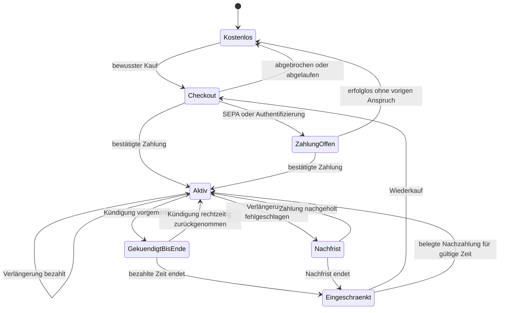

# GradeCrew: Gratisversion, Preise, Schullizenzen und Zahlungsbetrieb

**Entscheidungsbericht · 04.11.2026 · GC-BILLING-PLAN-01 · ausschließlich Recherche und Planung**

Alle Produktwerte in diesem Bericht sind Vorschläge, soweit sie nicht ausdrücklich als belegter Bestand bezeichnet sind. Kein Preis wurde beschlossen oder aktiviert. Kein Zahlungsanbieter-Konto, Vertrag, Produktcode, Zahlungsauftrag oder Deployment wurde angelegt. Offizielle Quellen wurden am 04.11.2026 abgerufen; Gebühren, Gesetze und Applebedingungen vor tatsächlichem Start erneut prüfen. Rechts- und Steuerfragen benötigen die benannten qualifizierten Prüfungen anhand des tatsächlichen Geschäfts.

## 1. Eine Seite für Martin

**Meine Empfehlung: GradeCrew dauerhaft kostenlos zugänglich lassen und zum Einstieg drei vollständige Tests schenken – ohne Kreditkarte, ohne Countdown ab Registrierung und ohne automatische Umwandlung in ein Abo.** Danach bleiben Anmeldung, eigene Ergebnisse, manuelle Korrektur und der vereinbarte Export zugänglich. Neue KI-Erstellungen und neue Unterrichtsrunden benötigen ein bezahltes Paket; bereits gestartete Klassen dürfen fertig werden. So erlebt eine Lehrkraft den Nutzen von Remy über Emmi und den Unterricht bis zu Wilma, bevor sie kaufen soll.

Mit „drei Tests“ meine ich drei erfolgreich gespeicherte, bearbeitbare Testentwürfe mit einer klar begrenzten Größe, nicht drei Klicks auf „Erstellen“. Technische Fehlschläge verbrauchen kein Kundenguthaben. Bilder, Audio und KI-Korrektur erhalten verständliche separate Grenzen. Das Startpaket muss einen echten vollständigen Unterrichtsablauf finanzieren; große Medienproduktionen sind kein sinnvoller Gratisstandard. Die konkrete V1-Beispielstrategie steht in Abschnitt 4 und ist noch nicht beschlossen.

**Für den ersten bezahlten Webbetrieb empfehle ich Stripe Checkout + Billing + Kundenportal und einen gesonderten jährlichen Schulweg auf Bestellung/Rechnung. Eignung 8/10** für einen zunächst überschaubaren deutschen Markt mit eigener kaufmännischer Betreuung. Stripe übernimmt das sichere Bezahlen und viel Aboverwaltung; GradeCrew bleibt bei diesem Weg Verkäufer und muss korrekte Steuern, Rechnungen, Rechte und Support organisieren. Für einen schnellen internationalen Privatkundenvertrieb wäre Paddle als Merchant of Record ernsthaft zu bevorzugen, wenn dessen Verkäuferrolle und Schulrechnungen passen. Gleiche Vergleichskriterien und Grenzen: Abschnitt 6.

**Preise jetzt als Hypothese testen:** ein einziges Lehrkraftpaket, beispielsweise 12,90 EUR monatlich oder 129 EUR jährlich; Schulen zunächst ein kleines jährliches Sitzpaket statt komplizierter Verbrauchsrechnungen. Das sind Rechen- und Interviewwerte, keine fertige Preisliste. Die Annahmenrechnung zeigt bei mittlerer betreuter Nutzung bereits etwa 7,15 EUR variable Vollkosten je Monat. Für ein wirtschaftlich gutes 129-EUR-Jahr müssen die tatsächlichen durchschnittlichen Kosten deutlich niedriger liegen oder Preis/Leistungsumfang angepasst werden. „Unbegrenzte KI“ würde ich nicht versprechen.

**Bei ausgebliebener Zahlung das Abo einschränken, niemals einfach den Login abschalten oder das Konto löschen.** Zahlungserinnerung, Nachfrist, klare Anzeige und Wiederaktivierung gehören dazu. Kein Zahlungsfehler darf eine laufende Prüfung abbrechen, Antworten löschen oder automatisch eine endgültige Note erzeugen. Ein Konto, ein Schulzugang und ein Abo sind drei unterschiedliche Dinge.

**Vor einem Kaufstart sind drei konkrete Dinge zu entscheiden:** Gratisumfang und Preisidee; tatsächlicher Verkäufer-/Steuerstatus und Rechnungsweg; zulässiges Kaufmodell der Lehrer-App. Besonders Apple ist ein eigenständiges Gate: Die EU-Bedingungen wurden zum 01.10.2026 geändert. Ein Webkauf ist keine pauschale Erlaubnis, Stripe in jeder iOS-App zu bewerben. Die Schüler-App Secure bleibt ein eigener, kostenloser Zugangsweg.

**Aufwand:** belastbarer Web-Abobetrieb mit Rechteprüfung, Kostenkontrolle, Rechnungen, Kündigung/Widerruf, Support und Abnahmetests ungefähr **39–66 Personentage** einschließlich der ersten einfachen institutionellen Abwicklung, unter den Annahmen in Abschnitt 13. Apple-IAP oder ein größerer automatisierter Schulvertrieb kommen gegebenenfalls hinzu. Der Checkoutbutton allein ist ein kleiner Teil. Zuerst Entscheidungen und Messung, dann isolierte Testzahlungen, dann freiwilliger Pilot, zuletzt ausdrücklich freigegebener Echtbetrieb.

**Bewertung dieses Konzepts: 8/10** für einen fairen, verständlichen und kontrollierbaren Einstieg. Begründung: voller Unterrichtskreislauf, begrenztes Gratisrisiko, existierende Firebasebasis, bewährte externe Zahlungsoberflächen. Offene Risiken separat: keine repräsentativen Ist-Kosten/Zahlungsbereitschaft, unbekannter Steuerstatus, noch ungeprüfte Apple-Einordnung und Schulbeschaffung. **Die tatsächliche Betriebsbereitschaft eines zahlungspflichtigen GradeCrew-Angebots kann ich aus dem vorhandenen Bestand nicht belastbar auf 1–10 bewerten**: ein implementierter und getesteter Billingablauf ist nicht nachgewiesen. Das ist keine Bewertung des Gesamtprojekts.

## 2. Was heute tatsächlich vorhanden ist

### 2.1 Quellen und Umgebungen

Die Recherche begann auf `HerrLoeffler/Hausaufgabe/main@e4109f9fe04bed8cb05a90ba58531ac2be22e63a`. START_HERE, AGENTS, STATE, TODO, CHAT_CONTRACT, CHAT_RECOVERY, Registry und Assurance-Einstiege wurden gelesen. Ein eigener Clone und Dokumentationsbranch vermeiden Eingriffe in laufende Facharbeiten. Quellen unter `sources/` wurden nicht verändert.

Der frische read-only Development Status vom 04.11.2026 zeigt 28 aktive Baustellen, 36 mögliche Dateiüberschneidungen und deutlich auseinanderliegende Branchhistorien. Diese Zahlen sind Warnsystemwerte, keine Qualitätsquote. Das Werkzeug konnte ohne `GITHUB_TOKEN` keine PRs abfragen; ergänzend wurde die öffentliche GitHub-API gelesen: 99 offene PRs, kein Titel/Head mit Billing/Stripe/Payment/Subscription/Lizenz/Quota/Meter. Registry/TODO und Branchnamen lieferten ebenfalls keinen passenden eigenständigen Billingauftrag. Deshalb neue enge Task-ID **GC-BILLING-PLAN-01**; verwandte Aufträge bleiben bestehen. Keine fremden Chats wurden angewiesen.

| Quelle | Frisch belegter Stand | Aussagegrenze |
|---|---|---|
| Gemeinsamer Webbranch | `feature/gradecrew-app-integration@5e45e9df2449ca7e4c4b735ae754452a6f304ab7` | Quellbestand, keine automatische Gleichsetzung mit Live |
| Öffentliche Liveadresse | `gradecrew.de/release.json`: Projekt `hausaufgabe-staging`, environment `production`, Commit `69414965b345881a8e66e55b6b76b2dd982dec41` | Hostingmanifest gelesen; keine neue vollständige Hash-/Backend-/Rulesprüfung |
| Öffentliches getrenntes Staging | `gradecrew-staging-2026.web.app/release.json`: Commit `5be513d6f8cc90520efb63ee3c0d4e878e84df2d` mit Kompositionsangaben | Hosting enthält Teilkompositionen; kein monolithischer Beweis für alle Dienste |
| Wilma | PR396/Branch `fix/wilma-budget-fundus-live-20261029@69414965`; HDF und Code der Budget-/Providerfunktionen gelesen | vorhandene Livebelege sind fremde Releasebelege, kein neuer Modell- oder Gerätetest |
| Native | `feature/native-live-staging-20261018@97cf926ee92519bc3457785e1f7b2d6212ad4879` | bestehende Store-/Authübergaben; keine aktuelle ASC-Sitzung oder angenommene Appprüfung |
| Analytics | `feature/analytics-teacher-v1-20261021@1b2fbdd14577e5646a1d57c1048623178ab1ff7a` | vorhandener Messvertrag, kein abgerufener Privatkunden-/Umsatzbestand |
| Schule/Datenschutz | PR366, `docs/gc-school-readiness-20261028@d0b463a71d36dd4729db97740596cd862faabc3c` | Standort-/Rechtsentscheidungen bleiben beim vorhandenen Owner |

Primärbelege: [main](https://github.com/HerrLoeffler/Hausaufgabe/tree/e4109f9fe04bed8cb05a90ba58531ac2be22e63a), [Live-Manifest](https://gradecrew.de/release.json), [Staging-Manifest](https://gradecrew-staging-2026.web.app/release.json), [Wilma-PR396](https://github.com/HerrLoeffler/Hausaufgabe/pull/396), [Schulbericht-PR366](https://github.com/HerrLoeffler/Hausaufgabe/pull/366).

### 2.2 Vorhandene Technik und wiederverwendbare Teile

- Weboberfläche: vorhandenes HTML/CSS/JavaScript, Firebase Auth, Firestore, getrennte Functions für KI und Assessment. Kein Anlass für einen Frontendframeworkwechsel.
- `functions/lib/access.js` erlaubt KI für aktive Teacher/Adminprofile; ein altes Betaflag wird absichtlich ignoriert. `profile.status` ist Kontostatus. **Diesen Schalter nicht zur Abozahlung umdeuten.** Billing erhält eigene Berechtigungen.
- `functions/lib/usage.js` hat transaktionale Minuten-/Tagesgrenzen, technische Events und Monatsrollups nach UID/Art. Minuten/Tag/Monat werden dort per UTC-ISO gebildet. Der Zähler steigt vor dem Providerstart; dieses Sicherheitslimit ist kein fairer kommerzieller Erfolgszähler.
- `recordUsage` lässt ein nachträgliches Statistikschreibproblem die bezahlte Antwort nicht vernichten. Gut für Produktzuverlässigkeit; allein kein vollständiges finanzielles Ledger, weil ein fehlgeschlagener Statistikeintrag nicht zwingend den Verbrauch belegt.
- Roh-KIevents sind im geprüften Modul auf 30 Tage, Quoten auf 14 Tage begrenzt; Monatsrollups enthalten Zähler/Modelle. Neue Rechnungsaufbewahrung darf nicht daraus abgeleitet werden.
- Konfiguriert sind `gpt-5.6-luna`, `gpt-image-2` und `gpt-4o-mini-tts`. Die gelesene Bildroute erzeugt ein Bild mit `1024x1024`, `quality: low`, WebP. Bilder können zusätzliche Text-/Bildprüfung und Wiederholungen verursachen. Hördateien und Varianten müssen einzeln zugeordnet werden.
- Bestehende Bildercaches und Wilmas bestätigter privater Fundus reduzieren Wiederholaufrufe. Nur echte Treffer zählen als Ersparnis; keine versprochene Trefferquote und kein automatisches Training mit Schülerdaten.
- Die Wilmaquelle hat eine konservative 20-EUR-Monatsgrenze mit getrennten maximalen Stage-/Liveanteilen (11,25/8,75 EUR), Reservierungen, unbekanntem Verbrauch als Hold, Europe/Berlin-Monat und einer bis 27.01.2027 begrenzten Preisrichtlinie. **Das ist ein gesamter technischer Kostenrahmen, kein 20-EUR-Preis pro Nutzer und keine Providerrechnung.** Neue Kundenpakete dürfen diesen bestehenden Rahmen nicht nebenbei aushebeln.

Dateibelege: [Access](https://github.com/HerrLoeffler/Hausaufgabe/blob/5e45e9df2449ca7e4c4b735ae754452a6f304ab7/functions/lib/access.js), [Usage](https://github.com/HerrLoeffler/Hausaufgabe/blob/5e45e9df2449ca7e4c4b735ae754452a6f304ab7/functions/lib/usage.js), [Konstanten](https://github.com/HerrLoeffler/Hausaufgabe/blob/5e45e9df2449ca7e4c4b735ae754452a6f304ab7/functions/lib/constants.js), [Bildroute](https://github.com/HerrLoeffler/Hausaufgabe/blob/5e45e9df2449ca7e4c4b735ae754452a6f304ab7/functions/lib/media.js), [Wilma-Budget](https://github.com/HerrLoeffler/Hausaufgabe/blob/69414965b345881a8e66e55b6b76b2dd982dec41/functions/lib/wilma/budget.mjs), [Wilma-Provider](https://github.com/HerrLoeffler/Hausaufgabe/blob/69414965b345881a8e66e55b6b76b2dd982dec41/functions/lib/wilma/provider.mjs).

### 2.3 Was sich daraus nicht behaupten lässt

Kein Nachweis eines laufenden Kundenabosystems, Stripe-/MoR-Kontos, automatisierter Rechnungszustellung, institutioneller Sitzverwaltung oder einer plattformübergreifenden Kaufberechtigung. Keine repräsentativen Produkt-Providerrechnungen, Ist-Kosten je Lehrkraft, aktuelle MAU-Kosten oder Zahlungsbereitschaft abgerufen. Kein Billingbestand aus Lehrerfeedback erschlossen. Bestehende Preis-/Finanzierungsentwürfe sind Szenarien. Games, ASV, VIDIS und Classroom haben eigene Reifegrade; sie werden nicht pauschal als verkaufsfertiger Bestandteil versprochen. VIDIS vermittelt Identität/Zugang, keine Zahlung oder Beschaffungsfreigabe.

## 3. Drei faire Gratisansätze

Ziel ist **ein echter vollständiger Kreislauf**, nicht eine hohe Zahl Registrierungen: erstes brauchbares Ergebnis, eigene Anpassung, Unterrichtseinsatz, verständliche Ergebnisse, freiwillige Kaufentscheidung. Schulkalender und Ferien machen Kalendertrials besonders empfindlich. Die folgenden Bewertungen sind begründete Eignungseinschätzungen, keine gemessenen Conversionraten.

Gleiche Kriterien, jeweils 1–10: **Erlebnis** (voller Kreislauf), **Fairness** (Zeitdruck/Transparenz), **Kostenkontrolle**, **Einfachheit im Betrieb**. Gleich gewichtet; Gesamt gerundet, entscheidende Schwächen separat.

| Kandidat | Erlebnis | Fairness | Kosten | Betrieb | Gesamt | Hauptabwägung |
|---|---:|---:|---:|---:|---:|---|
| A: drei erfolgreiche Startertests ohne Zeitablauf, danach Archiv/Abschluss | 8 | 9 | 9 | 8 | **9/10** | Genügend Versuche, begrenzte Akquisitionkosten; Wiederkehr ohne Kauf ist schwächer |
| B: 30 aktive Kalendertage ab erstem erfolgreichen Test, zusätzlich feste Verbrauchsgrenzen | 9 | 7 | 8 | 7 | **8/10** | Wiederholter Nutzen möglich; Ferien und Ausfalltage benötigen faire Verlängerung |
| C: dauerhaft ein kleiner neuer Test pro Monat plus höheres Starterguthaben | 9 | 10 | 5 | 6 | **8/10** | Starker Wiedereinstieg; wiederkehrende Kosten auch ohne Umsatz und mehr Missbrauchsprüfung |

**V1-Empfehlung A**, weil repräsentative Kosten- und Wiederkehrdaten fehlen. Ein dauerhafter Gratis-Kontostatus mit Starterguthaben ist eine echte kostenlose Version. Nach dem Verbrauch nicht nur eine undurchsichtige Paywall anzeigen, sondern die konkret weiter verfügbaren Funktionen. C später anhand Kosten pro aktiviertem Nichtzahler entscheiden; A nicht nachträglich heimlich in einen ablaufenden Trial verwandeln.

### 3.1 Warum nicht nur ein oder zwei Tests?

**Ein Test: 5/10** als einziger Realtrial. Technisch günstig, aber die erste Erstellung kann ein Lernversuch oder thematisch unpassend sein; zwischen Entwurf und Unterricht liegt oft Zeit. Ein schlechter Erstversuch darf kein verlorener einziger Kaufbeweis sein. Als zusätzliche öffentliche Demo gut.

**Zwei Tests: 7/10**, wenn beide vollständig überarbeitbar und praktisch durchführbar sind. Ein Lernlauf plus ein echter Kurs reicht häufig zur Orientierung, bleibt bei Fehlpassung knapp.

**Drei Tests: 9/10** für den Einstieg nach den gleichen Erlebnis-/Fairness-/Kosten-/Betriebskriterien. Erlaubt Lernversuch, echte Klasse und zweite Unterrichtserfahrung. Der Mehrpreis besteht im zusätzlichen begrenzten Erstellungs-/Korrekturverbrauch; nicht in einem beliebig offenen KIzugang. Vier/zehn Tests sind ohne Nutzungsdaten derzeit kein begründeter Standard.

### 3.2 7, 14 oder 30 Tage?

| Dauer, jeweils ab erstem brauchbarem Ergebnis und mit gleichem Verbrauchsdeckel | Erlebnis | Fairness | Kostenkontrolle | Betrieb | Eignung |
|---|---:|---:|---:|---:|---:|
| 7 Tage | 4 | 4 | 9 | 8 | **6/10** |
| 14 Tage | 7 | 6 | 8 | 8 | **7/10** |
| 30 Tage | 9 | 8 | 8 | 7 | **8/10** |

Sieben Tage können zwischen zwei Fachstunden bereits vorbei sein. 14 Tage sind vertretbar, aber Krankheits-/Ferienfälle bleiben. 30 Tage sind der beste Kalendertrial, wenn man B auswählt; Friststart explizit beim ersten erfolgreichen eigenen Test, nicht bei einer liegengebliebenen Registrierung. Unbegrenztes Generieren innerhalb eines Zeittrials wäre ein anderes, riskanteres Angebot.

### 3.3 Kreditkarte und Schulpilot

**Ohne Kreditkarte: 9/10**, mit vorab hinterlegter Karte und automatischem Bezahlstart: **5/10** für das Ziel unverbindlicher Lehrkrafterprobung. Gleiche Kriterien hier: Einstiegshürde, bewusster Kauf, Betriebsaufwand, Zahlungssicherheit. Karte kann später unfreiwilligen Zahlungsverlust reduzieren, nimmt aber Vertrauen und erfordert klare Einwilligungs-/Erinnerungsprozesse. V1 ohne Karte; erst ein ausdrücklicher Checkout schließt einen kostenpflichtigen Vertrag.

Ein **Schulpilot ist ein eigener vereinbarter Vorgang**, beispielsweise sechs tatsächliche Unterrichtswochen innerhalb eines Terminkorridors, bestimmte Sitze und ein ausdrücklich genanntes Kostenlimit. Ferienregel, Verantwortliche, Datenschutz-/Freigabeumfang, Support und Auswertung schriftlich festlegen. Kein stilles Jahresabo nach Pilotende. Ein konkreter Pilot darf kürzer/länger sein; sechs Wochen sind ein Entwurf, keine behauptete Nutzerentscheidung oder Pflichtdauer.

## 4. Ausgearbeitetes V1-Beispiel zur Entscheidung

### 4.1 Produktversprechen und Kontingente

**Vorschlag „GradeCrew Start“:** dauerhaft kostenloses Konto, drei Startertests, keine Zahlungsmethode erforderlich. Nach erfolgreicher Registrierung und angemessener Identitätsprüfung steht das Guthaben bereit. Öffentliche Demo bleibt zusätzlich ohne KIaufruf verfügbar.

| Leistung | Beispiel Start | Beispiel Lehrkraft Plus | Was die UI sagt |
|---|---|---|---|
| Neue erfolgreiche Tests | 3 insgesamt | 12 je Abomonat | „Noch 2 von 3 Startertests“ / „Noch 8 Tests bis …“ |
| Größe | bis 20 neue Aufgaben je Erstellung | bis 40 je Erstellung, Kostenreserve gesondert prüfen | Größe vor Erstellen anzeigen; große Tests nicht still als mehrere Tests berechnen |
| KIüberarbeitungen | 10 begrenzte Aktionen insgesamt | 40 je Monat | ganze Testrevision und Einzeländerung getrennt vor Aufruf benennen |
| Neue Bilder | 2 insgesamt | 20 je Monat | gespeichertes Bild erneut anzeigen verbraucht nichts |
| Neues Audio | bis 2 Minuten insgesamt | bis 20 Minuten je Monat | Frage und Antworten/Lösungen sind getrennte neue Spuren |
| Neue Wilma-KIvorschläge | bis 210 einzelne Antworten insgesamt | bis 300 je Monat | bekannte Regeln/Fundus und manuelle Bewertung weiter verfügbar |
| Klasse | je Startertest eine Runde bis 35 Teilnahmen | normale pädagogische Klassenlimits, keine Unlimitedzusage | vor Veröffentlichung realen Umfang und KIreichweite anzeigen |
| Bestehende Tests/Ergebnisse | lesen, manuell korrigieren, bestätigte Ergebnisse/vereinbarter Export | ebenso plus neue Erstellung/Unterrichtsrunden | Zahlungsgrenze zerstört keinen vorhandenen Unterricht |

Diese Zahlen sind **eine prüfbare Angebotsannahme**, keine bereits tragfähige Freigabe. Die aktuelle Produktgröße bis 100 Fragen und technische Tagesgrenzen sind andere Grenzen. 12 Tests mit jeweils 40 Fragen kosten möglicherweise mehr als das Kalkulationsmittel; verbindliche Preisentscheidung erst nach Größe-/Material-/Reparaturmessung. Die 210 Gratisvorschläge erlauben z. B. drei Klassen mit 35 Teilnahmen und je zwei neuen Freitextantworten. Bei mehr Freitext ist der Rest weiterhin manuell zu bewerten; das muss vor Veröffentlichung klar sein. Wilmas technische Gesamtgrenze bleibt zusätzlich bestehen und braucht vor Kundenzusage eine eigene wirtschaftliche Freigabe.

Keine Sperre nach dem überraschenden 36. Schüler mitten im Unterricht: Teilnehmererwartung/Leistungsumfang vor Start prüfen, angemessenen technischen Überlauf für berechtigt gestartete Runden einplanen. Sicherheits-/Lastgrenzen bleiben verbindlich und müssen vorher sichtbar sein. Die bezahlte Stufe bekommt keine versteckte automatische Zusatzrechnung. Kontingent leer → Wahl: warten auf nächste Periode, manuell weiterarbeiten oder ausdrücklich ein später angebotenes Zusatzpaket kaufen.

### 4.2 Was genau zählt als „Test“?

Eine **Erstellungseinheit** entsteht erst, wenn ein validierter und wieder öffnbarer Entwurf dauerhaft gespeichert ist und der Jobstatus das bestätigt. Mehrere Klicks, Polling, Download, Gerätewechsel und Wiederaufnahme desselben Jobs erzeugen keinen weiteren Verbrauch. Kundenwunsch nach einem anderen Thema ist eine neue Erstellung. Korrigierte technische Fehlgenerierung gehört zum ursprünglichen Job; zehn bewusst neue Alternativen sind echte weitere Nutzung.

„Brauchbar“ ist nicht gleich „Lehrkraft vergibt ein Smiley“: Sonst könnte beliebig viel nutzbarer Inhalt ohne Verbrauch entnommen werden. Automatische Struktur-/Vollständigkeitschecks bestimmen den technischen Erfolg; fachlich unbrauchbare Ergebnisse erhalten einen einfachen Reklamationsweg mit geringen, kontrollierten Ersatzgutschriften. Keine KIentscheidung allein über berechtigten Ersatz, kein Ranking von Lehrkräften. Fehlerquote zusätzlich intern messen.

- Entwurf kopieren, Titel/Text manuell ändern, neu öffnen: keine Erstellungsbuchung.
- Neue ganze KIvariante: vorab als neuer Test oder große Revision benennen; für V1 als Testeinheit zählen, weil eine vollständige neue Fassung erzeugt wird.
- Emmi-Einzeländerung/Antwortalternativen: eigene begrenzte Überarbeitungseinheit. Größe des Kontextes bleibt intern gedeckelt.
- Medien: nur neue erfolgreiche Datei zählt; identischer freigegebener Cachetreffer nicht. Schlechte Bild-/Audioqualität, abgebrochene oder unvollständige Datei führt nicht willkürlich zu Kundenverbrauch.
- Audioabhören durch 35 Schüler erzeugt nicht 35 neue Spracherzeugungen. Egress/Hosting kostet trotzdem.
- Wilma: eine neu an den Provider gesendete Antwortprüfung ist Kostenverbrauch, ein erneutes Anzeigen keine neue Prüfung. Geändertes Raster/Antwort kann neue Prüfung erfordern. Bestätigte Fundustreffer gesondert zählen.
- Bereits veröffentlichte Fassungen und aktive Attempts nicht nachträglich neu abrechnen; eine neue Klasse/Runde ist eine andere Operation als bloßes Wiederöffnen.

### 4.3 Limit ohne Unterrichtsabbruch

Bei Veröffentlichung eines Tests wird ein **versionierter Durchführungsanspruch** für die konkrete Runde gespeichert: Aufgabenfassung, Owner/Organisation, erlaubter Teilnehmerrahmen, aktive Abgaben/Offlinesync und Abschluss-/Exportrechte. Beispielhaft 14 Tage Annahme für Offline-Nachsynchronisierung nach offiziellem Rundenende, explizit sichtbar und mit bestehenden Securefristen abzustimmen. Keine heimliche Dauerverlängerung jeder offen gehaltenen Runde. Für einen geplanten späteren Unterrichtstermin gelten die im Angebot benannten Bedingungen; außerhalb der schon zugesagten Runde kann eine neue Veröffentlichung gesperrt sein.

Aboablauf oder globaler KIstop hindert den serverseitigen sicheren Abschluss nicht. Neue kostenpflichtige Wilmaaufrufe können bei Kostensperre warten; regelbasierte vorläufige Bewertung und manuelle Bestätigung bleiben. Kein ausfallender Zahlungseinzug macht Schülerantworten zu null Punkten. Sicherheitsnotfälle werden separat behandelt; ein Geldproblem ist kein Grund für Kontosperrung.

### 4.4 Missbrauchsschutz mit wenig Daten

Verifizierte E-Mail, bestehende UID, Rate-/Parallelitätsgrenzen, App Check wo passend, tägliches kostenloses Gesamtbudget, ungewöhnliche Konto-/Jobmuster und manuelle Kulanz-/Sperrprüfung kombinieren. Keine Ausweiskopie, Schulzugehörigkeit oder Kreditkarte für jeden Gratisnutzer verlangen. Schul-WLAN ist geteilt: IP allein darf weder Beweis für Mehrfachmissbrauch noch alleinige Sperre sein. Wegwerf-Mail-/Gerätesignale nur begründet, kurzlebig und datenschutzgeprüft verwenden. Schülerinnen und Schüler brauchen für die kommerzielle Quotierung kein Trackingprofil. Versehentlich doppelte Lehrerkonten müssen zusammengeführt werden können, ohne neue Startergutschriften beliebig zu vervielfachen.

### 4.5 Preisstruktur als Hypothese

Ein Startkonto, **ein** persönliches Pluspaket, **ein** institutioneller Jahresweg. Keine fünf fast gleichen Tarife. Als Interview-/Kalkulationsanker 9,90 / 12,90 / 14,90 EUR monatlich vergleichen, Jahresangebot etwa zehn Monatszahlungen bei zwölf Monaten Nutzung nur dann, wenn es sich rechnet. **Vorläufiger Lieblingskandidat: 12,90 EUR/Monat bzw. 129 EUR/Jahr**, weil leicht verständlich und innerhalb vergleichbarer persönlicher Toolbudgets; die jetzige Kostenannahme ist dafür noch zu dünn.

Entscheidungsregel vor Veröffentlichung: Bei diesem Preis durchschnittliche variable Vollkosten möglichst höchstens 4 EUR/Lehrkraftmonat und belastbare hohe Nutzungsfälle innerhalb der zugesagten Limits finanzierbar. Das ist unser wirtschaftliches Entwurfsziel, kein allgemeiner Branchenstandard. Bei höheren Ist-Kosten zunächst Reparatur-/Supportaufwand reduzieren, Medien-/Größenumfang korrigieren oder 14,90/149 prüfen. Nicht einfach Qualität abschalten.

Schulbeispiele für Gespräche: 10 namentlich zugewiesene Lehrkraftsitze/990 EUR pro Jahr oder 25 Sitze/1.990 EUR pro Jahr, **nur hypothetische Endpreise unter der später bestätigten Steuerbehandlung**. Rechenwerte je Sitz/Monat: 8,25 bzw. 6,63 EUR brutto. Der Rabatt erhöht das Margenrisiko; nicht mit vollen Privatlimits plus umfangreichem Einführungsservice ungesehen zusagen. Schulpaket bündelt persönliches Grundkontingent und begrenzten geteilten Medienpool, Mindestumfang, Sitzwechselregel und Support. Unbegrenzte Schülerzahl heißt nicht unbegrenzte neue KIbewertungen. Trägerangebot erst bei echter Nachfrage mit Sammelrechnung, Beschaffungsweg, Verantwortlichkeit und Einführung kalkulieren.

Sitz = konkrete nutzende Lehrkraft, kein geteiltes Passwort und kein Schüler. Teilzeit, Vertretung, Schulwechsel und Abwesenheit vertraglich fair regeln. Ein bloßer Eintrag einer Schuldomain beweist keine bezahlte Sitzberechtigung.

## 5. Kosten, Preise und wirtschaftliche Grenzen

### 5.1 Offizielle Modellpreise und konkrete Bestandsrisiken

Die geprüfte Produktkonfiguration verwendet OpenAI direkt; die getrennte Multi-Provider-Gatewayentwicklung ist kein Beweis, dass jeder Liveaufruf bereits durch ein gemeinsames Finanzledger läuft. Keine Modellmigration aus dieser Recherche ableiten.

| Modell/Route aus dem Code | Offizieller Tarif am Abrufdatum | Bedeutung für die Kalkulation |
|---|---|---|
| GPT-5.6 Luna | 0,20 USD/Mio. Eingabetokens, 0,02 gecachte Eingabe, 1,20 Ausgabe | vollständige Usage einschließlich bezahlter Reparatur-/Prüfaufrufe; große Kontexte können anders kosten |
| GPT Image 2 | 1024²: Ausgabe low ca. 0,006 USD, medium 0,053, high 0,211; Eingaben zusätzlich | Code nutzt low; kein pauschaler identischer Preis für Bearbeitungen/Prüfungen |
| GPT-4o mini TTS | 0,60 USD/Mio. Texteingabetokens, 12 USD/Mio. Audioausgabetokens | Textlänge/Sprachtempo allein kein geprüfter exakter Rechnungspreis pro Minute |

Quellen: [Luna-Modellpreis](https://developers.openai.com/api/docs/models/gpt-5.6-luna), [offizielle Bildkalkulation](https://developers.openai.com/api/docs/guides/image-generation#calculating-costs), [TTS-Modellpreis](https://developers.openai.com/api/docs/models/gpt-4o-mini-tts). USD sind keine Euro; eventuelle regionale Aufschläge, Steuer auf Providerbezug, tatsächlicher Tarif und Wechselkurs sind gesondert zu prüfen.

**Konkreter Lifecyclebefund:** Die offizielle TTS-Dokumentation nennt die Abschaltung von `gpt-4o-mini-tts` am **06.01.2027** und einen anderen APIworkflow als Nachfolger. Deshalb neue längerfristige Audioangebote erst mit dem Medienowner auf Migration, Qualität und neue Kosten prüfen. Kein stiller Modellwechsel und keine Gleichsetzung des neuen Modells mit `/v1/audio/speech`. [OpenAI Text-to-Speech](https://developers.openai.com/api/docs/guides/text-to-speech).

### 5.2 Ein vollständiger Kostenbegriff

Pro Operation brauchen wir Modell + tatsächliche Version, Zeitpunkt, Service-Tier, Region, Eingabe/Ausgabe, Cacheanteile, Mediengröße/-dauer, Providerrequest-ID, erfolgreiche/fehlgeschlagene Versuche und Preisversion. Zusätzlich Cloud Functions/Run, Firestore-Lese-/Schreibzugriffe, Storage, Medienübertragung, Backups/Logs/Secrets, Auth-/E-Mailkosten, Supportzeit, PSP-/Billing-/Taxgebühren, Rückerstattungs-/Rücklastschriftkosten und Akquisitionsguthaben.

Firebase hat Freikontingente und verbrauchsabhängige Preise; Hostingtransfer ist auch bei CDNcachetreffern nicht automatisch kostenlos. Auth-, Datenbank-, Functions- und Storagepreise hängen vom Produkt und tatsächlichem Tarif ab. Keine Annahme, dass alle freien Quoten je Lehrkraft neu entstehen. [Firebasepreise](https://firebase.google.com/pricing), [Hostingquoten](https://firebase.google.com/docs/hosting/usage-quotas-pricing).

Unternehmensfixkosten – Steuerberatung, Verträge, Buchhaltungssoftware, Domain, Appleentwicklerprogramm, CI, Bereitschaft, Entwicklung und Gründerlohn – kommen danach. Die folgenden Deckungsbeiträge sind **kein Gewinn**. Bereits vorhandene Konten/CI erzeugen keine sichere Nullkostenintegration.

### 5.3 Rechenmodell statt erfundener Ist-Messung

Formeln:

- `Textkosten USD = Summe(input_ungecached × Eingabetarif + input_cached × Cachetarif + output × Ausgabetarif) / 1.000.000`, alle Providerrequests einschließen.
- `KI EUR = USD × tatsächlicher EUR/USD-Umrechnungsfaktor + weitere Provider-/Regionskosten`.
- `Variable Kosten = KI + Cloud/Transfer + Support + Zahlungsgebühren + erwartete Ausfall-/Refundkosten`.
- `Deckungsbeitrag vor Fixkosten = Umsatz ohne abzuführende Umsatzsteuer − variable Kosten`.
- `Mindestpreis` bei proportionaler PSPgebühr `a`, fixer Gebühr `b`, übrigen Kosten `K` und gewünschtem Beitrag `D`: unter vereinfachten 19% USt `Bruttopreis = (K + D + b) / (1/1,19 − a)`.

**Eigene Beispielannahmen, keine gemessenen Durchschnittswerte:** 1 USD = 0,92 EUR ausschließlich als Rechenfaktor. Keine Wechselkursprognose. Ein mittlerer Test summiert 60.000 Eingabe-/12.000 Ausgabetokens: 0,0264 USD; doppelter Aufwand für weitere Prüf-/Reparaturarbeit ergibt rund 0,05 EUR. Eine begrenzte Emmiaktion 0,01 EUR, ein geprüftes Lowbild einschließlich mittlerer Zusatzarbeit 0,02 EUR, eine erzeugte Audiominute 0,02 EUR als Budgetansatz, ein neuer kleiner Wilmavorschlag 0,002 EUR. Zusätzlich 25% KIreserve. Audio-/Bild-/Freitextkosten können diese Ansätze deutlich übersteigen; das sind keine Zusagen des Providers.

| Nutzung pro Lehrkraftmonat | Klein | Mittel | Intensiv, außerhalb des vorgeschlagenen V1-Pakets |
|---|---:|---:|---:|
| Neue Tests | 4 | 12 | 40 |
| Begrenzte Emmiaktionen | 8 | 24 | 120 |
| Neue Bilder | 4 | 20 | 100 |
| Neues Audio in Minuten | 4 | 20 | 120 |
| Neue kleine Wilmavorschläge | 60 | 240 | 1.500 |
| KI aus obigen Stückannahmen | 0,56 EUR | 2,12 EUR | 10,60 EUR |
| KI einschließlich 25% Reserve | 0,70 EUR | 2,65 EUR | 13,25 EUR |
| Cloud/Transferannahme | 0,60 EUR | 1,00 EUR | 3,00 EUR |
| Supportannahme zu 30 EUR/Stunde | 4 min = 2 EUR | 7 min = 3,50 EUR | 20 min = 10 EUR |
| Summe vor Payment/Steuer/Fixkosten | **3,30 EUR** | **7,15 EUR** | **26,25 EUR** |

Support wird auch dann als Kosten angesetzt, wenn Martin ihn zunächst selbst unbezahlt leistet. Ein ruhiger Bestandskunde kann wenig Support benötigen; der Startmonat mehr. Ein Median allein genügt nicht: p90/p95, teure Materialien, 40/100-Fragentests und besonders aufwendige Reparaturpfade messen. Bei dreifachen KIstückkosten steigt die mittlere Summe auf 12,45 EUR und die intensive auf 52,75 EUR. Genau deshalb keine unlimitierte Flatrate auf Basis eines günstigen Einzelaufrufs.

### 5.4 Was vom Bruttopreis übrig bleibt

Rechenfall **Regelbesteuerung Deutschland mit 19%**; der tatsächliche Status und die Einstufung der Leistung sind nicht bestätigt. Stripe-Standard-EWR-Karte + Billing + Tax Basic integriert vereinfacht `1,5% + 0,7% + 0,5% + 0,25 EUR = 2,7% + 0,25 EUR`; Gebührenbasis/Steuer auf Gebühren im echten Vertrag prüfen. Ohne gebuchtes Tax Basic fallen dessen 0,5% nicht an. Kein pauschales zusätzliches 0,4%-Invoicing auf jede Billing-Aborechnung rechnen.

| Bruttopreis/Monat | Umsatz ohne 19% USt | Modellierte Payment/Billing/Taxgebühr | Verfügbar vor Produktkosten | DB klein | DB mittel | DB intensiv |
|---|---:|---:|---:|---:|---:|---:|
| 9,90 EUR | 8,32 | 0,52 | 7,80 | 4,50 | 0,65 | −18,45 |
| 12,90 EUR | 10,84 | 0,60 | 10,24 | 6,94 | 3,09 | −16,01 |
| 14,90 EUR | 12,52 | 0,65 | 11,87 | 8,57 | 4,72 | −14,38 |

**Jahresfall 129 EUR:** Zahlung einmal; rechnerischer Nettoumsatz pro Leistungsmonat 9,0336 EUR, modellierte Jahresgebühr 3,733 EUR bzw. 0,3111/Monat. Übrig vor Produktkosten 8,7225 EUR/Monat; beim mittleren Szenario Beitrag 1,5725 EUR. Monatlich 12,90 ist wirtschaftlich nicht dasselbe wie 129 jährlich. Vorauszahlung ist Liquidität, noch kein sofort vollständig verdienter Jahresgewinn; periodische Erlösabgrenzung/steuerliche Behandlung mit Buchhaltung festlegen.

Kleinunternehmer dürfen nicht einfach diese Tabelle durch „19% mehr Gewinn“ ersetzen: fehlender Vorsteuerabzug, Leistungsort und gegebenenfalls Reverse Charge auf eingekaufte Cloud-/KIleistungen verändern die Kosten. Eine USt-ID beweist weder Regelbesteuerung noch Befreiung. [§19 UStG](https://www.gesetze-im-internet.de/ustg_1980/__19.html).

### 5.5 Kosten der kostenlosen Erprobung

Voll ausgeschöpftes Startpaket aus Abschnitt 4, mit mittleren Entwurfsgrößen: 3×0,05 + 10×0,01 + 2×0,02 + 2×0,02 + 210×0,002 = **0,75 EUR KI**; 25% Reserve ergibt 0,9375. Plus 0,40 Cloud und 2,00 Supportannahme = **3,3375 EUR pro vollständig aktiviertem Starterkonto**. Das ist eine Szenariorechnung, keine Kostengarantie. 1.000 solche Konten entsprechen rund 3.338 EUR; 10.000 rund 33.375 EUR, noch ohne Marketing und Betrug. Nutzer mit nur Demo/Registrierung kosten anders.

Wenn 20% der aktivierten Starter später bezahlen, entfallen rechnerisch fünf Starterkosten auf einen Zahler: rund 16,69 EUR Akquisitionskosten allein aus Gratisnutzung. 20% ist nur eine Sensitivitätsannahme, keine Prognose. Bei 10% verdoppelt sich dieser Wert. Deshalb zusätzlich Gesamtbudget für Startguthaben und serverseitige begrenzte Aufnahme neuer Gratisjobs, ohne vorhandene Klassen still zu beeinträchtigen.

### 5.6 Wirtschaftliche Schulprüfung

10 Sitze/990 EUR brutto ergeben bei 19% USt 831,93 EUR netto/Jahr bzw. 6,93 EUR je Sitzmonat **vor** Zahlungs-/Rechnungskosten. 25/1.990 ergeben 1.672,27 netto bzw. 5,57 je Sitzmonat. Das mittlere private Kostenbeispiel 7,15 wäre bei Vollnutzung aller Sitze bereits zu teuer. Solche Schulpreise nur mit gemessen geringerem Durchschnitt, klaren gemeinsamen Budgets oder entsprechend höherem Preis anbieten. Nicht unterstellen, dass 80% gekaufter Sitze ungenutzt bleiben.

Keine faire Lizenz sperrt die ganze Schule, weil eine sehr aktive Lehrkraft alle Medien verbraucht: Grundrechte pro Sitz, transparenter Pool, individuelle Tagesgrenzen und sichtbare Ressourcenzuordnung. Vor einer neuen Runde Kapazität prüfen. Vertretungen/Schulleitungsadmin ohne volle Generierung brauchen gegebenenfalls keinen kostenpflichtigen Lehrkraftsitz; Beschluss im Angebot festhalten.

### 5.7 Kleiner offizieller Marktvergleich

Kein direkter Featuregleichstand, keine Behauptung über Qualität/Verkäufe oder Zahlungsbereitschaft. Preise sind nur ein Rahmen; GradeCrews Kernnutzen wäre der zusammenhängende Test-/Unterrichts-/Ergebniskreislauf.

| Angebot | Offiziell sichtbarer Preis/Gratisweg am Abrufdatum | Vergleichsgrenze |
|---|---|---|
| fobizz | Basic gratis; Tools 119 EUR/Jahr, Kombi 239; Schulprodukte ab 500 EUR/Jahr, laut Seite inklusive deutscher MwSt | breitere Tools/Fortbildungen; Schulpreis „ab“, kein Beweis für identischen Umfang |
| to teach | Free mit monatlich 5 Übungen/3 Arbeitsblättern/2 Entwürfen; sichtbare Monatsansicht Starter 5 EUR, Pro 10 EUR; Jahresrabatt beworben | Vorbereitung/Material statt identischer Assessment-/Secureleistung; Steuer-/Checkoutanzeige konkret prüfen |
| schulKI | Start 7,99 EUR/Monat oder 95,88/Jahr; Schul-/Teamangebote gesondert | chat-/medien-/feedbackorientiert und kontingentabhängig, keine Gleichsetzung „alle KI unbegrenzt“ |

Quellen: [fobizz Preise](https://fobizz.com/de/preise/), [to teach Preise](https://to-teach.ai/?lng=de#pricing), [schulKI](https://schulki.de/). Diese offiziellen Preisansichten belegen ein vorhandenes Angebot, keine Kaufwahrscheinlichkeit für GradeCrew. Keine Fremdlogos/-texte kopiert.

### 5.8 Zahlungsbereitschaft praktisch validieren

Mit 8–12 freiwilligen Lehrkräften unterschiedlicher Fächer/Schularten und 2–3 tatsächlichen Beschaffenden zunächst Gespräche und echte Unterrichtskreisläufe planen. Keine fingierten Käufe und keine verborgenen wechselnden Preise für dieselbe Schule. Erst fragen, welches Problem/welche Alternative Zeit kostet; dann konkrete Pakete und Endpreise zeigen, erwartete Nutzung und Kaufhindernisse erfassen. Privatbudget, schulischer Erstattungsweg und Trägerbeschaffung getrennt.

Erfassen: erstes erfolgreiches Ergebnis, eigene Überarbeitung, tatsächliche Durchführung, Ergebnisse geprüft, Kaufabsicht bei konkretem Preis und später tatsächlicher freiwilliger Kauf. Ein positives „tolle Idee“ ist keine Zahlungsbereitschaft. Kleine Fallzahl liefert qualitative Hindernisse, keine statistische Conversiongewissheit. Vor dem Pilot Erfolgskriterien und Beobachtungsfenster festlegen, ohne den Unterricht für Marketingmessungen umzubauen.

## 6. Zahlungsanbieter und Rechnungsweg

### 6.1 Gleiche Vergleichskriterien

Je 1–10, höher = geeigneter für den vorgeschlagenen deutschen V1-Betrieb: **Gesamtkosten** einschließlich Eigenarbeit, **Steuer-/Rechnungsentlastung**, **Privat+Schule**, **Integration/Betrieb**, **Daten-/Vertragskontrolle**, **Apple-Verwendbarkeit**. Letzteres heißt technische Anschlussfähigkeit unter gesonderter Appleprüfung, keine Befreiung von Storebedingungen. Bewertungsurteile sind eigene Einschätzungen.

| Weg | Kosten | Rechnung/Steuer | Privat+Schule | Betrieb | Kontrolle | Apple | Eignung für V1 |
|---|---:|---:|---:|---:|---:|---:|---|
| Stripe Checkout/Billing/Portal, eigener Verkäufer | 8 | 6 | 9 | 8 | 8 | 6 | **8/10**, Empfehlung bei Schwerpunkt DE und gesicherter Buchhaltung |
| Mollie PSP mit Recurring und eigenem Lizenz-/Rechnungsprozess | 8 | 5 | 8 | 6 | 8 | 6 | **7/10**, gute PSPalternative, mehr spezifische Ablaufarbeit prüfen |
| Paddle Merchant of Record | 6 | 9 | 6 | 8 | 5 | 6 | **7/10** für DE/Schulen, **9/10** für zuerst internationale Einzelkunden ohne eigenen Steuerapparat |
| Lemon Squeezy Merchant of Record | 5 | 9 | 5 | 7 | 5 | 6 | **6/10**, wegen Zuschlägen und institutionellem Prüfbedarf nachrangig |

Die letzte internationale 9/10 bezieht sich auf ein anderes ausdrücklich genanntes Ziel; sie ist keine Umgewichtung zur Schönrechnung der V1-Tabelle. Keine Option beseitigt GradeCrews Entitlement-, Datenschutz-, Kündigungs-, Support- oder App-Reviewarbeit.

### 6.2 Aktuelle Gebühren und Fallstricke

**Stripe Standard:** EWR-Standardkarte 1,5% + 0,25 EUR; EWR-Premiumkarten 2,8% + 0,25. SEPA-Lastschrift 0,35 EUR. Weitere Karten-/Wechselkurs-/Disputekosten gesondert. Billing Pay-as-you-go 0,7% Billingvolumen, einschließlich außerhalb Stripe abgewickelter Billingtransaktionen; einmalige Rechnungen ausgeschlossen. Tax Basic integriert 0,5% je entsprechend steuerlich abgewickelter Transaktion; separate APIintegration hat andere Preise. Einmaliges Invoicing Starter 0,4% je bezahlter Rechnung; nicht jede Billingrechnung doppelt addieren. Tatsächlichen Vertrag prüfen. [Payments](https://stripe.com/de/pricing), [Billing](https://stripe.com/de/billing/pricing), [Tax](https://stripe.com/de/tax/pricing), [Invoicing](https://stripe.com/de/invoicing/pricing).

**Mollie:** offizielle deutsche Seite zeigt EWR-Verbraucherkarten 1,8% + 0,25 EUR, kommerzielle EWR-Karten 2,9% + 0,25; Recurring/Checkout und Rechnungsfunktionen werden angeboten. Das ersetzt keinen geprüften deutschen E-Rechnungs-/Schulprozess. Recurring ist laut Dokumentation APIbasiert; einzelne Zahlungsmethoden/Mandate/Freischaltungen prüfen. Für SEPA keinen ungeprüften alten Partnertarif übernehmen: aktuelle konkrete Kondition im Angebot bestätigen. [Mollie Preise](https://www.mollie.com/de/pricing), [Recurring](https://docs.mollie.com/docs/recurring-payments), [Subscription-API](https://docs.mollie.com/reference/create-subscription).

**Paddle:** Standard 5% + 50¢ je Checkouttransaktion, SaaS, Abo-/Zahlungs-/Steuerabwicklung als MoR; individueller Tarif möglich. Die Währung der Fixgebühr, Gebührenbasis inklusive Steuern, Auszahlungs-/Reserve-/Refundbedingungen im Vertrag prüfen, nicht US-Cent still als Euro-Cent ausgeben. SaaS grundsätzlich passende Produktkategorie; tatsächliche Geschäfts-/Identitätsprüfung und institutionelle Rechnungsanforderungen bleiben offen. [Preise](https://www.paddle.com/pricing), [zulässige Angebote](https://www.paddle.com/help/start/intro-to-paddle/what-am-i-not-allowed-to-sell-on-paddle).

**Lemon Squeezy:** bewirbt 5% + 50¢; zusätzlich laut Gebührenhilfe +1,5% internationale Transaktionen außerhalb USA, +1,5% PayPal, +0,5% Abos. Auszahlung außerhalb USA kann weitere Gebühren verursachen. Ein deutsches Kartenabo ist damit nicht einfach pauschal 5%. Software/SaaS ist grundsätzlich zulässig, Dienstleistungen/Schulungen gesondert. [Preis](https://www.lemonsqueezy.com/pricing), [Gebührendetails](https://docs.lemonsqueezy.com/help/getting-started/fees), [zulässige Produkte](https://docs.lemonsqueezy.com/help/getting-started/prohibited-products).

Bei 12,90 EUR wären Stripe nach dem vereinfachten 2,7%-Fall 0,5983 EUR. Ein rein vergleichender MoR-Fall mit 5% + hypothetisch 0,50 EUR entspräche 1,145 EUR; beim tatsächlichen Dollarfixbetrag korrekt umrechnen. Der Unterschied von rund 0,55 EUR allein entscheidet wenig, wenn die eingesparte kaufmännische Zeit größer ist. Umgekehrt kann ein MoR für eine Schulkasse mit festem deutschen Lieferantenprozess ungeeignet sein. Ein Angebot mit 10.000 Abos und eines mit zehn Schulen brauchen unterschiedliche Entscheidungen.

### 6.3 Wer verkauft und wer stellt die Rechnung?

**Normaler PSP:** GradeCrew-Betreiber ist Verkäufer/Vertragspartner der Lehrkraft oder Schule. Stripe/Mollie bewegen das Geld und liefern Abrechnungswerkzeuge. Ein gebrandeter Checkout ändert den Verkäufer nicht. GradeCrew verantwortet seine Leistungsbeschreibung, Steuern, Rückabwicklung und fachlichen Support. Stripe Tax ist kein Nachweis, dass alle Steuererklärungen weltweit erledigt sind; Berechnung, Registrierungen und tatsächliches Filing unterscheiden. [Stripe Tax Aufgaben](https://docs.stripe.com/tax).

**MoR:** Paddle/Lemon Squeezy tritt für die abgewickelte Transaktion als Wiederverkäufer/Verkäufer gegenüber dem Käufer auf, übernimmt nach seinem Vertragsumfang insbesondere indirekte Umsatz-/Verkaufssteuern und erstellt Käuferbelege. GradeCrew liefert die Software und bekommt eine Abrechnung/Auszahlung. Keine zweite widersprechende eigene Steuerrechnung an den Endkunden erstellen. Eigene Unternehmensbesteuerung, Buchhaltung der MoR-Beziehung und Produktpflichten bleiben; die konkrete Parteien-/Leistungskette steuerlich prüfen. Die Webgestaltung kann GradeCrew zeigen, aber der tatsächliche Rechnungsaussteller muss erkennbar sein. [Paddle MoR](https://www.paddle.com/paddle-101), [Lemon Squeezy MoR](https://docs.lemonsqueezy.com/help/payments/merchant-of-record).

Stripe bietet inzwischen ebenfalls gesonderte Managed-Payments/MoRprodukte an. Das ist **nicht automatisch Bestandteil von Checkout + Billing**; keine stille Vermischung mit der hier kalkulierten PSPvariante. Eine zusätzliche Auswahl wäre ein eigener Eligibility-/Gebühren-/Vertragsvergleich, für die erste enge Entscheidung derzeit nicht notwendig.

### 6.4 Zahlungsarten und Reihenfolge

| Methode | Nutzen | Besondere Abwicklung | V1-Vorschlag |
|---|---|---|---|
| Karte, gegebenenfalls Wallet | schneller persönlicher Kauf, 3DS/SCA über PSP | Authentifizierung/Fehler/Chargeback; Wallet ist keine Apple-IAP-Ausnahme | zuerst im Web |
| SEPA-Lastschrift | vertraut, geringe Stückgebühr, wiederkehrend | Mandat, Vorabinformation, verzögerte Bestätigung, Rücklastschrift/Refundrisiko | nach vollständigen Pending-/Dunningtests |
| PayPal | verbreitete Zahlungspräferenz | Konto-/Methodenfreischaltung, konkrete Subscription-Unterstützung und Zusatzkosten prüfen | zweite Ausbaustufe, wenn echte Nachfrage |
| Überweisung/Rechnung | wichtig für Schule/Träger | Bestellung, Rechnungsempfänger, Referenz, Fälligkeit, Zahlungseingang, gegebenenfalls B2Gportal | zunächst kontrolliert manuell unterstützt |
| Institutioneller Jahresvertrag | Planbarkeit, ein Auftrag statt vieler Privatkäufe | Berechtigte Bestellung/Owner, Sitze, Vertragszeit, Verlängerung, Beschaffung | eigene Angebotsstrecke |

SEPA-Core ist verzögert und nicht endgültig risikolos nach erster Erfolgsmeldung; Stripe unterstützt Core, nicht das separate B2B-Lastschriftverfahren. Mandat und Zahlungsstatus ausdrücklich abbilden. [Stripe SEPA](https://docs.stripe.com/payments/sepa-debit). Bei Erstzahlung erst bestätigtes `paid` freischalten oder einen vorab festgelegten kleinen vorläufigen Anspruch anbieten; niemals unbegrenzt aus „Checkout abgeschlossen“ ableiten. Bei Bestandskunden kann die vereinbarte Nachfrist Unterricht schützen.

### 6.5 Providerdaten und Standort

Keinen Anbieter wegen EUfirmensitz als „alle Daten bleiben in der EU“ bewerben. Stripe erklärt je Verarbeitung Verantwortlichen-/Auftragsverarbeiterrollen und internationale Datenübermittlungen; DPA/Unterauftragnehmer/Transfergrundlage prüfen. Mollie beschreibt eigene Pflichten als regulierter PSP und Datenweitergaben; ein AVV allein passt nicht automatisch auf jede Tätigkeit. Paddle verarbeitet Käuferdaten als Verkäufer/Finanzakteur und hat eigene Datenschutzrollen. [Stripe Privacy](https://stripe.com/privacy), [Stripe DPA](https://stripe.com/legal/dpa), [Mollie Privacy](https://www.mollie.com/legal/privacy), [Paddle Privacy](https://www.paddle.com/legal/privacy).

Vor Auswahl eine konkrete Matrix: Vertragsgesellschaft, Rolle/Zweck, benötigte Felder, Speicher-/Support-/Backuporte, Unterauftragnehmer, Transfers, Fristen, Sicherheitsnachweise und Betroffenenprozess. Keine Schülerantworten, Materialien, Klassenlisten oder Fachnoten an PSP/MoR. Rechnungszwecke benötigen Name/Adresse/Leistungsdaten des Käufers, keine Leistung einzelner Schülerinnen und Schüler. Stripe weist bereits auf eine nächste Privacyfassung zum 20.11.2026 hin; vor Launch dann gültige Fassung verwenden.

## 7. Vollständiger Zahlungs- und Berechtigungsablauf

### 7.1 Drei getrennte Zustände

1. **Identität/Konto:** Wer meldet sich an? Sicherheitsstatus, Eigentümer und Löschprozess.
2. **Vertrag/Zahlung:** Welcher Verkäufer hat was vereinbart, für welchen Zeitraum, welche Rechnung ist offen/bezahlt/erstattet?
3. **Nutzungsberechtigung:** Was darf UID/Organisation jetzt, aus welchem Anspruch, bis wann und mit welchem Kontingent?

Ein gekündigter Vertrag kann bezahlt und weiter gültig sein. Ein Login kann trotz abgelaufenem Pluspaket funktionieren. Eine Rückerstattung kann teilweise sein, ohne das ganze Abo zu beenden. Ein Schüler benötigt keinen eigenen Zahlerstatus. Diese Unterschiede gehören in UI, Server und Support.

### 7.2 Zustandsdiagramm des vorgeschlagenen Produkts

Zusätzlich unabhängige Flags für Dispute, Refund, Datenschutzlöschung und temporäre Sicherheitsbeschränkung; nicht alles in einen unübersichtlichen Abostatus pressen. Providerzustand wird gespeichert, aber nicht blind als Produktzustand verwendet. [Stripe Subscriptionereignisse](https://docs.stripe.com/billing/subscriptions/webhooks).

### 7.3 Zustand/Zugriff/Trigger/Anzeige/Rechnung

| Produktzustand | Erlaubter Zugriff | Verlässlicher Trigger | Verständlicher Textentwurf | Rechnungsfolge |
|---|---|---|---|---|
| Kostenlos, Guthaben vorhanden | Startererstellung und zugesagter Durchlauf | serverseitige Starterzuteilung | „Noch 2 kostenlose Tests“ | keine kostenpflichtige Rechnung |
| Kostenlos, Guthaben verbraucht | Archiv, manuelle Bewertung, Export, geschützte Runden | erfolgreiche Guthabenbuchungen | „Deine Ergebnisse bleiben verfügbar. Für einen neuen Test wähle Plus.“ | kein Abo und keine Forderung |
| Checkout begonnen | bestehende Rechte unverändert | servererstellte Session | „Zahlung sicher abschließen“ | keine Zahlung behaupten; PSPstatus erfassen |
| Zahlung offen/Authentifizierung | alter Anspruch; bei Erstkauf noch kein volles Plus | autoritativ abgefragter Payment-/Invoicestatus | „Die Bestätigung steht noch aus.“ | offene Rechnung bzw. Zahlungsanforderung, keine Quittung |
| Aktiv/bezahlt | Paketumfang innerhalb separater Kosten-/Sicherheitsgrenzen | bestätigte bezahlte Rechnung plus gültiger Vertrag | „Plus aktiv bis …, nächste Zahlung …“ | finalisierter Beleg, Zahlung zugeordnet |
| Kündigung zum Laufzeitende | bis Ende identisch aktiv | bestätigtes Kündigungsereignis | „Gekündigt. Du kannst Plus bis … nutzen.“ | keine neue Verlängerung, bestehende Rechnung bleibt |
| Nachfrist/past_due | bestehende Nutzung im vereinbarten Rahmen; aktive Runde geschützt | fehlgeschlagene fällige Verlängerung | „Zahlung fehlgeschlagen. Bitte bis … aktualisieren.“ | offene Forderung; Erinnerungen statt neuer Doppelrechnung |
| Eingeschränkt/abgelaufen | Login/Archiv/Export/manuelle Korrektur; zugesagte Runden fertigstellen | Ende bezahlter Zeit + festgelegter Nachfrist | „Plus ist abgelaufen. Deine Daten sind weiterhin zugänglich.“ | offene Forderung separat; kein automatisches Löschen |
| Wiederaktivierung | Rechte aus neu bestätigter Periode | neue Zahlung/Vertrag mit eindeutiger Zuordnung | „Plus ist wieder aktiv. Neues Kontingent bis …“ | keine Gratisdoppelbuchung; neue Rechnung/Periode |
| Rückerstattung/Dispute | abhängig von Vertragsentscheidung, bestehende Prüfung schützen | belegter Refund/Dispute und Policy | „Erstattung wird bearbeitet“ / individueller Support | Storno/Korrektur/Zahlungsrückfluss separat zuordnen |
| Organisationssitz entzogen | private Ansprüche/Archiv bleiben gemäß Ownership | berechtigter Schuladmin + wirksamer Termin | „Dein Schulplatz endet am …“ | Schulvertrag nicht automatisch gekündigt |

**Vorschlag Nachfrist:** sieben Kalendertage ab belegtem fehlgeschlagenem Verlängerungseinzug, Erinnerungen etwa Tag 0/3/6, Einschränkung an Tag 7 nach erneuter Autoritätsprüfung. Nicht als gesetzlichen Standard ausgeben. Bei Schulkassen längere vertraglich vereinbarte Zahlungsziele, etwa 30 Tage, und manueller Kontakt. Die automatische Dunningkonfiguration muss zur vereinbarten Nachfrist passen. Kein unendliches Grace durch wiederholten identischen Webhook.

### 7.4 Wichtige Sonderfälle

- Browser kehrt mit `success=true` zurück, Webhook fehlt: Anzeige „Bestätigung läuft“, Backend liest zulässige Session/Invoice nach; kein Recht aus URLparametern.
- Zwei Tabs kaufen parallel: aktiven Plan/Checkout-Lock prüfen, Idempotenz; falls dennoch zwei erfolgreiche Verträge entstehen, Support-/Refundworkflow statt stiller Doppelabrechnung.
- Rechnung als `paid` mit null Betrag wegen Gutschein/Verrechnung: kann gültig sein; erlaubte Preis-/Rabatt-/Vertragsquelle prüfen, nicht `amount > 0` als einziges Kriterium.
- `active` Subscription allein reicht bei asynchronem Einzug nicht stets als Erstzahlungsbeweis. `invoice.paid`, Zahlungsverknüpfung und richtige Periode gemeinsam beurteilen.
- Alte `payment_failed` nach neuer bezahlter Verlängerung: gültigen neueren Zustand nicht zurückdrehen.
- Kündigung kurz vor Jahreswechsel: serverseitiger Zeitpunkt und Providerbestätigung; Kundenwunsch dauerhaft bestätigen, nicht von Clientuhr abhängig machen.
- Downgrade/Schulwechsel: bestehende Daten behalten; neue niedrigere Limits erst zum vereinbarten Zeitpunkt. Kein negativer Zähler/sofortiges Löschen oberhalb der neuen Grenze.
- Teilrefund: nicht pauschal alle Rechte widerrufen. Vollrefund und Vertragsende ebenfalls ausdrücklich koppeln, wenn das so vereinbart/geboten ist.
- Chargeback: finanzielle Streitlage, keine Bestätigung eines rechtmäßigen Widerrufs oder Betrugs. Belege/Fristen prüfen, keinen Schülerdatenexport als Zahlungsbeweis verwenden.
- Kontolöschung: offene Verträge und Rechnungspflichten abwickeln, Authentität/Schulownership klären; notwendige Geschäftsbelege getrennt behalten. Kein weiteres Abo heimlich ohne nutzbares Konto laufen lassen.
- Offline-Secure: bereits gestartete gültige Attemptrechte, sichere Fristen und Belege überleben einen Billingwechsel; keine neue Kaufprüfung mitten im Antwortenfluss.
