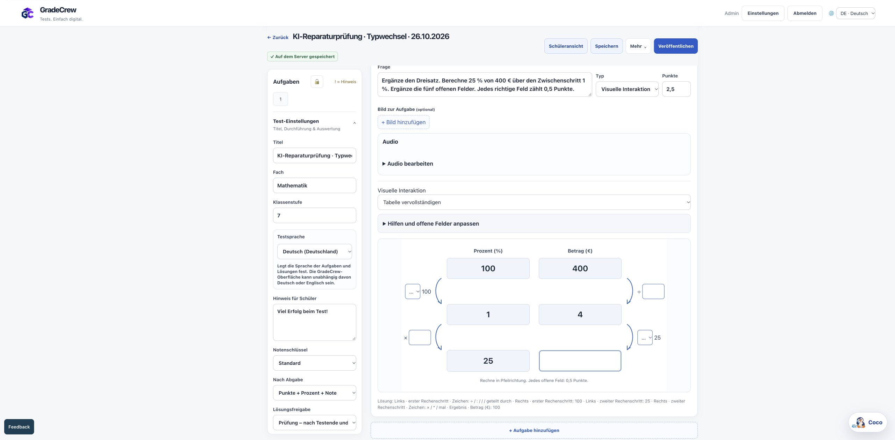

# Interaktive KI Aufgaben auf normalem Staging

Stand26.10.2026. Die Reparatur ist auf https://gradecrew-staging-2026.web.app/workspace.html veröffentlicht. Production bleibt unverändert. PR320/321 integrieren die Quellen; Hosting und sechs Assessmentfunktionen verwenden4fe345c16d5778a93b077af4e775e7d3addbdb9e, zwölf KI-Funktionen den identischen KI-Quellstand ausf391040d10c54b69af33ef67c923d3f4b9c9bcdc.

## Typ und Unterformat ändern

Beim Wechsel zu Visuelle Interaktion erscheint ein Dialog mit den acht vereinbarten Formaten und einem optionalen Inhaltswunsch. Erst „Mit KI anpassen“ startet die vorhandene echte KI. Kein Musterbeispiel wird als erzeugte Aufgabe eingesetzt. Dasselbe gilt beim Unterformatwechsel. Abbrechen, Fehler, doppelte Eingaben oder veraltete Antworten erhalten die bisherige Aufgabe. Die aktuelle ursprüngliche Fassung bleibt beim Zurückwechseln erhalten; Punkte bleiben gleich.

Im tatsächlichen Browser wurde „Berechne25%von400€“ in einen Dreisatz umgewandelt: vier unabhängige äußere Pfeile, fünf offene Zeichen-/Zahlenfelder, je0,5Punkte. Der Entwurf wurde auf dem Server gespeichert. Anschließend erzeugte derselbe Dialog eine passende Koordinatenaufgabe: Achsen0..100% und0..400€, Eingabeschritt1, private LösungP(25|100), unverändert2,5Punkte. Die Darstellung zeichnet nur grobe Hauptlinien, Eingaben bleiben genau.

Der Browser-PrüftestDAL2769M wurde während dieser Arbeit außerhalb einer hier protokollierten Veröffentlichungsaktion beendet, erneut veröffentlicht und auf Lehrkraftstart/1Minute gestellt. Die zweite Speicherung wurde bei nun aktivem Test mit permission-denied abgelehnt; die gespeicherte Dreisatzfassung bleibt erhalten. Diese Untersuchung hat den aktiven Test nicht beendet oder überschrieben. Die zweite KI-Fassung bleibt im lokalen Browserentwurf. Herkunft der parallelen Veröffentlichung ist unbekannt; keine Umgehung der Inhaltssperre.

## Echte größere Erstellungen

| Probe | Ergebnis | Dauer ungefähr | Interne Providerrequests | Reparaturversuche |
|---|---|---|---|---|
|20Aufgaben/60Punkte|8LXU3NB8,ready,20/60gespeichert|6Minuten18Sekunden|20|17|
|40Aufgaben/100Punkte|DHAXCRZP,ready,40/100gespeichert|14Minuten5Sekunden|42|36|

Beide nutzen vorhandene normale Staging-Endpunkte und das bereits eingerichtete synthetische Konto. Zwei logische Erstellungsaufträge, keine Wiederholung oder Doppelbeauftragung. Dazu zwei echte Typ-/Unterformatanfragen im Browser; deren interne Providerzahl wurde nicht separat ausgelesen. Die Nutzungsereignisse für die beiden großen Aufträge weisengpt-5.6-luna,273897und650958Tokens aus. Preise wurden nicht geschätzt. Beide nutzten zwei Qualitätsprüfungen, keine vollständige Neugenerierung. Frühere Lehrerbewertungen waren für dieses synthetische Konto nicht verfügbar; die entsprechende Prüfwarnung bleibt erhalten.

Alle60Aufgaben bestehen die geschlossene Datenprüfung; Anzahl und Punktesummen stimmen. Unabhängig geprüft: Prozentrechnungen, Rasteranteile, Zahlenstrahlwerte, Tabellen und Verbindungen.9plus28Dreisätze wurden zusätzlich mit unabhängiger Zahlenrechnung auf konstantes Verhältnis beziehungsweise konstantes Produkt geprüft; alle expliziten0,5Punkte-pro-Feld-Angaben stimmen. Der40er-Test enthält auch einen umgekehrten Dreisatz. Diese beiden Serien prüfen MathematikKlasse7; sie sind kein neuer fachübergreifender Nachweis und keine Freigabe aller denkbaren KI-Inhalte.

Die echte normale Serverauswertung des20er-Tests bestätigt60/60,59,5/60bei genau einem falschen Dreisatzfeld und0/60bei leerer Abgabe. Wiederaufnahme liefert unveränderte lösungsfreie Aufgaben; wiederholte Abgabe verändert keine Note. Der20er-Test wurde ausschließlich für diese synthetischen Prüfungen veröffentlicht; der40er bleibt Entwurf.

## Ursprüngliche Abbrüche

Fehlerreferenz0602eab7 gehört zu einem echten20Aufgaben/60Punkte-Auftrag, der in der Qualitätsprüfung mit einem unspezifischen Fehler endete. Der konkrete ursprüngliche Entwurf wurde nicht aufbewahrt; sein exakter Auslöser bleibt unbewiesen. Reproduziert und korrigiert wurde die Maskierung: ein ungültiger Reparaturentwurf wurde trotzdem in die Qualitätsprüfung projiziert und erzeugte dort einen allgemeinen Fehler. Strukturfehler bleiben jetzt konkret erhalten; technische Klassifizierung nennt begrenzt Fehlerstelle/Typ ohne Aufgabentext oder Antworten zu protokollieren.

Die zweite tatsächliche Erstellung mit40Aufgaben/100Punkten scheiterte in der Reparatur an Koordinatenrastern21–30. Gültige Prozent-/Preisachsen0..100/0..400mitSchritt1 wurden durch die ehemalige30-Intervalle-Grenze abgelehnt. Die reproduzierte Korrektur trennt Eingaberaster(bis10000Schritte, weiter begrenzt) von gezeichneten Hauptlinien(etwa20jeAchse). Nicht endliche oder nicht erreichbare Raster bleiben ungültig. Private Koordinaten und Toleranzen werden nicht verändert. Die genaue ursprüngliche fehlerhafte Aufgabenserie liegt nicht vor.

## Veröffentlichung und Erhalt anderer Arbeit

Ein frischer Abgleich erkannte die parallel veröffentlichte Klassenraumquellef1bee946 mit213Dateien. Die Reparatur verwendet diese tatsächliche Basis, erhält207Dateien exakt und verändert nurapp.js,workspace.htmlsFormatfeld,visual-tasks.mjs,visual/core.js,visual/renderers.js,visual/visual.css sowie die beiden neuen Moduledreisatz.mjsundvisual-format-choice.mjs. Alle215öffentlichenDateihashes der eigenen Veröffentlichung stimmen. Die spätere additive Klassenraumveröffentlichung wird inlater-hosting-verification.json separat abgeglichen. Alle acht Klassenraummodule, öffentliche Homepage, Login und/api/classroom/**-Route bleiben erhalten.

Auch die gerade reparierte persönliche Klassenraum-Abgabe bleibt erhalten: alle37Assessmentdateien der parallel veröffentlichten Quelle sind enthalten; nur die zwei absichtlich aktualisierten Visualverträge unterscheiden sich. Genau18vorhandeneFunktionen aktualisiert,62andereQuellhashes unverändert,80vorher/nachher,keinehinzugefügt/gelöscht. Keine Rules-,Auth-,Native- oder Productionänderung.

Automatische lokale Prüfung:569Web/UI und468Backendprüfungen grün, scopedESLint0. PR320:vierCI-Prüfungen erfolgreich; PR321:Node22-Prüfung erfolgreich. Unabhängiger Review: zweiP2-Funde zu Typversionen und Operationsaliasen behoben; erneute Prüfung der Klassenraumkomposition und Verpackung ohne offenen konkreten Blocker.

## Grenzen und nächster Schritt

Die große Erstellung funktioniert, benötigt aber noch viele automatische Korrekturen. Für die Präsentation größere Tests vorab erstellen. Reparaturzahl und Laufzeit zu senken bleibtP1, ohne fachliche oder technische Prüfungen abzuschalten. Noch offen: Martins fachliche Abnahme und physischer Touchgerätetest. Lernwirksamkeit wird aus diesen technischen Proben nicht abgeleitet.

Dauerhafte Regeln und Bedienung: docs/learning/INTERACTIVE_TASK_PRINCIPLES.md und docs/learning/REMY_INTERACTIVE_AUTHORING.md. Konkrete Belege: generation-20/40.json, gespeicherte Aufgaben,content-verification.json,server-verification.json,type-change.json,usage-verification.json,public-verification.json undfunctions-verification.json. Private Tokens und ursprüngliche Nutzer-/Jobdaten bleiben außerhalb des Repositories.
