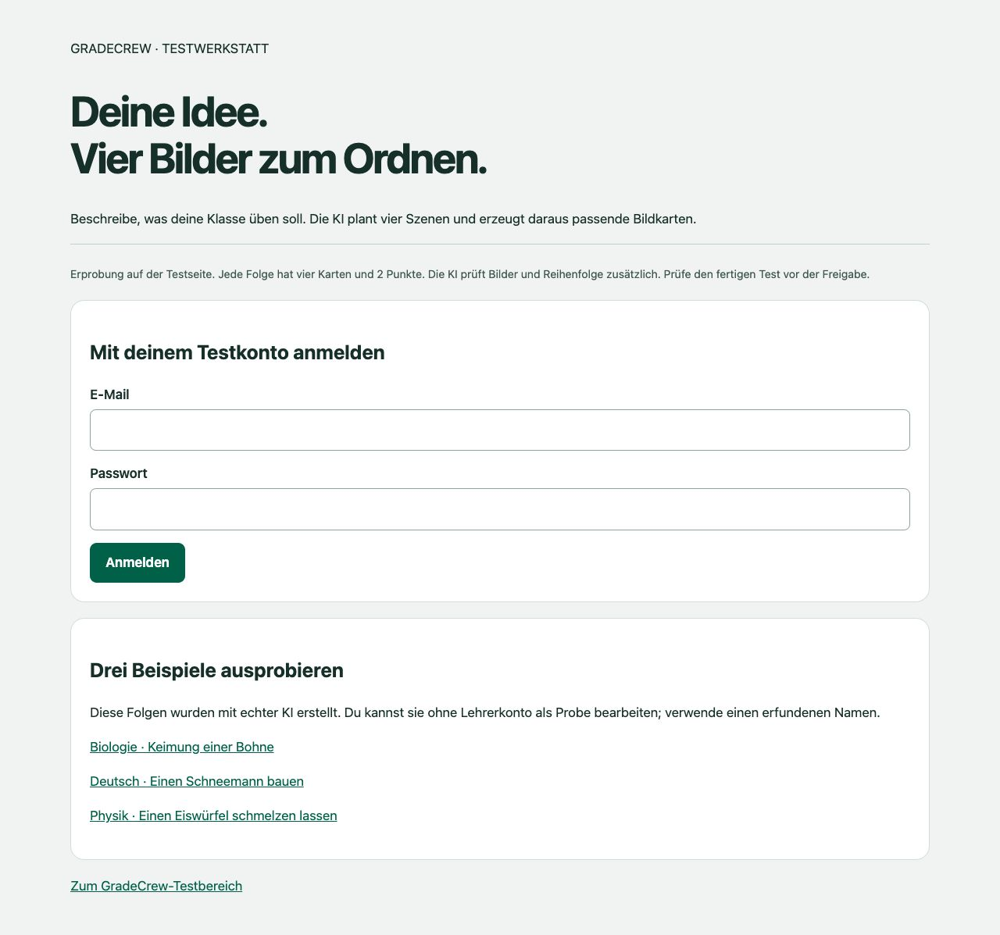
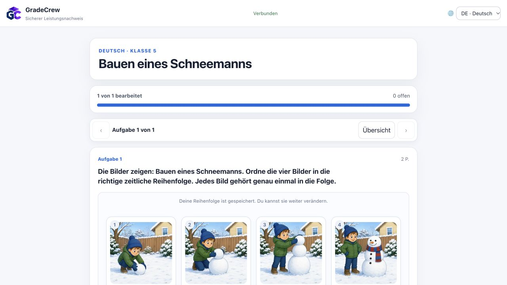

# Bildfolgen mit echter KI · Pilot vom28.10.2026

Task **GC-EXTENDED-QUESTION-TYPES-01**. Nur isolierter Hostingkanal **sequence28** und16eigene Functions in `gradecrew-staging-2026`. Normales Staging-Hosting, seine80bestehenden Functions, Regeln und Production wurden durch diesen Pilot nicht ersetzt.

## Direkt ausprobieren

[Eigene Bildfolge frei beschreiben](https://gradecrew-staging-2026--sequence28-hxbbyqtu.web.app/bildfolgen/). Mit vorhandenem freigegebenem Testkonto anmelden, Fach/Klasse und Wunsch eingeben. Es entstehen neue KI-Inhalte, keine fest hinterlegten Beispielbilder. Der gespeicherte Auftrag bleibt nach Neuladen erreichbar. „Auftrag erneut prüfen“ verwendet dieselbe Anfrage-ID, keine zweite logische Erstellung. Der fertige Entwurf erscheint auch im normalen Editor **dieser Pilotadresse**. Letzte Folge erneut öffnen oder nächste erstellen, ohne einen Test abschließen zu müssen.

Öffentliche synthetische Proben (vier Karten, je2Punkte; erfundenen Namen verwenden):

| Fach | Lernziel | Test |
|---|---|---|
| Biologie,6 | Keimung einer Bohne | [KPAWWW5Y](https://gradecrew-staging-2026--sequence28-hxbbyqtu.web.app/secure-student.html?test=KPAWWW5Y) |
| Deutsch,5 | Vorgangsbeschreibung: Schneemann bauen | [M56XGEZZ](https://gradecrew-staging-2026--sequence28-hxbbyqtu.web.app/secure-student.html?test=M56XGEZZ) |
| Physik,7 | Schmelzen eines Eiswürfels | [YA572A9R](https://gradecrew-staging-2026--sequence28-hxbbyqtu.web.app/secure-student.html?test=YA572A9R) |

Die Hosting-Vorschau ist zeitlich begrenzt; Ablauf und Quellstände stehen in den Deploybelegen. Keine Freigabe für echte Schülerdaten oder unverändert in Production.

## Was tatsächlich passiert

Die bestehende KI-Verbindung plant vier Szenen mit einem **fachlich notwendigen Zustand** je Karte. Ein2048×2048-Gesamtbild wird vor Kompression serverseitig in vier992×992-Ausschnitte geteilt und je Karte auf höchstens26.000Bytes WebP optimiert. Der Master bleibt nur im Serverspeicher. Vier getrennte Bilder, neutrale Zufalls-IDs, gemischte Reihenfolge und beschreibende Alttexte gehen in den öffentlichen Auftrag; der Schlüssel bleibt privat.

Zwei getrennte KI-Kontexte prüfen die tatsächlichen Ausschnitte: zuerst fachliche Vollständigkeit, Bilder, Titel, Auftrag und Bildbeschreibungen; dann Lösung der gemischten Folge ausschließlich aus Bildern, IDs und öffentlichem Auftrag. Letztere Prüfung erhält weder geplante Szenen, Bildbeschreibungen noch Lösung. Ein gleicher konfigurierter Anbieter wird verwendet, kein zusätzlicher Claude-Anbieter behauptet. Unbestätigte Zustände oder widersprüchliche Reihenfolgen verhindern `ready`.

v1.2 korrigiert Beschreibungen anhand sichtbarer Bilder, ohne dafür Bilder oder Schlüssel zu verändern. Nur beiläufige Unterschiede ohne Einfluss auf Lernziel/Reihenfolge dürfen so berichtigt werden. Fehlende fachlich notwendige Zustände bleiben Fehler. Korrigierte Beschreibungen durchlaufen zusätzlich geschlossene Feld-, Längen-, Markup- und Reihenfolgehinweisprüfungen. Private Ausschnitte des aktuellen Versuchs werden im berechtigten eigenen `aiJob.sequenceDraft` behalten; kein Master und keine neue öffentliche Assetablage.

## Echte Versuche und konkrete Verbesserungen

| Auftrag | Ergebnis | Job | Bildversuche | Dauer |
|---|---|---|---:|---:|
| BiologieA, echtes Wunschformular | bereit, KPAWWW5Y |417051f2f65bb434e6fb3770b05773f80de99401|1|72s|
| DeutschA | kontrolliert blockiert, d4bed299 |cc5c56b67975b3b1ad3725aee6b7b5702b34bc78|2|siehe Rohbeleg|
| PhysikA | bereit, YA572A9R |ccafc93d27b6c37dd68d5a5fc07c20e8464c92d9|2|143s|
| DeutschB | kontrolliert blockiert, ff1d94ea |f612d535626f13ff9dbe7dde5864dc2c9ed67946|1|siehe Rohbeleg|
| DeutschC, v1.2 | bereit, M56XGEZZ |0120ada4a48bb913f92a092d111cfd6c86a0e78e|1|106s|

A/B sind nicht aus der Historie gelöscht: DeutschA verlangte eine vom Modell ergänzte Gartenhütte, obwohl sie für den Auftrag unerheblich war. Andere Ablehnungen betrafen Augen/Arme, die vom geplanten Beschreibungstext abwichen; die Blindlösung blieb richtig. Daraus entstanden `requiredState` und die gezielte Korrektur tatsächlich sichtbarer Beschreibungen. Physik erforderte unter anderem die klare Prozessrichtung Schmelzen und ein eindeutiges Einzelobjekt. Fehlende/unklare Bilder werden nicht durch eine bloße Textbeschreibung ersetzt.

Das anfangs selbst gesetzte Pilotbudget wurde nach konkreten Befunden begründet erweitert: **drei Fachszenarien, fünf logische Aufträge, sieben Bildaufrufe**, nicht fünf erfolgreiche Tests. Erfolgreich ausgegebene Karten:12. Insgesamt erzeugte Ausschnitte:28. Die alten A/B-Bildbytes waren vom alten Worker nicht behalten worden und konnten deshalb nicht wiederverwendet werden; v1.2 behebt das für weitere Erprobung. Kein achter Bildaufruf und kein unbekannter Providerstart blind wiederholt.

Die geschützten eigenen Nutzungsbelege ergeben **19strukturierte KI-Antworten und70.522aufgezeichnete Tokens**; Geldbetrag unbekannt. Bild-Provider-Request-IDs wurden vom ersten Wrapper nicht separat erhalten, logische IDs, Bildnutzung und Master-Prüfsummen dagegen schon. `usage.json` weist diese Grenze aus. Benutzerzugriff auf private Nutzungsereignisse blieb korrekt403; Auswertung über vorhandenen berechtigten Projektzugang, ohne Rechteänderung. Die historische117-Antworten-/Vierjob-Serie zur Rezeptauswahl bleibt separat.

## Verifikation

- **369Backendtests**, **136Assessmenttests**, **15visuelle Tests** grün; zehn gezielte Bildfolgenfälle enthalten echte RED→GREEN-Schritte. Keine Summe über überlappende Suiten bilden.
- Ein unabhängiger Gesamtprüfer fand konkrete Probleme vor und während der Arbeit: fehlende Speichermetadaten, Dispatch-Wiederaufnahme, ungeeignete synchrone Regeneration, überlanger Kontext, verlorene Zuordnungs-IDs, unkontrollierte Titel/Beschreibungen und wiederholte Rendererhandler. Nachgebessert; letzte Quellenprüfung ohne neuen wesentlichen Antwort-/Datenschutzblocker,10/10gezielte Tests bestanden. Das ist keine allgemeine Produktzertifizierung.
- **Zwölf echte serverseitige Bewertungsfälle**: pro Fach richtig2/2, zwei Positionen vertauscht1/2, umgekehrt0/2, leer0/2. Jeweils öffentliches Paper ohne Schlüssel/Master, Wiederaufnahme und identische Quittung bei erneuter Abgabe. Beleg: `server-verification.json`.
- Reales Browserformular erzeugte Biologie, Neuladen während des Jobs setzte ihn fort. Normaler Editor lud die neuen Bilder; echte Auftragsänderung gespeichert, Bildbytes und Lösung unverändert serverseitig bestätigt.
- Browserprüfung fand fehlende Containerklasse und sichtbaren verborgenen Wiederaufnahmebutton; korrigiert. Vier Karten stehen auf breitem Bildschirm nebeneinander, auf schmalem Bildschirm zweispaltig. Maus-/Tastenbedienung im Browser geprüft; physischer Touch-/Lehrertest bleibt offen.
- Selektiver Deploy: zuerst16neue eigene Endpunkte, danach nur betroffene eigene Erstellungsendpunkte. Bestehende80Quellen beim ersten Vorher-/Nachhervergleich identisch. Endgültige Quellen-/Hostingprüfsummen siehe `deployment-final.json`.

## Grenzen und nächster Schritt

Nur die Pilotadresse unterstützt `generated-four`; nicht über die kanonische Test- oder Schuladresse öffnen. Neue Bilderfolge im freien Pilotformular erzeugen, danach im bestehenden Editor bearbeiten. Synchrone KI-Neuerzeugung einer gespeicherten Bildfolge wurde bewusst gesperrt, damit ein kurzer Anfrage-Timeout kein kostenpflichtiges Ergebnis verliert. Umwandlung in andere unterstützte Formate bleibt über den bereinigten semantischen Kontext möglich. Der Standardkatalog der acht aktiven Formate wurde nicht stillschweigend erweitert.

Qualifiziert sind zunächst **vier Karten und klar gerichtete lineare Abläufe**. Beliebig viele Karten, mehrere akzeptierte Kreisfolgen, gemischte automatische Bildfolgenauswahl, zusätzliche Bildanbieter und flächige Lehrerfreigabe sind nicht durch diesen Pilot bewiesen. Beschreibungen und Bildreihenfolgen brauchen weiterhin Lehrerprüfung. Drei gelungene Beispiele begründen weder99%Zuverlässigkeit noch eine Unterrichtswirkung oder Geräteabnahme.

Nächster Schritt: Martin beschreibt auf der Pilotseite einen eigenen fachlichen Wunsch und prüft Darstellung, Lernziel und Lösung. Danach begrenzte weitere Fach-/Geräteproben, bevor eine Integration in normales Staging überhaupt entschieden wird. Kein Production-Rollout.

## Gesicherter Abschluss nach Präsentationsunterbrechung

Die vollständige Übersicht wurde separat als Hostingstand a8187beb8cba6a120e7a3addd6534eac28cd0f4d veröffentlicht; Backend bleibt207dbc64d2045e11ede8fa42281d7c4adf965d0d(v1.2). Alle Dateien der Vorschau wurden gegen den Releasebeleg geprüft (deployment-final.json). Browser zeigt alle drei öffentlichen Probelinks und das vorhandene Testkonto-Login; browser-overview.png hält den Stand fest. Die zusätzliche Schüler-UI-Abgabe vor Unterbrechung hat keinen gesicherten sichtbaren Receiptnachweis und wird nicht zu den zwölf bestandenen Serverfällen hinzugerechnet. Kein Wiederholungsstart und keine weitere bezahlte KI-Erzeugung nach Wiederaufnahme.

