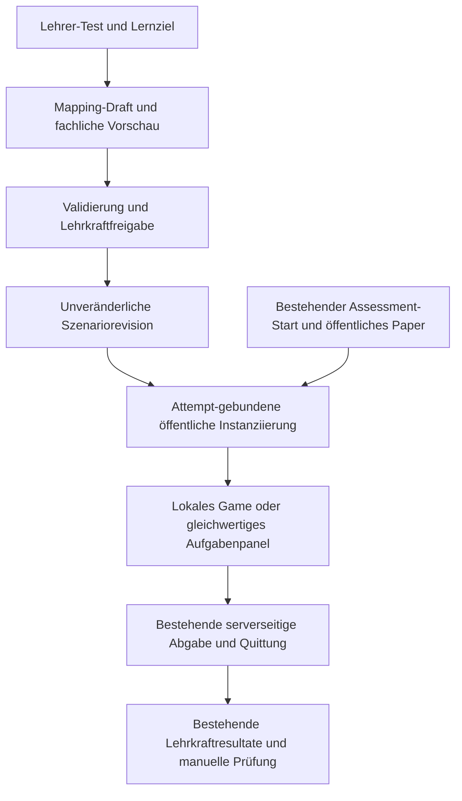

# Adaptive Lerninsel aus Lehrer-Tests: Machbarkeit und Umsetzungsplan

Stand 13.10.2026 · GC-GAMES-LERNINSEL-ADAPTIVE-PLAN-20261013 · ausschließlich Planung. [Kurzfassung](kurzfassung.md), [Mappingmatrix](mappingmatrix.md), [Kosten und Last](kosten-last.md), [Quellen und Codebelege](quellen-codebelege.md), [Aufgabenübergabe](../../../../workstreams/lerninsel-adaptive-plan-20261013.md).

## 1. Antwort und empfohlene Richtung

**Ja, fachübergreifende Anpassung ist grundsätzlich machbar.** Ein Lehrer-Test sollte dabei ein Szenario aus einer geprüften Bibliothek konfigurieren. Die vorhandene 3D-Welt, Figuren, Tore und Interaktionskerne werden wiederverwendet; Aufgaben, Wortmaterial, Einheiten, Reihenfolge und passende Routen unterscheiden sich als Daten. Nicht jedes neue Quiz benötigt neue 3D-Modelle, generierten Code oder einen Enginebuild.

Das ist ein eigener Produktadapter mit nennenswertem Anfangsaufwand. Es ist weder ein kleiner Textaustausch noch ein bereits vorhandenes Feature. Die schwierigen Teile sind fachlich passende Übersetzung, unveränderte Bewertung, zuverlässige Wiederaufnahme, sichere Datenprojektion und Bedienbarkeit auf den verbindlichen Zielgeräten. Günstiger laufender Datentransfer allein macht diese Arbeit nicht trivial.

Empfehlung als **Vorschlag, noch keine Produktentscheidung Martins**: zuerst ein ausdrücklich freigegebenes Übungs-MVP mit Deutsch und Mathematik, vier Mechaniken und einer begrenzten Welt. Freie AI-3D-/Codegeneration bleibt ein getrenntes Forschungsvorhaben. Benotete Prüfungen kommen erst nach gesonderter Integritäts- und Fairnessprüfung hinzu. Eine ungeeignete Frage bleibt im normalen Aufgabenpanel; die Welt zwingt kein Rätsel auf.

## 2. Belegter Ausgangsstand und klare Grenzen

Frisch gelesener App-Integrationsstand ist `44ab6540a9ac0cd4a144dd25eb84a7198d22498b` auf `feature/gradecrew-app-integration`; Koordinationsbasis `main@a0f16f9cf64c74dcdacefa489d2e7a1da1b58881`. Die aktuelle Assessment-Exportoberfläche liegt in `assessment-functions/main.js` und lädt `lib/secure-lifecycle` plus `lib/cleanup`. Die daneben liegenden älteren `index.js`/`secure-submit.js` sind **nicht** die maßgebliche Exportoberfläche dieses Stands.

Der Kern kennt elf Aufgabentypen. Er erstellt ein öffentliches Attempt-Paper mit undurchsichtigen Antwort-/Item-IDs und getrenntem privaten `gradingKey`. Zahlaufgaben liefern öffentlich die Einheit, nicht `numericAnswer` oder Toleranz; Reihenfolgen liefern gemischte Items, nicht `acceptedOrders`; Wortmarkierung liefert den Passagekontext, nicht Zielwörter. Abgabe bewertet der Server; Wiederholungsabgaben desselben Attempts liefern die bestehende Quittung. Diese Basis ist wiederverwendbar. Sie ersetzt keinen noch zu bauenden nativen Adapter. [Exakte Codebelege](quellen-codebelege.md#bestehender-assessment-code).

Die Lerninsel ist heute ein nativer Unreal-Prototyp, kein bestätigter Browserexport und kein fertiges Klassenprodukt. PR175/219/220 und deren ältere Task-/Budgethistorie bleiben eigenständig. Der Level1-Stand `ee994cbc8e61134d3daa72dd46f1a589205ec6a5` enthält lokale Lernregeln und eigene Saves. In `Core/IslandRules.h` sind unter anderem das korrekte Verbmaskenmuster und die 3/10-Liter-Prüfung im Client ablesbar. Das ist für den bestehenden lokalen Lernprototyp eine nachvollziehbare Bauweise, für geheim zu bewertende Lehrer-Tests aber keine sichere unveränderte Bewertungsarchitektur.

Die Regeln schützen aktive Prüfungsinhalte; beim Resume prüft `contractForQuestions` den Authoring-Fingerprint. Heute wird das Paper aus bestehenden Fragen und privatem Papersecret rekonstruiert. `secureAssessmentVersion: 2` bezeichnet dabei den Assessmentvertrag und ist **kein bereits implementiertes Szenariorevisionssystem**. Das unten vorgeschlagene unveränderliche Szenariopublish muss diese bestehende Prüfung ergänzen, nicht als schon vorhanden dargestellt werden.

Verwandte Arbeit wird verknüpft: PR185/GC-GAMES-PIPELINE-01 ist eine gemeinsame Games-Grundlagen-/Entwicklermodus-Skizze, kein belegter nativer Feedbackadapter. PR218/GC-PEDAGOGY-KB-01 enthält einen begrenzten geprüften Aufgabenprofilpool, ist offen und nicht allein durch sein Vorhandensein im Produkt aktiv. PR228 betrifft Generatorhinweise. PR229 merkt eine spätere ausdrückliche Übungs-Lösungsfreigabe nach eigener Abgabe vor und enthält ausschließlich Kommentare. Keine dieser Arbeiten wird hier dupliziert oder still als umgesetzt behandelt. ET bleibt die bestehende Entwicklungs-/Feedbackzuständigkeit, kein neuer öffentlicher Ausführungsserver für Schüler.

## 3. Drei Bedeutungen von „automatisch ändern“

1. **Automatische Inhaltsparametrisierung:** vorhandene Fragen, Antworten und Kontexte werden in passende freigegebene Vorlagen eingesetzt. Ein Compiler prüft Typ, Maße, Länge und Medien. Das ist der empfohlene Normalfall; oft ohne neue KI-Anfrage möglich.
2. **Begrenzte Weltvariation:** erlaubte Inselmodule werden anders angeordnet, Dekoration und Routen aus geprüften Varianten gewählt. Der Generator arbeitet nur innerhalb einer geprüften Grammatik, mit bekannten Anschlussstellen, maximaler Objektanzahl und einer alternativen direkten Aufgabenansicht. Kollision, Erreichbarkeit und sinnvolle Abfolge müssen geprüft werden. Das ist mehr Aufwand als bloße Texte, aber beherrschbar.
3. **Freie AI-3D-/Codegeneration:** neue Modelle, Navigation, Interaktionslogik und vielleicht Scripts entstehen pro Lehrer-Test. Dann sind Lizenz, Geometrie, Rig, Kollision, Performance, Lösungskorrektheit und Sicherheit jedes Kandidaten neu zu qualifizieren. Eine schöne Vorschau ist kein spielbarer Build. Schülergeräte laden niemals ungeprüften generierten ausführbaren Code.

„Im Hintergrund“ bedeutet einen begrenzten Draft-Job nach ausdrücklicher Lehreraktion: Status, Abbruch, Fehler, Versionsbindung, deduplizierte Wiederholung und Budgetgrenze. Es bedeutet keine endlose Weltproduktion und kein AI-Call pro Schülerframe. AI kann Mapping oder verständliche neutrale Einbettung vorschlagen; fachliche Entscheidung und Publish bleiben kontrolliert. Das bestehende Generator-/Routing-/Pool-System wird nach seiner tatsächlichen Integration genutzt, nicht mit einem zweiten Providerframework nachgebaut.

## 4. Fachunabhängige Kerne, fachliche Zulassung

Eine Interaktion wie Auswählen, Messen, Zuordnen oder Ordnen ist fachunabhängig. Die **Bedeutung der Aufgabe** ist es nicht. Ein identisches UI-Schema rechtfertigt daher noch kein fachlich identisches Rätsel. Der Mapper berücksichtigt Typ, Lernziel, erwarteten Antwortumfang, Sprache, Einheiten, Medien, Jahrgang, Hilfen und Bewertung. Bei unbekannten Angaben fragt die Vorschau die Lehrkraft oder bietet ein neutrales Panel; sie setzt keine aus Defaults abgeleitete fachliche Freigabe.

Beispiele:

- Mathematik: „Fülle 3/10 eines 1-Liter-Messbechers“ kann eine Messstation parametrisieren. Die Darstellung nennt dasselbe Ganze, klare Zehntelskala und zulässige Messschritte. Als Antwort kann der Adapter bei der veröffentlichten Einheit Liter `0,3` erzeugen. Handelt die Ausgangsfrage von einer Umrechnung in Milliliter, darf er nicht ungeprüft eine andere Einheit und damit eine andere Aufgabe senden. Ein Modell darf keine Vergleichsantwort auf die Schülerseite schreiben.
- Deutsch: Verben werden **in ihren Sätzen** markiert; „Laufen“ kann im Kontext ein Nomen sein. Wörter ohne Satz dürfen nicht automatisch nach einer Wortliste als Verben benotet werden. Verbsteine können Mehrfachwahl/Wortmarkierung ausdrücken, wenn der Kontext sichtbar bleibt. Die Artikel-Satzfolge übernimmt eine veröffentlichte Reihenfolgeaufgabe samt zulässigen Alternativen auf dem Server; natürliche Sprache hat häufig mehrere richtige Reihenfolgen.
- Sachfach: Bilder von Blatt, Blüte und Frucht lassen sich passenden Begriffen zuordnen. Ein Pflanzenmerkmal kann von Jahreszeit oder Entwicklungszustand abhängen. Der Zustand muss benannt und das Bild fachlich geprüft sein. Geschichte mit kontroverser Begründung bleibt Freitext und manuell bewertet; ein einzelnes Türsymbol kann keine Argumentationsrubric ersetzen.
- Fremdsprache: Wort-Bild- oder Wort-Audio-Zuordnung ist möglich. Hörverstehen darf nicht durch sichtbaren Hörtext ersetzt werden. Ausspracheprüfung benötigt einen eigenen späteren Vertrag und bleibt außerhalb des MVP; Tastaturantwort ist kein Nachweis gesprochener Sprachkompetenz.

[Die Matrix](mappingmatrix.md) erklärt alle elf vorhandenen Typen, fachliche Grenzen, Antwortabbildung und Fallback. Vollständige Typabdeckung ist nicht gleichbedeutend mit vollständiger curricularer Abdeckung.

## 5. Zielarchitektur und Datenzuständigkeiten

**Welt-/Assetpaket:** ausführbarer geprüfter Runtimecode, Geometrie, Materialien, generische Figuren, UI und Mechanikbibliothek. Ein Paketupdate erfolgt bei neuen Mechaniken/Assets oder Fehlerkorrekturen; ein Lehrer-Test wählt daraus Daten. Eine feste Renderer-Assetversion bekommt einen eigenen Cachekey.

**Szenariodefinition (neuer Vorschlag):** Testbezug, fachlich freigegebene Vorlagenzuordnung, Dauerziel, Inhalts-/Mapperversion, erlaubte Layoutvariation, Barrierefreiheitsprofil, Medienreferenzen und Policy. Sie enthält keine Schüleridentität und keine öffentlichen Lösungsschlüssel. Die veröffentlichte Definition ist unveränderlich; Änderungen erzeugen eine neue Revision und bestätigen erneut betroffene Einstellungen.

**Attempt-Manifest (neuer Vorschlag):** wird erst mit dem echten öffentlichen Paper eines gestarteten Attempts instanziiert. Es bindet `quizId`, `sessionRunId`, `attemptId`, Szenariorevision, Runtime-/Mapperversion, Paperbindung und dauerhaft gewählte Layoutvariante. Antwortoptionen übernehmen genau die für diesen Attempt erzeugten IDs. Eine Lehrervorschau vor dem Start benutzt separate Vorschau-IDs; deren IDs werden nie als Schülerantworten wiederverwendet.

**Privater Bewertungsbereich:** bestehender Schlüssel, Decoder und Lehrkraftfreigaben. Ein Client bekommt weder Korrektindizes noch Rubriclösung, Zielwörter, akzeptierte Reihenfolgen, geheime Toleranzen oder Regeln der Form „dieses Item öffnet das Tor“. Auch Objektname, Position, Farbe, Animationstrigger oder versteckte Meshgruppe dürfen nicht unabsichtlich die Lösung kodieren.

**UI-Zustand:** Auswahl, aktuelle Station und notwendige lokale Wiederaufnahme. **Fachliche Antwort:** kanonische Antwort pro `questionId`. **Autoritative Bewertung:** ausschließlich Server. **Entwicklungsfeedback:** separater bestehender ET-/Debugpfad, kein Bestandteil des Schüler-Antwortkanals. Diese vier Begriffe bleiben in Code und Lehreroberfläche getrennt.

Die illustrative Datei [manifest-vorschlag.json](manifest-vorschlag.json) ist kein implementiertes API-/Schema und keine Migration. Sie enthält bewusst nur eine Vorlagendefinition, keine echten Attemptdaten. Die konkreten neuen Speicherpfade und Endpunkte werden erst bei einem Folgeauftrag gegen bestehende Owner-/Rulesverträge festgelegt.

### Server-/Clientgrenze und Validierung

Ein serverseitiger Validator lehnt unbekannte Typen, zu lange Texte, fremde Frage-IDs, unzulässige Medien, unpassende Versionen und Lösungsschlüssel in der öffentlichen Projektion ab. Layoutdaten wählen erlaubte Modul-IDs und geprüfte Parameterbereiche, keine frei benannten Scripts/Blueprints oder beliebige Netzwerk-URLs. Medienrechte und Herkunft bleiben nachvollziehbar. Native Clients rendern nur bekannte Vorlagen und erhalten eine verständliche Fallbackdarstellung, wenn die Runtime eine Vorlage noch nicht unterstützt.

Hash oder Signatur sichern Herkunft und Versionsbindung, machen den Client aber nicht vertrauenswürdig. Eine manipulierte lokale Physik, ein gefälschter Torstatus oder ein übersprungener Weg kann keine autoritativen Punkte erzeugen. Server prüft Attempt, Token, Run, Frist und Antworten wie im bestehenden Assessmentvertrag. Die Manifestbindung muss zusätzlich gegen Austausch von Test-/Attemptvarianten schützen.

## 6. Vollständiger Teacherflow

| Schritt | Zielverhalten | Vorhanden / vorgeschlagen |
| --- | --- | --- |
| 1. Test auswählen | bestehendes Quiz, Fragen, Punkte und Rubric bleiben fachliche Quelle | bestehender Testeditor; Lerninsel-Auswahl neu |
| 2. Zweck, Ziel, Dauer | ausdrücklich Übung oder Prüfung; gewünschte Dauer plus Zielgeräte; keine Umdeutung aus `resultMode=none` | neuer Zweckvertrag erforderlich |
| 3. Mappingvorschau | je Frage: gewählte Mechanik, fachlicher Grund, Hilfen, Antwortformat, nicht darstellbare Teile und Fallback; Lehrer kann ändern | neu |
| 4. Fachlich freigeben | Auswahl-/Hör-/Kontextinformationen prüfen; AI-Draft nie ungeprüft veröffentlichen | neu, vorhandene Lehrerberechtigungen erhalten |
| 5. Unveränderlich publishen | Revision, Runtimekompatibilität, Hilfen-/Bewertungs-/Lösungspolicy bestätigen; bestehender aktiver Test bleibt geschützt | Szenariopublish neu |
| 6. QR oder Code teilen | bestehender Testbezug plus Szenariorevision, keine Tokens im QR; installierte native App bzw. noch festzulegender Browserweg | Game-Link/Deep-Link neu, bestehende Zugangslogik verknüpfen |
| 7. Attempt starten | gültiger Startvertrag; bei Lehrerstart zunächst `ready`, Paper erst bei `running` | bestehende Callable verwenden |
| 8. Lokal spielen | Bewegung/Stationen lokal, canonical answers sammeln, direktes gleichwertiges Panel jederzeit erreichbar | nativer Adapter neu |
| 9. Abgeben | serverseitige Frist und gleiche Bewertungsregeln, wiederholbare Quittung, keine clientseitigen Scoreclaims | bestehender Submit, Adapter neu |
| 10. Lehrerresultate | bestehende decodierte Antworten, Reviewstatus und manuelle Bewertung; zusätzlich höchstens nötige Szenariorevision | vorhandene Resultate, minimales Zusatzschema vorgeschlagen |

Ein QR-Link beweist weder eine installierte App noch einen Webport. Ein neuer Quizcode allein ersetzt nicht den lokalen hochentropischen Attempttoken. Native Aufrufe müssen den tatsächlichen Callable-Protokoll-/Authentifizierungsvertrag implementieren; `secure-assessment-client.js` lässt sich nicht einfach als Firebase-JS-SDK in C++ importieren. Auth/App-Check-Konzept für native Clients bleibt vor Umsetzung zu qualifizieren. Am geprüften Source ist `enforceAppCheck: false`; daraus wird keine bereits aktive App-Check-Sperre erfunden.

## 7. Start, Abgabe, Resume und Versionsbindung

Der bestehende Start nimmt `quizId`, `studentName`, `clientAttemptId` und `attemptToken`. Die Serverableitung bindet den Attempt an die Laufgeneration; gleiche Startkennung mit gleichem Token/Kürzel darf keinen zweiten Versuch anlegen. Rückgabe enthält Status, Run, serverseitige Zeiten und bei laufendem Versuch das öffentliche `paper`.

Der Adapter speichert lokal geschützt Attemptkennung, Token, Szenariorevision, Itembindung und notwendige Antworten. Keine Tokens in QR, Logs, Telemetrie oder Clips. Bestehende normale Level1-Saves werden nicht wiederverwendet: Szenario-/Attemptzustände benötigen eine eigene Namespace-/Versionsmigration. Die Szene kann wiederhergestellt werden, ohne eine beantwortete Aufgabe zu löschen oder eine falsche Antwort als richtig zu markieren. Der räumliche Wiedereinstieg liegt auf einem sicheren erlaubten Boden; die fachliche Auswahl bleibt erhalten.

Resume prüft den bestehenden Serverzustand und denselben Run. Ein `stateOnly`-Check ersetzt kein dauerhaftes Live-Tracking jedes Frames. Für einen freigegebenen Szenarioadapter wird die Layoutvariante beim ersten Start festgeschrieben; Rekonstruktion nach Resume darf die Items nicht anders auf Optionen abbilden. Offene Antworten werden nur in ihrem erlaubten Format gespeichert. Die heutige persistente Servercheckpointfunktion für einzelne laufende Antworten ist hier **nicht nachgewiesen**: cloudübergreifendes Draft-Resume wäre ein gesonderter neuer Vertrag. Das vorhandene Resume und lokale Antwortpersistenz werden nicht zu dieser Funktion umgedeutet.

Abgabe sendet wie bisher `{quizId, attemptId, attemptToken, answers, autoSubmitted}`. Sie sendet keine Punktesumme als Wahrheit. `answers` nutzt ausschließlich die IDs des öffentlichen Papers, die Originaleinheit und die vorhandenen Formate. Beispiel: `ordering` als ID-Liste; `matching` als Links-ID→Rechts-ID; `gapfill` als positionsgebundene Liste, weil der aktuelle Sanitizer diese Form erwartet, selbst wenn intern IDs der Lücken vorhanden sind. Der Server decodiert Lehrerantworten und bewertet, bei manuellen Teilen bleibt die Note zunächst offen. Eine verlorene HTTP-Antwort nach erfolgreicher Transaktion ist kein Anlass für neue Attempt-ID oder zweite Abgabe.

Eine veröffentlichte Revision darf nicht heimlich den Inhalt eines laufenden Attempts ändern. Der bestehende Fingerprint macht Veränderungen bereits zu einem Fehler; das Ziel ist zusätzlich ein belastbarer revisionsgebundener Snapshot für Szenario und Bewertungsgrundlage. Nachträgliche Lehreränderungen gelten für neue freigegebene Revisionen. Lösungsfreigabe bezieht sich auf die private passende Attemptrevision, nicht auf später geänderte Quizfragen. Keine eigene neue Punktelogik oder Rubric parallel zum bestehenden Assessmentkern.

## 8. Übung und Prüfung sind verschiedene Produkteigenschaften

### Übung

Nach ausdrücklicher freigegebener Trainingspolicy können zeitnahes Feedback, erneutes Probieren, Hilfe und begründete Lösungshinweise sinnvoll sein. Bewegungszeit, Kollision oder Motorikfehler werden nicht benotet. Wiederholte Lernantworten werden nachvollziehbar als Übungsversuche behandelt, nicht als versteckte Änderung einer summativen Erstabgabe. Eine spätere neue Feedbackoberfläche darf nur im qualifizierten Übungsscope auf serverseitige Lernregeln zugreifen; der öffentliche Manifestpayload bleibt schlüsselfrei.

Für völlig offline arbeitende Übung mit sofortiger Richtigkeitsprüfung müssten korrekte Regeln lokal sein oder ableitbar werden. Dann ist die Lösung aus dem Paket extrahierbar. Das lässt sich nicht mit Verschleierung oder Signatur wegargumentieren. Zwei ehrliche Varianten: online begrenztes Übungsfeedback über einen neu zu qualifizierenden privaten Vertrag, oder ausdrücklich separate, nicht summativ nutzbare Offlineübungsinhalte. Der aktuelle Auftrag empfiehlt die erste Variante; er implementiert sie nicht.

### Summative Prüfung

Richtigkeitsabhängige Tore, unbegrenztes „noch falsch“-Feedback und lokale Lösungssondierung unterlaufen die Prüfungsintegrität auch ohne offene `correctAnswer`-Felder. Ein manipulierter Client kann alle Varianten ausprobieren; ein Serverpunktestand verhindert nicht den Antwortverrat durch Feedback. Deshalb: ein Tor darf nach bestätigter Antwortabgabe öffnen, unabhängig von richtig/falsch, oder nur neutrale Navigation steuern. Kein Korrektheitsfeedback vor dem ausdrücklich erlaubten Zeitpunkt. Die Aufgabe bleibt änderbar nur nach veröffentlichter Prüfungsregel; Hilfen, Punkte und Zeitlimit sind bei Start eingefroren.

Normale Selbststart-/Lehrerstartmodi und Ergebnisanzeige bestimmen keine Übungserlaubnis. Der heutige Receiptweg hält Lösungen bis zum Testende und seiner Freigabebedingung zurück. PR229 ist ein Vermerk zu einer künftigen Übungsfreigabe nach eigener Abgabe, nicht die Genehmigung beliebig früher Einzelantwortfeedbacks. Diese Policies müssen beim vorhandenen Assessmentowner zusammen qualifiziert werden.

**Stop für benotete Freigabe:** jede Lösung im Schülerbundle, eine ausnutzbare Korrektheitssondierung, unterschiedliche Punkte/Rubrics zwischen Panel und Game, oder die Benotung von Bewegungsgeschick. Dann bleibt der betroffene Prüfungsmodus gesperrt, nicht die unabhängige Dokumentation oder ein ausdrücklich getrennter Übungsentwurf.

## 9. Accessibility und Lernqualität als eigenes Gate

Eine dauernd begehbare 3D-Welt ist kein Ersatz für direkte Bedienung. Jede fachliche Handlung braucht eine gleichwertige Alternative: Auswahl per fokussierbarer Liste, Zahleneingabe neben dem Messbecher, Ordnen per Tastatur statt Sprung-/Balanceanforderung, wiederholbares Audio soweit die veröffentlichte Aufgabe es erlaubt. Farbe wird durch Text/Symbol ergänzt, Reduced Motion und sichtbarer Fokus gelten auch nativ. Maus, Touch und Tastatur benötigen echte Geräteprüfungen. Ein Motorik- oder Sehproblem darf keine falsche Fachantwort erzwingen.

Fachliche Abnahme prüft Kontexttreue, Distraktoren, mehrere richtige Sprachlösungen, Maße und die unveränderte Kompetenz. Lernwirkung wird gesondert untersucht: Verstehen Kinder, welche Aussage sie abgeben? Wird die Handlung begründet oder nur erraten? Kann eine passende neutrale Aufgabe nach dem Spiel selbstständig gelöst werden? Motivation allein ist kein Lernnachweis. Für ein späteres Pilotdesign: kleiner Vor-/Nachtransfer, qualitative Beobachtung und gleiche Lernzeit im Vergleich zu einer neutralen Aufgabenansicht; vorab definierte Kriterien, keine behauptete Studie oder automatische Note aus Verweildauer.

## 10. Plattformentscheidung bleibt eigenständig

Native Unreal nutzt den vorhandenen Code und vorhandene Szene. Ein Schulrollout braucht trotzdem signierte/paketierte Runtime, Verteilung, Updates, Geräterecht und Performanceprüfung; heutige `.command`-Editorstarter sind kein Schulinstallationspaket. Das illustrative 50–150MB-Budget ist insbesondere **keine gemessene Größe des UE-Prototyps**.

Die aktuelle Epic-Packaging-Dokumentation nennt Desktop- und Mobilziele einschließlich iPadOS. Sie belegt keinen offiziellen aktuellen UE5-HTML5-Export; ein alter HTML5-Satz in der Pixel-Streaming-Übersicht ist dafür kein belastbarer Exportnachweis. Ein Webport, etwa mit einer geeigneten WebGL-/WebGPU-Runtime, benötigt eine eigene Bewertung von Grafik, Touch, Accessibility und Assetbudgets. Ein alternatives Enginepaket für Web ist ebenfalls eine eigene Qualifizierung, keine Dropdownkonvertierung der vorhandenen C++-Welt. [Epic-Quellen](quellen-codebelege.md#primärquellen-plattform).

Pixel Streaming hält Rendering und Spielzustand auf GPU-Hosts. Es kann einen kleinen Browserclient ermöglichen, benötigt aber unabhängige Spielinstanzen/Kapazitätsplanung, Sessionisolation, Signaling und gegebenenfalls TURN. Viele Zuschauer desselben Streams sind keine 1.000 unabhängig steuernden Schüler. Eine SFU löst nicht das Rendern unabhängiger Welten. [Lastrechnung](kosten-last.md#pixel-streaming-ist-ein-anderes-kostenmodell).

**Bekannte Produktvorgabe Martins: Browser/Webpage zuerst, iPad später.** Offen ist der technische Runtime-/Portweg, nicht dieser Webwunsch. Vor großer Produktintegration braucht es einen ausdrücklich beauftragten kleinen repräsentativen Browser-/iPad-Machbarkeitsbeleg für Grafik, Touch, Transfer und RAM. Unreal darf einen dünnen Referenz-/Datenadapterbeleg liefern, ist aber nicht automatisch die primäre Produktlaufzeit. Daten-/Bewertungsvertrag bleiben plattformneutral, damit kein zweiter vollständiger Adapter entsteht. Heute kein Probehost, Enginewechsel oder Runtimeversuch.

## 11. Gleich bewertete Ansätze, keine Abnahmezahlen

Skala 1–10, höher ist günstiger. Vier gleich gewichtete Kriterien: Zieltreue zum fachlich anpassbaren Test, erwartete laufende Kostenkontrolle, qualifizierbare Lern-/Spielqualität, Wartbarkeit. Die Zahlen sind nachvollziehbare Planungseinschätzungen mit Unsicherheit von etwa ±2 Punkten, keine gemessene Qualität.

| Ansatz | Zieltreue | Kostenkontrolle | Qualität qualifizierbar | Wartung | Mittel |
| --- | ---: | ---: | ---: | ---: | ---: |
| Feste geprüfte Welt, parametrisierte Aufgaben | 8 | 9 | 8 | 9 | 8,50 |
| Geprüfte Module plus begrenzte Routenvariation | 9 | 8 | 7 | 7 | 7,75 |
| Freie AI-3D-/Codegeneration pro Test | 6 | 3 | 3 | 2 | 3,50 |

Die freie Variante kann neuartige Aufgaben darstellen, hat aber ungeklärte Korrektheits-/Build-/Assetgates. Der modulare Ansatz gewinnt Abwechslung, erhöht jedoch Navigations- und Regressionstestaufwand. Die feste Welt kann monoton werden und passt nicht auf jede Frage; deshalb Fallback und fachliche Zuordnung statt „alles als Tor“. Native/Web/Streaming ist eine dazu orthogonale Plattformentscheidung und wird nicht durch diese Inhaltsbewertung entschieden.

## 12. Kleines vertikales MVP und Aufwand

Vorgeschlagener Web-first-MVP: eine kurze Ankunft plus vier Stationen, Deutsch und Mathematik, circa sechs bis zehn Aufgaben, vier Kerne **Wählen/Markieren, Ordnen, Zahl/Messen, Zuordnen**. Aufgaben stammen aus vorhandenen Lehrertests und werden in einer fachlichen Vorschau freigegeben. Direkte Panelalternative, lokales Resume und bestehende Gesamt-Abgabe gehören von Anfang an dazu. Kein offenes Weltgenerieren, Multiplayer, Wasser-Großsimulation, Sprachaufnahme, automatische Essaybenotung, neuer Aufgabenpool oder Produktion aller elf Typen im ersten Schnitt.

**Vergleichsszenario native Integration, keine Empfehlung gegen Web-first:** Schätzung in **Personenwochen**, eine PW entspricht fünf konzentrierten Arbeitstagen einer erfahrenen Person. Annahmen: vorhandene Welt bleibt nutzbar, eine primäre native Plattform, Assessmentowner verfügbar, wiederverwendbare UI/Berechtigungen, zwei erfahrene Entwickler mit C++/Unreal- und Web/Firebasekompetenz, Teilzeit Fachdidaktik/UX/QA. Keine Zusage vor Inventur und Referenzmessung; AI-Agentlaufzeit ist nicht identisch mit Personenaufwand.

| Phase | Ergebnis | Aufwand |
| --- | --- | ---: |
| P0 · Verträge und Zielgerät | veröffentlichte Aufgabe/Antwort/Policy/Nativezugang abgleichen; ein Fachbeispiel je MVP-Kern | 1–2 PW |
| P1 · Daten-/Versionsadapter | Validator, öffentliche Projektion, Attemptbindung, private Bewertung und Resumevertrag | 3–5 PW |
| P2 · Native Referenzstrecke | vier Mechaniken, direkte Alternative, sichere Szene, Input-/Fehlerzustände | 4–6 PW |
| P3 · Lehrkraftvorschau | Mapping editieren, Fallback, fachliche Freigabe, revisionsgebundenes Publish/QR | 2–4 PW |
| P4 · Qualifikation | Abgabeparität, echte Laufwege, Accessibility, Geräte-/Last-/Pilotprüfungen | 3–5 PW |
| Summe | brauchbarer Übungspilot auf einer Plattform, ohne Port/Freigabe einer Prüfung | **13–22 PW** |

Mit zwei Entwicklern ergibt das nicht automatisch 6,5–11 Kalenderwochen: Teile sind abhängig; Reviews, Fachabnahme und Schulgeräteverfügbarkeit setzen Grenzen. Eine grobe Planungsspanne von **8–14 Kalenderwochen** gilt nur bei gut nutzbarem Ausgangsstand und verfügbarem Feedback, mit hoher Unsicherheit. Bei parallelen Produktaufgaben verlängert sich die Durchlaufzeit.

**Empfohlene Web-first-Reihenfolge und Gesamtband:** zuerst repräsentative Runtime-/Gerätequalifikation (1–3PW), dann gemeinsamer Daten-/Bewertungsvertrag (3–5PW), Browsermechaniken/Assetport (8–14PW), Lehrkraftvorschau (2–4PW) und integrierte Abnahme/Pilot (4–6PW). Zusammen18–32PW, mit2–4PW expliziter Unsicherheitsreserve **20–36PW**. Das ersetzt die native Produktintegration weitgehend; nicht13–22PW plus einen kompletten zweiten Webbau addieren. Bei zwei erfahrenen Entwicklern mit Web3D/Backendkompetenz und teilzeitig verfügbarer Fach-/UX-/QArolle grob12–22Kalenderwochen unter günstigen Ausgangsannahmen, keine Zusage. Wird in der frühen Qualifikation der Asset-/Performanceweg verworfen, ist diese Spanne neu zu bestimmen. Referenz-Artneubau, unbekannte Schulgeräte und eine später größere Welt bleiben zusätzliche Risiken.

Zusätzliche grobe Vergleichspakete: Web-/iPad-Webport und echte Gerätequalifikation etwa 8–20 PW, native iPad-Verteilung/Touch-/Performancequalifikation etwa 4–10 PW, summative Policy-/Integritäts-/Paritätsqualifikation etwa 4–8 PW nach stabilem Übungspilot. Diese Pakete sind alternative/teilweise überlappende Schätzungen, nicht pauschal zu addieren. Freie AI-3D-Produktion ist ohne repräsentativen qualifizierten Kandidaten seriös nicht terminierbar. Fertige Grafikkulisse in Referenzqualität oder kompletter UE-Neuaufbau ist in der MVP-Zahl nicht enthalten.

## 13. Prüf- und Abnahmegates mit Stopkriterien

| Gate | Konkreter späterer Beleg | Stop / Fallback |
| --- | --- | --- |
| G0 · fachliches Mapping | Lehrer prüft beide Fächer, Kontext, Einheiten, Antwortformat und zulässige Sprachvarianten | ungeeignete Fragen als Panel, kein erzwungenes Rätsel |
| G1 · öffentliche Daten | Tests/Bundle-/Netzwerkprüfung: keine Schlüssel, cross-attempt IDs/Revisionen abgewiesen | kein Assessmentrelease bei Leak |
| G2 · Bewertungsparität | dieselben Antworten über Game/Panel erhalten dieselben Teilpunkte, Reviewflags und Quittungen | Adapter blockieren bei Abweichung |
| G3 · realer Ablauf | vollständiger normaler Inputlauf, korrekte/falsche Antworten, Unterbrechung, Resume, Doppelabgabe, Lehrerstart/Frist | Fixture/Teleport/Editorbild zählt nicht als PASS |
| G4 · Zugänglichkeit | reale Tastatur/Touch/Reduced Motion/Lesbarkeit, Panel ohne Weg-/Geschickzwang, betroffene Schüler beobachten | direktes Panel bleibt nutzbar; kein Motoriknotenanteil |
| G5 · Gerät und Assetbudget | Pakettransfer kalt/warm, Peak-RAM, Startzeit, FPS/Frametimes am benannten Schulgerät | Budget/FPS verfehlt: kleinere Welt, Portentscheidung erneut öffnen |
| G6 · Last und Betrieb | 1.000 Starts in60s, Abgabewelle, Retry, Rate-Limits, Serverquittungslatenz, Kosten/Logs messen | Ressourcen-/Kostenlimit erreicht: Warteschlange/Fallback, nicht blind skalieren |
| G7 · Lernen und Freigabe | fachlicher Transfer-/Verständnisbeleg, explizite Zweckpolicy; getrennte Releasegates | Training bleibt Training, keine summative Freigabe aus Motivation |

Vorgeschlagene Messziele für den Referenzschnitt: 30FPS als Mindestziel am verbindlichen Gerät, mindestens 95% der Framezeiten innerhalb 33,3ms, direkte Bedienung ohne räumlichen Zwang; Start nach bereits vorhandenen Assets möglichst innerhalb5s, Submitquittung p95 unter2s bei der festgelegten Testlast. Das sind **zu prüfende Ziele**, keine heutigen Messwerte. RAM- und Paketlimits erst nach Wahl/Inventur des Zielgeräts numerisch verbindlich festlegen; niedrigste verfügbare Schulgeräteklasse bestimmt sie.

## 14. Entscheidungen und nächster erlaubter Schritt

| ID | Art / Voraussetzung | Owner | Stand |
| --- | --- | --- | --- |
| D1 · vorhandener Assessmentvertrag | Fakt; keine | Fachchat | geprüft an44ab, neue Manifest-/Native-/Trainingsverträge klar als Vorschlag getrennt |
| D2 · Übung zuerst oder summative Priorität | Präferenz; D1 | Martin über Lerninsel-Zentrale | Empfehlung Übung zuerst, Entscheidung offen |
| D3 · Runtimeweg für Web-first | technische Wahl; bekannte Produktvorgabe Webpage zuerst/iPad später, D2 | Runtimeowner / Martin über Zentrale | Ziel bekannt; Port/alternative Webruntime/Streaming noch zu qualifizieren |
| D4 · reale Größen-/Geräte-/Lastgrenzen | Fakt/Messung; D3 plus Folgeauftrag | ausführende Runtime-/Backendowner | Schätzmodell vorhanden, Messung offen |

Unbekannt: genaue Browser-/Geräteflotte und etwaige Installationserlaubnis, tatsächlich benötigte Fragen pro Unterrichtsstunde, vorhandene Paketgröße/Peak-RAM, zulässige Schul-/Providerzwecke, konkrete EU-Datenbankregion und Restquota. Ausgeschlossen: heutige Implementierung, Builds, Geräte-/Lasttests, neue Providerstarts, Änderung des ersten Levels, Merge/Deploy, neuer ETserver und automatische Noten-/Rechtsfreigabe.

**Genau nächster Schritt:** Die Lerninsel-Zentrale legt Martin die vorgeschlagene Übungs-MVP-Grenze für das bekannte Web-first-Ziel samt begrenzter künftiger Runtimequalifikation vor. Erst danach darf ein ausdrücklich beauftragter vertikaler Umsetzungsschnitt gegen denselben Assessmentowner geplant und gebaut werden. Diese Mappe selbst ist `branch_only/documentation`, kein Runtime-, CI-, Staging- oder Lernwirkungsnachweis.
